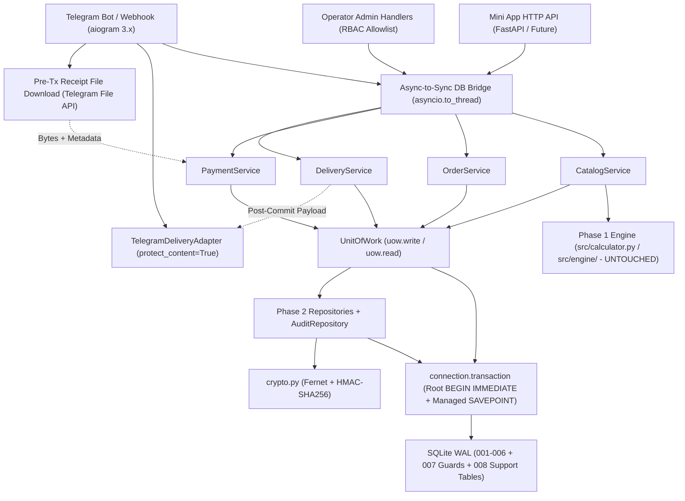
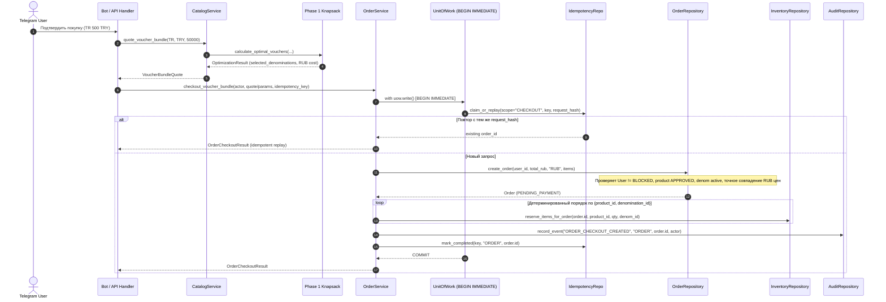
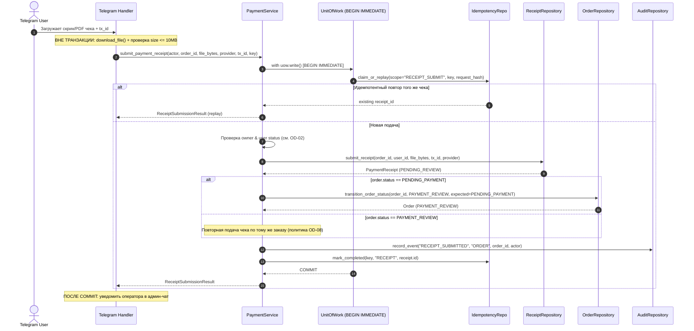
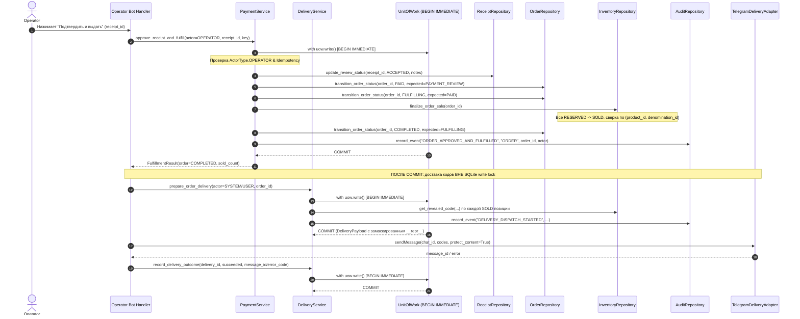

# Phase 3 Architecture & Implementation Design — «Сервис для PS» (`HipTwinse/ps-service`)

- **Repository:** `https://github.com/HipTwinse/ps-service`
- **Branch:** `main`
- **Verified HEAD SHA:** `a261edcd2154e524426d6a258da1862c92ce297d`
- **Статус документа:** `DESIGN ONLY — IMPLEMENTATION BLOCKED PENDING PRODUCT COMMANDER APPROVAL`
- **Статус Phase 1 (`src/engine/`, `src/calculator.py`):** не изменена (`0` diff относительно базового `main`)
- **Статус Phase 2 (`src/db/`, `src/migrations/001`–`006`):** закрыта Security Gate (`GO`), PR #1 влит в `main`, CI (`Python 3.11` / `3.12`) и локальный прогон (`147` тестов на `Python 3.14.7`) — зелёные.

---

## 1. Executive Summary

Настоящий документ фиксирует целевую архитектуру **Phase 3 (Service Layer, Transaction Coordination, DB Hardening & Security Policy)** перед переходом к написанию кода. Документ составлен строго на основе фактического кода на ветке `main` (`a261edcd`) и закрывает архитектурные и безопасностные риски, оставленные в статусе неблокирующих после Phase 2 (`SG-P2-004`–`SG-P2-016`), а также закладывает безопасный фундамент для будущих адаптеров Telegram-бота (`aiogram 3.x`) и Mini App API (`FastAPI`).

Ключевые архитектурные решения:

1. **Координация транзакций и `Unit of Work` (`SG-P2-004`):** вместо удаления `transaction()` из репозиториев (что сломало бы 147 существующих тестов и автономную защиту репозиторного слоя) и вместо внедрения тяжёлого ORM выбирается **управляемая вложенность `transaction()` через SQLite `SAVEPOINT` + явный облегчённый `UnitOfWork`** (`uow.write()` / `uow.read()`). Неуправляемые внешние транзакции (ручной `BEGIN` или неявный DML в `sqlite3`) по-прежнему отклоняются с `RuntimeError`, а эскалация режима блокировки (`DEFERRED -> IMMEDIATE`) внутри вложенного блока запрещается.
2. **Тонкий сервисный слой (`src/services/`) с жёстким разделением БД и сети:** вся бизнес-оркестрация выносится в сервисы (`CatalogService`, `OrderService`, `PaymentService`, `DeliveryService`) и аудит (`AuditRepository`), которые работают через короткие синхронные SQLite-транзакции (`BEGIN IMMEDIATE`, миллисекунды) в выделенном worker/thread executor. Любые сетевые операции (скачивание файла чека из Telegram, отправка сообщения с кодом пользователю, вызовы внешних API) выполняются **строго до открытия или после коммита** write-транзакции.
3. **Инварианты жизненного цикла заказа и SQLite (`SG-P2-004`, `SG-P2-006`):** запрещается переход `FULFILLING -> COMPLETED` при наличии `RESERVED` инвентаря или неполном `SOLD`-покрытии `order_items`; переход в `CANCELLED` разрешается только при отсутствии `RESERVED` инвентаря (сервис атомарно вызывает `release_order_reservations()` и `transition_order_status(CANCELLED)`). Эти правила дублируются триггерами SQLite в новой **миграции `007`** (вместе с запретом отката `SOLD` и запретом привязки `voucher_denominations` к `FIXED_PRODUCT`).
4. **Двухфазная идемпотентная доставка и политика безопасности:** фиксация факта оплаты и перевод инвентаря в `SOLD` происходят атомарно в БД, после чего `DeliveryService` готовит зашифрованный/расшифрованный payload с маскированием в `__repr__`, а Telegram-адаптер выполняет доставку с `protect_content=True` и фиксацией попытки в таблице `order_deliveries` (**миграция `008`**). Спорные политики доступа (`BLOCKED`-пользователи, ручная/автоматическая активация `FIXED_PRODUCT`, возвраты `SOLD`, просмотр кодов оператором) вынесены в **Раздел 13 (`OD-01`–`OD-09`)** на утверждение Product Commander.
5. **Нулевое вмешательство в Phase 1:** `src/engine/` и `src/calculator.py` остаются неизменными; связь между `Denomination`/`SelectedDenomination` и `voucher_denominations` реализуется на сервисном уровне через уникальный ключ `(region, currency, face_value_minor)`.

---

## 2. Current Architecture Assessment

### 2.1. Phase 1 (`src/calculator.py`, `src/engine/`)

Фактическая реализация на `HEAD` `a261edcd`:
- `src/calculator.py` (`L1–L28`) — чистый фасад реэкспорта `src/engine/__init__.py`.
- `src/engine/models.py`:
  - `Region` (`TR`, `US`), `Currency` (`TRY`, `USD`, алиас `US = "USD"` — валюты `RUB` в Phase 1 нет), `REGION_CURRENCY_MAP = {Region.TR: Currency.TRY, Region.US: Currency.USD}`.
  - `Denomination(face_value_minor: int, cost_rub_kopecks: int, stock_limit: int, enabled: bool = True)`.
  - `SelectedDenomination(face_value_minor: int, quantity: int, cost_rub_kopecks: int, total_cost_rub_kopecks: int)`.
  - `OptimizationResult(status, region, currency, target_amount_minor, selected_denominations, total_face_value_minor, wallet_change_minor, total_procurement_cost_rub_kopecks, voucher_count, reason)` со свойством `is_success`.
  - Контрактные лимиты: `DEFAULT_MAX_VOUCHERS_PER_ORDER = 6`, `MAX_PERMITTED_VOUCHERS_PER_ORDER = 20`, `MAX_TARGET_AMOUNT_MINOR = 5_000_000`, `MAX_FACE_VALUE_MINOR = 5_000_000`, `MAX_COST_RUB_KOPECKS = 50_000_000`, `MAX_STOCK_LIMIT = 1_000`, `MAX_DENOMINATIONS_COUNT = 20`.
- `src/engine/knapsack.py`: функция `calculate_optimal_vouchers(...)` (лексикографическая оптимизация: минимум `total_procurement_cost_rub_kopecks`, затем минимум `wallet_change_minor`, затем минимум `voucher_count`, затем предпочтение более крупных номиналов).

**Критическое наблюдение по интеграции Phase 1 <-> Phase 2:**
1. `Denomination` и `SelectedDenomination` не содержат `denomination_id` и `product_id`. Мост строится через ограничение `UNIQUE (region, currency, face_value_minor)` таблицы `voucher_denominations` (`001_initial_schema.sql:49`).
2. `CatalogRepository.get_active_denominations(region, currency)` (`src/db/repositories.py:236–259`) фильтрует только `voucher_denominations.is_active = 1` и **не проверяет `products.status = 'APPROVED'`**, тогда как `OrderRepository.create_order()` (`src/db/repositories.py:1050`) отклоняет заказы на `DRAFT`/`DISABLED`-продукты.
3. Контракт валюты расходится между слоями: Phase 1 оперирует номиналами в `TRY`/`USD` и ценами `cost_rub_kopecks`, а `OrderRepository.create_order()` (`src/db/repositories.py:1073–1114`) для `VOUCHER` и `FIXED_PRODUCT` жёстко требует `currency == "RUB"` и точного совпадения `unit_price_minor == voucher_denominations.cost_rub_kopecks`.

### 2.2. Phase 2 (`src/db/` и `src/migrations/001`–`006`)

Фактическая реализация на `HEAD` `a261edcd`:
- **`src/db/connection.py`:**
  - `get_connection()` / `create_connection()`: выставляет `row_factory = sqlite3.Row`, `PRAGMA foreign_keys = ON`, `PRAGMA busy_timeout = {timeout_seconds * 1000}`, для файловых БД `PRAGMA journal_mode = WAL` и `PRAGMA synchronous = NORMAL`; использует стандартный `isolation_level=""` модуля `sqlite3`.
  - `transaction(conn, mode="IMMEDIATE")`: немедленно падает с `RuntimeError`, если `conn.in_transaction` уже `True` (`L97–L100`); в `except BaseException:` откатывает транзакцию (`L106–L112`).
  - `backup_database()` (`L115–L138`): запрещает запуск при `source_conn.in_transaction`.
  - `restore_database()` (`L141–L330`): проверяет блокировку через `BEGIN EXCLUSIVE` + `PRAGMA wal_checkpoint(TRUNCATE)`, восстанавливает во временный файл, проверяет `PRAGMA integrity_check`, подменяет БД через `.orig_bak_*`, но в блоках `L232`, `L262`, `L295` ловит `except Exception:` вместо `BaseException` (`SG-P2-014`).
- **`src/db/crypto.py`:** Fernet-шифрование (`encrypt_payload` / `decrypt_payload`) + HMAC-SHA256 (`compute_fingerprint`) с политикой `ENV`/`APP_ENV`. Fallback-секреты разрешены только когда задан хотя бы один из `ENV`/`APP_ENV` и все заданные значения входят в `{"test", "testing", "dev", "development"}`. Наблюдаются мелкие огрехи `SG-P2-012`: `key or get_encryption_key()` (пустые `b""` подменяются), нет минимальной длины `FINGERPRINT_PEPPER`, пробельный `FINGERPRINT_PEPPER` затеняет `INVENTORY_FINGERPRINT_PEPPER`.
- **`src/db/migrations.py`:** `run_migrations()` сериализуется через `BEGIN IMMEDIATE`, проверяет SHA-256 `checksum` в `schema_migrations`, использует `_split_sql_statements()` на базе построчного `sqlite3.complete_statement(buffer)`. Остаточные краевые случаи парсера (`;` в одной строке или завершающий `/* ... */`) описаны в `SG-P2-005`.
- **`src/db/repositories.py`:** 5 классов (`CatalogRepository`, `UserRepository`, `InventoryRepository`, `OrderRepository`, `ReceiptRepository`). **`AuditRepository` отсутствует** — запись в `audit_events` выполняется только внутри `OrderRepository.transition_order_status()` (`L1185–L1193`).
- **`src/migrations/001`–`006`:** 11 таблиц, 13 индексов, 12 активных триггеров. Главные ограничения текущей реализации:
  1. Нельзя объединить несколько методов репозиториев в одну атомарную транзакцию (`SG-P2-004`).
  2. `OrderRepository.transition_order_status()` не проверяет инвентарь при переходе в `COMPLETED` или `CANCELLED`, а `finalize_order_sale()` проверяет все `order_items` без исключения для неинвентарных `FIXED_PRODUCT` (`MANUAL_REVIEW`).
  3. Прямые SQL-операции обходят часть бизнес-ограничений (`SOLD -> AVAILABLE`, `voucher_denominations -> FIXED_PRODUCT`, прыжки статусов `orders`, изменение `order_items` после оплаты) (`SG-P2-006`).
  4. `ReceiptRepository.submit_receipt()` не проверяет `users.status == 'BLOCKED'`, а `update_review_status()` допускает любой откат статуса проверки чека.
  5. Методы записи репозиториев читают возвращаемый DTO (`self.get_*()`) после выхода из `with transaction(...)` (`SG-P2-014`).
  6. `InventoryRepository.get_revealed_code()` не проверяет `users.status` и отдаёт разные сообщения `ValidationError` по статусу/владению (`SG-P2-013`).

**Влияние на существующие тесты Phase 2 (важно для планирования Stage 3.1):**
- `tests/test_orders.py:232–275` (`test_order_state_machine_transitions`) создаёт заказ типа `VOUCHER` без резервирования/финализации инвентаря и переводит его `FULFILLING -> COMPLETED`. После включения инварианта `SG-P2-004` этот тест потребует либо резервирования/финализации инвентаря перед `COMPLETED`, либо использования неинвентарного `FIXED_PRODUCT` с подтверждением ручного выполнения.
- `tests/test_phase2_security_gate_remediation.py:605–643` (`test_sg_p2_002_cancelled_order_release_lifecycle_and_safe_cleanup`) вызывает `transition_order_status(CANCELLED)` **до** `release_order_reservations(order.id)`. При принятии строгой предусловий-модели `CANCELLED` (Вариант A, Раздел 5) порядок шагов в этом тесте должен быть инвертирован (`release` до `CANCELLED` или через `OrderService.cancel_order()`) с добавлением негативного теста, подтверждающего блокировку `CANCELLED` при наличии `RESERVED`.

---

## 3. Proposed Service Layer Architecture

### 3.1. Архитектурная схема слоёв



### 3.2. Принципы разграничения слоёв

| Слой | Размещение | Ответственность | Жёсткие ограничения |
| :--- | :--- | :--- | :--- |
| **Transport / Adapters** | `src/bot/` (Stage 3.3, не в 3.1/3.2) | Парсинг Telegram updates/HTTP, скачивание файлов чеков, проверка allowlist операторов, отправка сообщений и обработка сетевых ретраев | Не импортирует `sqlite3` напрямую, не открывает транзакций, не формирует SQL |
| **Service Layer** | `src/services/` (Stage 3.2) | Сценарная оркестрация (UoW), проверка `ActorContext` и политик доступа, вызов Phase 1, идемпотентность, аудит, подготовка и фиксация статуса доставки | Не делает HTTP/Telegram API вызовов внутри `uow.write()`, не хранит глобального мутабельного состояния |
| **Domain Engine (Phase 1)** | `src/engine/`, `src/calculator.py` | Математический расчёт оптимального набора номиналов (`calculate_optimal_vouchers`) | **Неприкосновенно.** Чистые вычисления без БД и сети |
| **Repository & DB Layer** | `src/db/`, `src/migrations/` | CRUD, криптография, транзакционные примитивы (`BEGIN IMMEDIATE` / `SAVEPOINT`), DB-инварианты и триггеры | Не принимает решений об UX/Telegram, не содержит сетевого I/O |

### 3.3. Компоненты сервисного слоя и контракты методов

#### 1) `src/services/actor.py` — контекст субъекта
- `ActorType(str, Enum)`: `USER = "USER"`, `OPERATOR = "OPERATOR"`, `SYSTEM = "SYSTEM"`.
- `@dataclass(frozen=True) class ActorContext`:
  - `actor_type: ActorType`
  - `user_id: Optional[int]` (внутренний `users.id` для `USER`; `None` для `SYSTEM`)
  - `external_id: str` (Telegram `user.id` или `"SYSTEM_TTL_WORKER"`)
  - `correlation_id: Optional[str] = None` (для трассировки без секретов).

#### 2) `src/services/errors.py` — иерархия доменных исключений
Наследует базовые классы из `src/db/models.py` (`DatabaseError` и его подклассы), чтобы исключения не теряли семантику при пробросе:
- `ServiceError(DatabaseError)` — базовый класс сервисного слоя (или обёртка-миксин над `DatabaseError`).
- `PermissionDeniedError(DatabaseError)` — нарушение RBAC или чужой контекст (`actor` не владелец / не оператор).
- `UserBlockedError(PermissionDeniedError)` — операция отклонена из-за `UserStatus.BLOCKED`.
- `PriceChangedError(ConflictError)` — между квотированием Phase 1 и checkout изменился прайс или активность номинала в каталоге.
- `IdempotencyConflictError(ConflictError)` — повторное использование `idempotency_key` с другим payload (`request_hash` не совпадает).
- `DeliveryError(ServiceError)` — ошибка подготовки/фиксации доставки (без утечки plaintext-кода в тексте исключения).

#### 3) `src/services/catalog_service.py` — каталог и мост к Phase 1
- `list_approved_voucher_denominations(region: str, currency: str) -> list[VoucherQuoteCandidate]`:
  - Граница: `uow.read()`.
  - Запрос: `JOIN products` (`products.status = 'APPROVED' AND products.product_type = 'VOUCHER'`) + `voucher_denominations.is_active = 1` + агрегат доступного склада (`COUNT(*) FROM inventory_items WHERE status = 'AVAILABLE' GROUP BY denomination_id`).
- `quote_voucher_bundle(region: str, currency: str, target_amount_minor: int, max_vouchers_per_order: int = 6, max_allowed_overshoot_minor: Optional[int] = None) -> VoucherBundleQuote`:
  - Граница: `uow.read()` для загрузки кандидатов, затем вычисление Phase 1 **вне write-транзакции** (`calculate_optimal_vouchers(...)`).
  - Маппинг: ограничивает `stock_limit = min(available_count, MAX_STOCK_LIMIT)` (`1000`), отсекает список по `MAX_DENOMINATIONS_COUNT` (`20`) с детерминированным приоритетом или явной валидационной ошибкой, сопоставляет `SelectedDenomination.face_value_minor` обратно к `VoucherDenomination.id` и `product_id` через карту `{vd.face_value_minor: vd}`.
  - Возвращает `VoucherBundleQuote(region, currency, target_amount_minor, items: tuple[QuotedVoucherLine, ...], total_face_value_minor, wallet_change_minor, total_rub_kopecks, quote_fingerprint)`.
- `list_approved_fixed_products() -> list[FixedProductOffer]`: `uow.read()`, строго `products.status = 'APPROVED' AND fixed_product_details.approval_status = 'APPROVED'`.
- `create_voucher_product(...)`, `add_voucher_denomination(...)`, `create_fixed_product(...)`, `approve_fixed_product(...)`, `set_product_status(...)`, `import_inventory_codes(...)`:
  - Граница: `uow.write()`, требуют `ActorType.OPERATOR`, пишут структурированное событие в `AuditRepository` (без открытых кодов!).

#### 4) `src/services/order_service.py` — оформление, отмена и просмотр заказов
- `checkout_voucher_bundle(actor: ActorContext, region: str, currency: str, target_amount_minor: int, expected_total_rub_kopecks: Optional[int] = None, max_vouchers_per_order: int = 6, idempotency_key: Optional[str] = None) -> OrderCheckoutResult`:
  - Граница: короткий `uow.read()` + Phase 1 расчёт, затем одна атомарная `uow.write()` (`BEGIN IMMEDIATE`) с идемпотентностью, созданием заказа и резервированием всех позиций.
- `checkout_fixed_product(actor: ActorContext, product_id: int, quantity: int = 1, expected_unit_price_rub_kopecks: Optional[int] = None, idempotency_key: Optional[str] = None) -> OrderCheckoutResult`:
  - Граница: одна `uow.write()`. Проверяет `UserStatus`, `ProductStatus.APPROVED`, `ApprovalStatus.APPROVED`, цену. Для инвентарных типов (см. `OD-03`) резервирует `quantity` позиций в этой же транзакции.
- `cancel_order(actor: ActorContext, order_id: int, reason: Optional[str] = None, idempotency_key: Optional[str] = None) -> Order`:
  - Граница: одна `uow.write()`. Атомарно освобождает `RESERVED` инвентарь (`release_order_reservations`), при необходимости обновляет ожидающие чеки (см. `OD-05`), переводит статус в `CANCELLED` и пишет аудит.
- `expire_stale_orders(actor: ActorContext, ttl_seconds: int = 900, batch_limit: int = 50) -> list[int]`:
  - Граница: `ActorType.SYSTEM`; выборка кандидатов `PENDING_PAYMENT` старше `ttl_seconds` (при наличии столбца/политики TTL), затем **отдельная короткая `uow.write()` на каждый заказ** (чтобы не блокировать базу на батч).
- `get_order_details(actor: ActorContext, order_id: int) -> OrderDetailsDTO`:
  - Граница: `uow.read()`; для `USER` проверяет `order.user_id == actor.user_id` и политику `UserStatus` (`OD-01`); возвращает заказ, `order_items`, метаданные чеков и статус доставки (без расшифрованных кодов).

#### 5) `src/services/payment_service.py` — приём чеков и проверка оператором
- `submit_payment_receipt(actor: ActorContext, order_id: int, file_bytes: bytes, provider_name: str = "MANUAL", provider_tx_id: Optional[str] = None, idempotency_key: Optional[str] = None) -> ReceiptSubmissionResult`:
  - Важно: скачивание `file_bytes` из Telegram выполняется **до** вызова сервиса. Внутри `uow.write()` — проверка идемпотентности, `submit_receipt()`, переход `PENDING_PAYMENT -> PAYMENT_REVIEW` (если заказ ещё в `PENDING_PAYMENT`), запись в `audit_events`.
- `approve_receipt_and_fulfill(actor: ActorContext, receipt_id: int, reviewer_notes: Optional[str] = None, idempotency_key: Optional[str] = None) -> FulfillmentResult`:
  - Граница: `ActorType.OPERATOR`, одна `uow.write()`. Атомарно переводит чек в `ACCEPTED`, заказ `PAYMENT_REVIEW -> PAID -> FULFILLING`, вызывает `finalize_order_sale()` и переводит заказ `FULFILLING -> COMPLETED` (для предрезервированных инвентарных заказов).
- `approve_receipt_only(actor: ActorContext, receipt_id: int, reviewer_notes: Optional[str] = None, idempotency_key: Optional[str] = None) -> Order`:
  - Альтернативный путь для заказов с отложенной дозакупкой или ручным выполнением (`MANUAL_REVIEW`): переводит чек в `ACCEPTED` и заказ `PAYMENT_REVIEW -> PAID` (или `PAID -> FULFILLING` — единый переходный сценарий без преждевременного `COMPLETED`).
- `fulfill_paid_order(actor: ActorContext, order_id: int, notes: Optional[str] = None, idempotency_key: Optional[str] = None) -> FulfillmentResult`:
  - Для заказов в `PAID`/`FULFILLING`: переводит в `FULFILLING` (если `PAID`), финализирует резервы (`finalize_order_sale()`) и переводит в `COMPLETED`.
- `complete_manual_fulfillment(actor: ActorContext, order_id: int, fulfillment_notes: str, idempotency_key: Optional[str] = None) -> Order`:
  - Для неинвентарных `FIXED_PRODUCT` (`MANUAL_REVIEW` / `OD-03`): проверяет отсутствие `RESERVED`/`SOLD` инвентаря, требует непустого `fulfillment_notes` (подтверждение выдачи оператором) и переводит `FULFILLING -> COMPLETED`.
- `reject_receipt(actor: ActorContext, receipt_id: int, reviewer_notes: str, return_to_pending_payment: bool = True, idempotency_key: Optional[str] = None) -> ReceiptReviewResult`:
  - Граница: `ActorType.OPERATOR`, `uow.write()`. Переводит чек в `REJECTED` (или `DUPLICATE`), при `return_to_pending_payment=True` и отсутствии других `PENDING_REVIEW`/`ACCEPTED` чеков переводит `PAYMENT_REVIEW -> PENDING_PAYMENT` (либо оставляет решение на `OD-05`).
- `initiate_refund_review(actor: ActorContext, order_id: int, reason: str, idempotency_key: Optional[str] = None) -> Order`:
  - Граница: `ActorType.OPERATOR`, `uow.write()`. Переводит `PAID`/`FULFILLING`/`COMPLETED` в `REFUND_REVIEW` с обязательным аудитом причины.

#### 6) `src/services/delivery_service.py` — безопасная выдача и повторная доставка
Для исключения сетевых вызовов внутри `BEGIN IMMEDIATE` проектируется **двухфазный паттерн доставки**:
- `@dataclass(frozen=True) class DeliveryCodeItem`: `inventory_item_id: int`, `product_id: int`, `denomination_id: Optional[int]`, `code: str` — с переопределённым `__repr__` и `__str__`, возвращающими `"DeliveryCodeItem(id=..., code=***REDACTED***)"`, чтобы коды никогда не попадали в логи/traceback.
- `prepare_order_delivery(actor: ActorContext, order_id: int, allow_redelivery: bool = False) -> DeliveryPayload`:
  - Граница: `uow.write()` (или `uow.read()` + запись `DELIVERY_PENDING`/`ATTEMPT` в `order_deliveries`).
  - Проверяет права (`USER` владелец и политика `UserStatus` по `OD-01`, либо `OPERATOR` по `OD-07`), статус заказа (`COMPLETED` / `REVEALABLE_ORDER_STATUSES`), выбирает все `inventory_items` заказа в статусе `SOLD`, расшифровывает через `InventoryRepository.get_revealed_code(..., expected_order_id=order_id, expected_user_id=order.user_id)`.
  - Создаёт/обновляет запись попытки доставки в `order_deliveries` (`status='PENDING'`, `attempt_count + 1`) и пишет событие `DELIVERY_PREPARED` в `audit_events` (строго только ID позиций, без plaintext кодов).
  - **Выходит из транзакции и закрывает соединение.**
- **Вне БД (Transport Adapter):** `TelegramDeliveryAdapter` отправляет сообщение в Telegram с `protect_content=True` (и retry при временных 429/5xx).
- `record_delivery_outcome(actor: ActorContext, delivery_id: int, succeeded: bool, external_message_id: Optional[str] = None, error_code: Optional[str] = None) -> None`:
  - Граница: новая короткая `uow.write()`. Фиксирует `SENT` (с `delivered_at`, `external_message_id`) или `FAILED` (только код/класс ошибки, без секретов) в `order_deliveries` и `audit_events`.

#### 7) `AuditRepository` (добавляется в `src/db/repositories.py`)
- Метод `record_event(event_type: str, entity_type: str, entity_id: int, actor: Optional[ActorContext] = None, details: Optional[dict[str, Any]] = None) -> AuditEvent`.
- Обязательный нормализованный формат `details_json`:
  `{"actor_type": ..., "actor_id": ..., "actor_external_id": ..., "correlation_id": ..., "idempotency_key": ..., ...}`.
- **Правило безопасности аудита:** запрещено передавать в `details` `file_bytes`, `encrypted_payload`, `plaintext` кодов, ключи шифрования, `FINGERPRINT_PEPPER` или `provider_tx_id` целиком, если это чувствительный платёжный токен (допустим хэш/маскированный суффикс или метаданные перехода).

---

## 4. Transaction Coordination / Unit of Work Design (`SG-P2-004`)

### 4.1. Сравнение вариантов архитектуры

| Вариант | Суть | Плюсы | Минусы | Вердикт |
| :--- | :--- | :--- | :--- | :--- |
| **1. Только `SAVEPOINT` в `transaction()` без `UnitOfWork`** | Вызовы сервисов напрямую открывают `with transaction(conn):` и вызывают репозитории | Минимальный объём нового кода | Размытое владение соединением в сервисах, каждый сервис сам управляет factory/close и retry на `SQLITE_BUSY` | Отклонён как единственный механизм |
| **2. Внешний UoW с удалением `transaction()` из репозиториев** | Репозитории перестают вызывать `transaction()` и надеются на вызывающий UoW | Простое вложение | **Ломает обратную совместимость** со всеми 147 тестами Phase 2 и делает прямые вызовы репозиториев небезопасными | **Отклонён** |
| **3. Управляемый `SAVEPOINT` в `transaction()` + Явный облегчённый `UnitOfWork`** | `transaction()` поддерживает контролируемую вложенность через `SAVEPOINT`, продолжая отвергать чужие транзакции; `UnitOfWork` инкапсулирует соединение и репозитории | 100% обратная совместимость с Phase 2; полная атомарность любых композиций; явная граница блокировок в сервисах; без ORM-оверхеда | Требует аккуратного трекинга глубины/режима транзакций на уровне соединения | **ВЫБРАН** |

### 4.2. Механика управляемого `transaction()` (`src/db/connection.py`)

Для сохранения гарантии из Phase 2 (*«запрет случайного присоединения к чужой незакоммиченной транзакции»*) в `src/db/connection.py` вводится реестр управляемого состояния на соединение на базе `weakref.WeakKeyDictionary[sqlite3.Connection, _ManagedTxState]`, защищённый `threading.Lock()`:

```python
@dataclass
class _ManagedTxState:
    depth: int = 0
    root_mode: str = "IMMEDIATE"
    next_savepoint_id: int = 1
    owner_thread_id: int = 0
```

**Точные правила поведения `transaction(conn, mode="IMMEDIATE")`:**

1. **Защита от неуправляемой внешней транзакции (инвариант Phase 2 сохранён на 100%):**
   - Если `conn.in_transaction` истинно, **а в реестре `state.depth == 0`**, это означает, что транзакцию открыл внешний код (`conn.execute("BEGIN ...")` или неявный DML при `isolation_level=""`).
   - Действие: **немедленно выбросить `RuntimeError`** (сохранив существующее сообщение и защиту).
2. **Обнаружение рассинхронизации:**
   - Если `not conn.in_transaction`, но `state.depth > 0` (например, внешний код принудительно сделал `ROLLBACK` или `COMMIT` в обход менеджера): очистить `_ManagedTxState` и немедленно выбросить `RuntimeError("Managed transaction state desynchronized")`.
3. **Запуск корневой транзакции (`depth == 0` и `not conn.in_transaction`):**
   - Выполнить `conn.execute(f"BEGIN {norm_mode};")`.
   - Зафиксировать `state = _ManagedTxState(depth=1, root_mode=norm_mode, next_savepoint_id=1, owner_thread_id=threading.get_ident())`.
   - Внутри `try`: `yield conn`, затем `conn.commit()`.
   - В `except BaseException:` (включая `KeyboardInterrupt`, `SystemExit`, `asyncio.CancelledError`): если `conn.in_transaction`, выполнить `conn.rollback()` (с подавлением `sqlite3.Error` только при сбое отката) и пробросить исключение.
   - В `finally:` удалить `conn` из реестра `_MANAGED_TX_REGISTRY`.
4. **Вложенная управляемая транзакция (`depth >= 1` и `conn.in_transaction`):**
   - **Проверка потока:** если `state.owner_thread_id != threading.get_ident()`, выбросить `RuntimeError` (одно `sqlite3.Connection` не должно делить одну активную транзакцию между потоками).
   - **Запрет эскалации блокировки (критично для SQLite):**
     - Определяется иерархия строгости: `DEFERRED (1) < IMMEDIATE (2) < EXCLUSIVE (3)`.
     - Если вложенный вызов требует `mode` строже, чем `state.root_mode` (например, внешний `DEFERRED`, а репозиторий просит `IMMEDIATE`), выбрасывается `RuntimeError("Cannot escalate SQLite lock mode inside nested transaction")`!
     - Причина: в SQLite `SAVEPOINT` внутри уже начатой `DEFERRED`-транзакции **не** приобретает upfront write lock в момент входа и подвержен немедленному `SQLITE_BUSY` deadlock при обновлении снимка до записи. Поэтому любая пишущая композиция обязана начинаться с корневого `BEGIN IMMEDIATE` (или `EXCLUSIVE`).
     - Напротив, вложенный `DEFERRED` внутри корневого `IMMEDIATE` допустим (корневая блокировка уже максимальна для записи).
   - **Механика `SAVEPOINT`:**
     - Присвоить уникальное имя `sp_name = f"sp_mgr_{state.next_savepoint_id}"`, увеличить `next_savepoint_id += 1` и `depth += 1`.
     - Выполнить `conn.execute(f"SAVEPOINT {sp_name};")`.
     - При нормальном выходе: `conn.execute(f"RELEASE SAVEPOINT {sp_name};")`.
     - При `except BaseException:`: если `conn.in_transaction`, выполнить **оба** оператора:
       1. `conn.execute(f"ROLLBACK TO SAVEPOINT {sp_name};")` — откатывает изменения внутри блока, но **не удаляет** сам savepoint в SQLite!
       2. `conn.execute(f"RELEASE SAVEPOINT {sp_name};")` — обязательно снимает savepoint со стека, чтобы при перехвате исключения вызывающей стороной (если сервис решает обработать частичный отказ и продолжить транзакцию) не копились висячие точки сохранения.
     - В `finally:`: `state.depth -= 1`.
5. **Совместимость с `backup_database()` и `run_migrations()`:**
   - И `backup_database()`, и `run_migrations()` продолжают проверять `if conn.in_transaction: raise RuntimeError(...)`. Их нельзя вызывать внутри ни внешней, ни управляемой транзакции — только на спокойном соединении.
6. **Консистентность чтения DTO (`SG-P2-014`):**
   - После перевода `self.get_*()` в репозиториях **внутрь** `with transaction(self.conn, mode="IMMEDIATE"):` (до `commit`/`RELEASE`) возвращаемый объект `Order` / `PaymentReceipt` / `Product` всегда читается в той же изолированной write-транзакции (и на корневом уровне, и при вызове из вложенного `UnitOfWork`).
7. **Взаимодействие с `isolation_level=""` (стандартный режим `sqlite3` в Phase 2):**
   - Поскольку внешняя корневая `transaction()` явно вызывает `BEGIN IMMEDIATE;` до первого `yield` и явно вызывает `conn.commit()`/`conn.rollback()` по выходу, Python `sqlite3` (включая версии `3.11`, `3.12`, `3.14`) корректно поддерживает `conn.in_transaction == True` на протяжении всего цикла `SAVEPOINT` и не вставляет скрытых автокоммитов.

### 4.3. Контракт `UnitOfWork` (`src/services/uow.py`)

```python
class UnitOfWork:
    # Фабрика подключений (production) ИЛИ заимствованное соединение (tests)
    @classmethod
    def from_connection(cls, conn: sqlite3.Connection) -> "UnitOfWork": ...

    @contextmanager
    def write(self, mode: str = "IMMEDIATE") -> Iterator["DbSession"]: ...

    @contextmanager
    def read(self) -> Iterator["DbSession"]: ...
```

- **`DbSession`** предоставляет свойства с ленивой инициализацией на одном и том же `conn`: `.catalog` (`CatalogRepository`), `.users` (`UserRepository`), `.inventory` (`InventoryRepository`), `.orders` (`OrderRepository`), `.receipts` (`ReceiptRepository`), `.audit` (`AuditRepository`), `.idempotency` / `.deliveries` (Stage 3.2).
- **Владение соединением:**
  - Если `UnitOfWork` создан с `db_path` / `connection_factory`: каждый вход в `uow.write()` или `uow.read()` открывает короткоживущее соединение через `get_connection_context()`, выполняет работу и **всегда закрывает** соединение в `finally`. `uow.write()` дополнительно оборачивает тело в `with transaction(conn, mode=mode):`.
  - В `uow.read()` транзакция для записи не открывается; используется один `SELECT`-снимок (при необходимости серия согласованных чтений оборачивается в `with transaction(conn, mode="DEFERRED"):` с автоматическим `commit`/закрытием). Попытка вызвать методы записи репозиториев внутри `uow.read()` на корневом `DEFERRED`-снимке немедленно пресечётся либо интерфейсом `ReadSession` (который экспонирует только read-методы и сервисные query-методы), либо запретом эскалации `DEFERRED -> IMMEDIATE`!
  - Если `UnitOfWork.from_connection(conn)` используется в юнит-тестах: `uow` **не закрывает** `conn` при выходе из контекста, но полноценно управляет `transaction(conn, mode="IMMEDIATE")`.
- **Повторные попытки при `SQLITE_BUSY`:** допускаются **только** на самой внешней границе `uow.write()` (до первого успешного входа в `BEGIN IMMEDIATE`, когда никаких изменений ещё не сделано) с ограниченным числом попыток и малым backoff. Внутри уже открытой транзакции retry категорически запрещён.

---

## 5. Order Lifecycle State Machine

### 5.1. Диаграмма состояний заказа (`orders.status`)

```mermaid
stateDiagram-v2
    [*] --> PENDING_PAYMENT : create_order (RUB snapshot + reserve if inventory-backed)

    PENDING_PAYMENT --> PAYMENT_REVIEW : submit_receipt (PENDING_REVIEW)
    PENDING_PAYMENT --> CANCELLED : cancel_order / TTL expire [RESERVED == 0]

    PAYMENT_REVIEW --> PAID : approve_receipt [receipt ACCEPTED]
    PAYMENT_REVIEW --> PENDING_PAYMENT : reject_receipt [no other active receipts]
    PAYMENT_REVIEW --> CANCELLED : cancel_order [RESERVED == 0]

    PAID --> FULFILLING : start_fulfillment
    PAID --> REFUND_REVIEW : initiate_refund_review

    FULFILLING --> COMPLETED : complete_inventory [RESERVED == 0 and SOLD == ordered_qty]
    FULFILLING --> COMPLETED : complete_manual [non-inventory and RESERVED/SOLD == 0 and operator notes]
    FULFILLING --> REFUND_REVIEW : initiate_refund_review

    COMPLETED --> REFUND_REVIEW : initiate_refund_review

    REFUND_REVIEW --> CANCELLED : finalize_refund_cancel [RESERVED == 0; SOLD remains immutable]

    CANCELLED --> [*]
```



### 5.2. Матрица строгих предусловий переходов

В дополнение к `ALLOWED_ORDER_TRANSITIONS` (`src/db/models.py:69–77`) вводятся жёсткие предусловия:

| Переход | Предусловие в Python (`OrderRepository` / Service) | Предусловие в SQLite (Миграция `007`) | Политика по инвентарю и чекам |
| :--- | :--- | :--- | :--- |
| `* -> PAYMENT_REVIEW` | Существует хотя бы 1 чек `payment_receipts` в статусе `PENDING_REVIEW` (при вызове через `PaymentService`) | Разрешён из `PENDING_PAYMENT` | Резервы остаются `RESERVED` за заказом |
| `PAYMENT_REVIEW -> PAID` | Фиксируется `paid_at = CURRENT_TIMESTAMP`; при вызове через `PaymentService` обязан существовать чек `ACCEPTED` | Разрешён только из `PAYMENT_REVIEW`; `paid_at` заполняется | Резервы (если были) остаются `RESERVED` |
| `PAYMENT_REVIEW -> PENDING_PAYMENT` | Нет чеков в статусе `ACCEPTED` или `PENDING_REVIEW` | Разрешён из `PAYMENT_REVIEW` | Резервы сохраняются до отмены или TTL |
| `PAID -> FULFILLING` | Заказ имеет >= 1 `order_items` | Разрешён только из `PAID` | Подготовка к выдаче / дозакупке |
| **`FULFILLING -> COMPLETED` (инвентарные позиции)** | 1) `COUNT(RESERVED для order_id) == 0`; 2) Для каждого инвентарного `(product_id, denomination_id)` `COUNT(SOLD) == SUM(order_items.quantity)` | **Триггер блокирует переход**, если есть хотя бы 1 `RESERVED` по заказу ИЛИ для любого `VOUCHER` / `FIXED_PRODUCT (CODE)` несоответствие `SOLD != ordered_qty` | Гарантирует 100% полноту выдачи; частичная выдача невозможна |
| **`FULFILLING -> COMPLETED` (неинвентарные `FIXED_PRODUCT`)** | 1) `COUNT(RESERVED для order_id) == 0`; 2) `COUNT(SOLD)` по неинвентарной позиции `== 0`; 3) Вызов выполнен с `ActorType.OPERATOR` и непустым `notes` (передано в `audit_events`) | Триггер проверяет `RESERVED == 0` и отсутствие привязки `VOUCHER`/`CODE` без `SOLD` | Чётко разделяет ручную выдачу и складские коды |
| **`* -> CANCELLED`** (`PENDING_PAYMENT`, `PAYMENT_REVIEW`, `REFUND_REVIEW`) | **`COUNT(RESERVED для order_id) == 0`** (инвентарь должен быть освобождён **до** перехода в `CANCELLED` внутри той же UoW-транзакции) | **Триггер блокирует `NEW.status = 'CANCELLED'`**, если `EXISTS (SELECT 1 FROM inventory_items WHERE reserved_order_id = NEW.id AND status = 'RESERVED')` | Если отмена из `REFUND_REVIEW` после выдачи кода, уже `SOLD`-позиции **не откатываются** в `AVAILABLE` |
| `* -> REFUND_REVIEW` | Допустим из `PAID`, `FULFILLING`, `COMPLETED`; рекомендуется обязательный `notes` с причиной | Разрешён из `PAID`, `FULFILLING`, `COMPLETED` | Останавливает дальнейшую выдачу (`REVEALABLE_ORDER_STATUSES` исключает `REFUND_REVIEW`) |

### 5.3. Политика для `FIXED_PRODUCT`, не использующих `inventory_items`

По текущей схеме `001_initial_schema.sql:56` у `fixed_product_details` есть `delivery_method` со значениями:
1. `'CODE'` — **всегда инвентарный**: код хранится в `inventory_items` (`InventoryType.FIXED_CODE`), резервируется на checkout, переводится в `SOLD` в `finalize_order_sale()`, раскрывается через `get_revealed_code()`.
2. `'MANUAL_REVIEW'` — **всегда неинвентарный**: в `inventory_items` не хранится; финализируется оператором вручную через `complete_manual_fulfillment(actor=OPERATOR, order_id, fulfillment_notes)`.
3. `'OFFICIAL_ACTIVATION'` — **спорная серая зона** (может идти через зашифрованные `ACTIVATION_DATA` в `inventory_items` либо как ручная услуга оператора без `inventory_items`). Вынесено в **Open Decision `OD-03`**.

**Важное исправление в `InventoryRepository.finalize_order_sale()` (`src/db/repositories.py:833–869`):**
Сейчас `finalize_order_sale()` собирает **все** `order_items` заказа (включая `FIXED_PRODUCT`) и требует для каждого `RESERVED`-позиции. Если в заказе есть неинвентарный `MANUAL_REVIEW`, текущий код отвергнет финализацию с `ValidationError`.
- В Phase 3 `finalize_order_sale()` должен определять множество **инвентарно-обеспечиваемых** строк заказа (через JOIN с `products` и `fixed_product_details`: `product_type = 'VOUCHER'` или `delivery_method = 'CODE'`, а для `OFFICIAL_ACTIVATION` — по итогу `OD-03`).
- На время Phase 3 MVP **рекомендуется запретить смешанные заказы** (в одном заказе одновременно инвентарные и ручные позиции — вынесено в `OD-04`), чтобы состояние заказа `FULFILLING -> COMPLETED` имело однозначную семантику.

### 5.4. Выбор модели освобождения резервов при `CANCELLED`

- **Вариант A (Рекомендуемый): Явное предусловие в `OrderRepository` + атомарная оркестрация в `OrderService` + SQLite-триггер.**
  - `OrderRepository.transition_order_status(CANCELLED)` проверяет `RESERVED == 0` и кидает `InvalidStateTransitionError` при наличии неснятых резервов.
  - `OrderService.cancel_order()` внутри одной `uow.write()` вызывает сначала `InventoryRepository.release_order_reservations(order_id)`, затем `OrderRepository.transition_order_status(order_id, CANCELLED)`.
  - Триггер БД гарантирует запрет `CANCELLED` при живом `RESERVED` даже при прямом SQL.
  - *Почему выбран Вариант A:* сохраняет Single Responsibility Principle (репозиторий заказов не мутирует таблицу инвентаря скрытым побочным эффектом), исключает молчаливый сброс резервов при ошибочном ручном вызове и делает нарушение заметным и в Python, и в SQLite.
- *Альтернатива (Вариант B — авто-освобождение внутри `OrderRepository.transition_order_status`):* создаёт скрытую связность между репозиториями и затрудняет миграцию/аудит изменений по инвентарю без вызова `InventoryRepository`.

### 5.5. Жизненный цикл проверки чека (`payment_receipts.review_status`)

- `PENDING_REVIEW -> {ACCEPTED, REJECTED, DUPLICATE}`.
- `ACCEPTED`, `REJECTED`, `DUPLICATE` — **терминальные состояния** для конкретной строки чека (в Phase 2 `ReceiptRepository.update_review_status()` не ограничивал обратные переходы, например `ACCEPTED -> REJECTED`).
- Для одного `order_id` допускается **не более одного** чека в статусе `ACCEPTED` (проверяется в сервисе и триггером/индексом в миграции `007`).

---

## 6. Atomic Business Workflows

### 6.1. Workflow 1: Checkout (`create_order` + `reserve_items_for_order`)



- **Граница транзакции:**
  - *До транзакции:* (опционально) пре-квотирование `CatalogService.quote_voucher_bundle()`.
  - *Внутри `uow.write()` (`BEGIN IMMEDIATE`):* повторное чтение актуального каталога/склада, сверка цены (`expected_total_rub_kopecks`), проверка лимита открытых неоплаченных заказов (`OD-08`), `IdempotencyRepo`, `OrderRepository.create_order()`, цикл `InventoryRepository.reserve_items_for_order()`, `AuditRepository.record_event()`.
  - *После коммита:* показ реквизитов оплаты пользователю в Telegram.
- **Последовательность операций:** расчёт корзины -> `BEGIN IMMEDIATE` -> idempotency check -> проверка лимитов и актуальной цены каталога -> `create_order()` -> последовательное резервирование по отсортированному списку `(product_id, denomination_id)` (для детерминизма блокировок) -> `audit_events` -> `idempotency_keys` -> `COMMIT`.
- **Предусловия:** `actor.actor_type == USER`, пользователь существует и `status == 'ACTIVE'`, продукт `APPROVED`, номинал `is_active == 1` (для `FIXED_PRODUCT`: `approval_status == 'APPROVED'`), достаточный остаток `AVAILABLE` в `inventory_items`.
- **Возможные ошибки:** `UserBlockedError`, `PriceChangedError` (если каталог/склад изменились с момента пре-квоты), `InsufficientInventoryError`, `IdempotencyConflictError`, `ValidationError` (включая отказ Phase 1 `no_solution`).
- **Поведение при rollback:** при отказе резервирования на *любом* из номиналов (например, на 2-м номинале в корзине из 2 номиналов) `transaction()` откатывает **всю** `BEGIN IMMEDIATE` транзакцию (и заказ `orders`, и строки `order_items`, и уже зарезервированный 1-й номинал возвращаются в исходное состояние). Сироты-заказы без резервов не возникают.
- **Защита от повторного выполнения:** обязательный `idempotency_key` (на базе Telegram `callback_query.id` / сгенерированного checkout nonce); повтор при сбое сети возвращает созданный заказ без повторного списания со склада.
- **Необходимые тесты:**
  - Успешный checkout `VOUCHER` (1 и 2+ номинала в одном заказе) и `FIXED_PRODUCT`.
  - Rollback-тест: в корзине из 2 номиналов для 1-го есть 1 код, для 2-го — 0 кодов -> заказ не создан, 1-й код остался `AVAILABLE`.
  - `PriceChangedError` при изменении `cost_rub_kopecks` между quote и checkout.
  - Конкурентный тест (`Barrier(2)`): 2 пользователя одновременно оформляют последний код -> ровно 1 успех, 1 `InsufficientInventoryError`, `RESERVED` ровно 1 раз.
  - Идемпотентный replay с тем же ключом и `IdempotencyConflictError` при подмене суммы/региона под тем же ключом.

### 6.2. Workflow 2: Submit Receipt (`submit_receipt` + `transition_order_status(PAYMENT_REVIEW)`)



- **Граница транзакции:**
  - *До транзакции:* загрузка файла из Telegram API (сетевой I/O), проверка `0 < len(file_bytes) <= 10 * 1024 * 1024`.
  - *Внутри `uow.write()` (`BEGIN IMMEDIATE`):* проверка идемпотентности, политика `UserStatus` (`OD-02`), `ReceiptRepository.submit_receipt()`, переход `PENDING_PAYMENT -> PAYMENT_REVIEW` (при текущем статусе `PENDING_PAYMENT`), запись `audit_events`.
  - *После коммита:* отправка уведомления оператору в Telegram.
- **Последовательность операций:** скачивание файла (pre-tx) -> `BEGIN IMMEDIATE` -> проверка владельца/статуса пользователя/заказа -> вычисление SHA-256 и запись чека -> условный перевод статуса заказа в `PAYMENT_REVIEW` -> аудит -> `COMMIT` -> уведомление оператора.
- **Предусловия:** `order.user_id == actor.user_id`, заказ в статусе `PENDING_PAYMENT` (или `PAYMENT_REVIEW` согласно `OD-08`), файл не пуст и `<= 10 MiB`, `file_sha256` и `(provider_name, provider_tx_id)` ранее не использовались.
- **Возможные ошибки:** `ValidationError` (не владелец, пустой/слишком большой файл, невалидный `provider_name`), `UserBlockedError` (`OD-02`), `DuplicateReceiptError` (повторный хэш файла или `provider_tx_id`), `InvalidStateTransitionError` (заказ уже `CANCELLED`/`PAID`/`COMPLETED`), `IdempotencyConflictError`.
- **Поведение при rollback:** если `transition_order_status(PAYMENT_REVIEW)` падает (например, заказ параллельно отменён), `submit_receipt()` откатывается целиком — в БД не остаётся «осиротевшего» чека для отменённого заказа; при успехе `submit_receipt()` без падения, но падении аудита откатываются и чек, и смена статуса.
- **Защита от повторного выполнения:**
  - При обрыве сети между клиентом и сервером повторный запрос с тем же `idempotency_key` и тем же `file_sha256` вернёт существующий `PaymentReceipt` без `DuplicateReceiptError`.
  - Попытка загрузить тот же чек (`file_sha256` или `provider_tx_id`) для **другого** заказа или с другим `idempotency_key` жёстко блокируется с `DuplicateReceiptError` (антифрод).
- **Необходимые тесты:**
  - Успешная подача переводит `PENDING_PAYMENT -> PAYMENT_REVIEW` атомарно.
  - Rollback-тест: сбой после `submit_receipt()` (инъекция ошибки в `transition_order_status`) не оставляет строки в `payment_receipts`.
  - Конкурентный тест (`Barrier(2)`): `submit_receipt` против `cancel_order` (или TTL worker) на одном заказе — ровно один побеждает, инвариант `CANCELLED` + отсутствие чеков vs `PAYMENT_REVIEW` + чек соблюдён.
  - Replay с тем же `idempotency_key` возвращает результат; чужой чек с тем же `file_sha256` отклонён с `DuplicateReceiptError`.

### 6.3. Workflow 3: Approve Receipt and Fulfill (`ACCEPTED` + `PAID` + `FULFILLING` + `finalize_order_sale` + `COMPLETED`)



- **Разделение вариантов исполнения (критично для бизнес-модели с нулевым складом / дропшиппингом):**
  1. **Путь 3A — Складской буфер (1-клик `approve_receipt_and_fulfill`):** вся цепочка (`ACCEPTED` -> `PAID` -> `FULFILLING` -> `finalize_order_sale()` -> `COMPLETED`) проходит в **одной** `uow.write()`. Подходит, когда позиции уже были `RESERVED` на checkout.
  2. **Путь 3B — Дропшиппинг / ручная дозакупка кода (`approve_receipt_only` -> закупка оператором -> `fulfill_paid_order`):** если заказ оформлен без предрезерва или требует внешней закупки (вне БД), оператор в 1-й транзакции подтверждает оплату (`ACCEPTED` -> `PAID`), затем **вне БД** закупает и импортирует код (`import_items`), затем во 2-й транзакции (`fulfill_paid_order`) резервирует (при необходимости), финализирует (`SOLD`) и завершает (`COMPLETED`).
  3. **Путь 3C — Неинвентарная ручная услуга (`MANUAL_REVIEW`):** `approve_receipt_only` (`ACCEPTED` -> `PAID` -> `FULFILLING`), выполнение услуги оператором **вне БД**, затем `complete_manual_fulfillment(order_id, fulfillment_notes)` (`FULFILLING -> COMPLETED`).
- **Граница транзакции для Пути 3A:**
  - *Внутри 1-й `uow.write()`:* проверка роли `OPERATOR`, идемпотентность, обновление чека (`PENDING_REVIEW -> ACCEPTED`), отсутствие других `ACCEPTED` чеков на заказ, переходы заказа (`PAYMENT_REVIEW -> PAID -> FULFILLING`), `finalize_order_sale()`, переход (`FULFILLING -> COMPLETED`), аудит.
  - *После коммита:* выдача кодов пользователю через `DeliveryService` (отдельная короткая `uow.write()` на подготовку/учёт попытки, отправка в Telegram вне БД, короткая `uow.write()` на фиксацию `SENT`/`FAILED`).
- **Предусловия:** `actor.actor_type == OPERATOR`, чек в `PENDING_REVIEW`, заказ в `PAYMENT_REVIEW`, нет другого `ACCEPTED` чека по заказу, все инвентарные позиции заказа находятся в `RESERVED` в точном количестве и с точным `(product_id, denomination_id)`.
- **Возможные ошибки:** `PermissionDeniedError`, `NotFoundError`, `InvalidStateTransitionError` (чек уже обработан или заказ не в `PAYMENT_REVIEW`), `ValidationError` (несоответствие `RESERVED` позиций), `ConflictError` (уже `SOLD` / конкурентное изменение статуса), `IdempotencyConflictError`.
- **Поведение при rollback:**
  - Если `finalize_order_sale()` падает на проверке неполного резерва, откатываются **и `COMPLETED`, и `FULFILLING`, и `PAID`, и `review_status = ACCEPTED`** — чек остаётся `PENDING_REVIEW`, заказ остаётся `PAYMENT_REVIEW`, инвентарь остаётся `RESERVED`. Никаких «зависших `PAID`/`FULFILLING` без товара» не возникает.
  - Если же БД успешно закоммитила `COMPLETED` + `SOLD`, а на следующем шаге упал Telegram API (`sendMessage`), заказ **не откатывается** (деньги приняты, товар списан), но в `order_deliveries` фиксируется `FAILED`, и клиент/оператор может безопасно повторить доставку уже проданных `SOLD`-кодов (повторного списания со склада не происходит).
- **Защита от повторного выполнения:**
  - Двойной клик двух операторов (или повторный webhook/callback): 1-й вызов переводит чек в `ACCEPTED` и заказ в `COMPLETED`; 2-й вызов с тем же `idempotency_key` получает кэшированный результат, а 2-й вызов с *другим* ключом от другого оператора получает `InvalidStateTransitionError` / `ConflictError` на уровне `BEGIN IMMEDIATE` без повторной финализации.
- **Необходимые тесты:**
  - Атомарный `approve_receipt_and_fulfill` (1 и несколько позиций).
  - Fault-injection rollback: сбой в `finalize_order_sale()` откатывает статус чека обратно в `PENDING_REVIEW` и заказа в `PAYMENT_REVIEW`.
  - Конкурентный тест (`Barrier(2)`): 2 оператора одновременно жмут `Approve` на одном чеке — 1 успех, 1 ошибка состояния (`ConflictError`/`InvalidStateTransitionError`), ровно 1 `ACCEPTED` чек, ровно 1 набор `SOLD`.
  - Повторная доставка после симуляции падения Telegram API (после коммита `COMPLETED`): заказ остаётся `COMPLETED`, повторная выдача отдаёт те же `SOLD` коды без ошибки `InsufficientInventoryError`.

### 6.4. Workflow 4: Cancel Order (`release_order_reservations` + `CANCELLED`)

```mermaid
sequenceDiagram
    autonumber
    actor Caller as User / Operator / TTL Worker
    participant OrdSvc as OrderService
    participant UoW as UnitOfWork (BEGIN IMMEDIATE)
    participant InvRepo as InventoryRepository
    participant RcptRepo as ReceiptRepository
    participant OrdRepo as OrderRepository
    participant Audit as AuditRepository

    Caller->>OrdSvc: cancel_order(actor, order_id, reason, idempotency_key)
    OrdSvc->>UoW: with uow.write() [BEGIN IMMEDIATE]
    Note over OrdSvc: Проверка прав (owner/OPERATOR/SYSTEM) и допустимого статуса заказа
    alt Статус в {PENDING_PAYMENT, PAYMENT_REVIEW, REFUND_REVIEW}
        OrdSvc->>InvRepo: release_order_reservations(order_id)
        InvRepo-->>OrdSvc: released_count (RESERVED -> AVAILABLE, reserved_order_id = NULL)
        opt Есть чеки PENDING_REVIEW (см. OD-05)
            OrdSvc->>RcptRepo: Отклонить висящие PENDING_REVIEW чеки (REJECTED)
        end
        OrdSvc->>OrdRepo: transition_order_status(order_id, CANCELLED, notes=reason)
        Note over OrdRepo: Проверяет COUNT(RESERVED) == 0; SOLD позиции не трогаются
        OrdSvc->>Audit: record_event("ORDER_CANCELLED", "ORDER", order_id, actor, {released_count})
        UoW-->>OrdSvc: COMMIT
        OrdSvc-->>Caller: Order (CANCELLED)
    else Статус уже CANCELLED (при том же idempotency_key)
        OrdSvc-->>Caller: Idempotent replay Order (CANCELLED)
    else Статус PAID / FULFILLING / COMPLETED
        OrdSvc-->>Caller: InvalidStateTransitionError (требуется initiate_refund_review)
    end
```

- **Граница транзакции:** одна короткая `uow.write()` (`BEGIN IMMEDIATE`) без сетевого I/O; уведомление пользователя/оператора — строго после коммита.
- **Последовательность операций:** проверка субъекта и принадлежности (`USER` только свой заказ, см. также `OD-05` про отмену из `PAYMENT_REVIEW`; `OPERATOR`/`SYSTEM` по своим правилам) -> идемпотентность -> `release_order_reservations(order_id)` -> обработка ожидающих чеков (`OD-05`) -> `transition_order_status(order_id, CANCELLED)` -> `audit_events` -> `COMMIT`.
- **Предусловия:** заказ в статусе `PENDING_PAYMENT`, `PAYMENT_REVIEW` или `REFUND_REVIEW` (отмена из `PAID`/`FULFILLING`/`COMPLETED` напрямую запрещена — только через `REFUND_REVIEW`).
- **Возможные ошибки:** `PermissionDeniedError`, `NotFoundError`, `InvalidStateTransitionError` (включая попытку отменить уже `PAID`/`COMPLETED` заказ или `CANCELLED` без идемпотентного ключа), `ConflictError`.
- **Поведение при rollback:** если `transition_order_status(CANCELLED)` завершается ошибкой (например, невалидный исходный статус), освобождение резервов `release_order_reservations()` **откатывается** — товар остаётся зарезервированным за заказом, исключая «живой заказ без резервов». При отмене из `REFUND_REVIEW` уже проданные (`SOLD`) коды никогда не возвращаются в `AVAILABLE`.
- **Защита от повторного выполнения:** повтор с тем же `idempotency_key` возвращает уже отменённый заказ; конкурентная отмена и `approve_receipt_and_fulfill` / `submit_receipt` сериализуются через `BEGIN IMMEDIATE`.
- **Необходимые тесты:**
  - Атомарная отмена из `PENDING_PAYMENT`, `PAYMENT_REVIEW`, `REFUND_REVIEW` (проверка: `RESERVED -> AVAILABLE`, `SOLD` остаётся `SOLD`).
  - Негативный тест: попытка прямого `OrderRepository.transition_order_status(order.id, CANCELLED)` при наличии `RESERVED` -> `InvalidStateTransitionError`.
  - Rollback-тест: сбой на шаге `transition_order_status(CANCELLED)` откатывает `release_order_reservations()` (инвентарь остаётся `RESERVED`).
  - Конкурентные тесты (`Barrier(2)`): `cancel_order` vs `approve_receipt_and_fulfill`; `cancel_order` (TTL worker) vs `submit_payment_receipt`.

---

## 7. Database Invariants and Migration 007 Proposal (`SG-P2-006`)

### 7.1. Нужна ли миграция `007`?

**Да, обязательно.** Существующие миграции `001`–`006` защищены SHA-256 `checksum` в таблице `schema_migrations` (`src/db/migrations.py:159–164`): любая правка уже применённых файлов приведёт к `RuntimeError("checksum mismatch")` на существующих БД. Новые DB-level инварианты вносятся строго forward-only миграцией **`src/migrations/007_phase3_integrity_guards.sql`**, а сервисные таблицы поддержки (`idempotency_keys`, `order_deliveries`, защита `audit_events`) — отдельной миграцией **`src/migrations/008_phase3_service_support.sql`** (разделение гарантирует, что `007` отвечает только за целостность существующей схемы Phase 2).

### 7.2. Pre-flight проверки в миграции `007`

С учётом замечания **`SG-P2-006`** (подраздел 3 о том, что `INNER JOIN` в `003` пропускает битые строки, созданные с `foreign_keys = OFF`), **все pre-flight проверки в `007` обязаны использовать `LEFT JOIN`**. Миграция `007` прерывается через `SELECT RAISE(ABORT, ...)` внутри `BEGIN IMMEDIATE` (атомарный откат) при обнаружении любого из нарушений:

1. `chk_007_voucher_denom_invalid_product`: строка в `voucher_denominations` с отсутствующим продуктом (`p.id IS NULL`) или `p.product_type != 'VOUCHER'`.
2. `chk_007_voucher_denom_details_mismatch`: строка в `voucher_denominations`, не совпадающая по `(region, currency)` с `voucher_details` или нарушающая пары `('TR','TRY')` / `('US','USD')`.
3. `chk_007_orphaned_inventory_or_order_items`: строки `inventory_items` или `order_items` с `p.id IS NULL` (`LEFT JOIN products`).
4. `chk_007_cancelled_order_with_reserved_inventory`: заказы в статусе `CANCELLED`, у которых остались `inventory_items` со статусом `'RESERVED'`.
5. `chk_007_completed_order_inventory_mismatch`: заказы в статусе `COMPLETED`, у которых либо остались `'RESERVED'` позиции, либо по инвентарным `order_items` (`VOUCHER` / `FIXED_PRODUCT` со способом `CODE`) количество `SOLD` не равно заказанному `SUM(quantity)`.
6. `chk_007_multiple_accepted_receipts`: заказ `order_id`, имеющий более 1 чека в статусе `'ACCEPTED'`.

### 7.3. Предлагаемые SQLite-триггеры в миграции `007`

| Имя триггера | Таблица и событие | Проверяемые инварианты |
| :--- | :--- | :--- |
| `trg_voucher_denominations_validate_insert` | `BEFORE INSERT ON voucher_denominations` | Запрещает `product_type != 'VOUCHER'` (`FIXED_PRODUCT`); проверяет соответствие `NEW.(region, currency)` таблице `voucher_details` и паре `TR/TRY` или `US/USD` |
| `trg_voucher_denominations_validate_update` | `BEFORE UPDATE OF product_id, region, currency ON voucher_denominations` | То же для `NEW.product_id`, `NEW.region`, `NEW.currency` (плюс запрещает смену `region`/`currency` при уже существующих `order_items` или `inventory_items` на этот `denomination_id`) |
| `trg_inventory_items_validate_status_transition` | `BEFORE UPDATE OF status, reserved_order_id ON inventory_items` | **1)** Жёстко запрещает любой переход **из `OLD.status = 'SOLD'`** (`SOLD -> AVAILABLE`, `SOLD -> RESERVED`, `SOLD -> QUARANTINED`, `SOLD -> DISABLED`) и запрещает менять `reserved_order_id` у `SOLD` *(если `OD-06` разрешит `SOLD -> QUARANTINED`, разрешить только этот переход при неизменном `reserved_order_id`)*; **2)** Запрещает прямой прыжок `AVAILABLE -> SOLD` в обход `RESERVED`; **3)** Запрещает `RESERVED -> RESERVED` на другой `reserved_order_id`; **4)** Запрещает `QUARANTINED`/`DISABLED` переводить сразу в `RESERVED`/`SOLD` (и сбрасывать в `AVAILABLE`, если сохранился `reserved_order_id`) |
| `trg_inventory_items_enforce_allocation_cap` | `BEFORE INSERT` и `BEFORE UPDATE OF product_id, denomination_id, status, reserved_order_id ON inventory_items` (при `NEW.status IN ('RESERVED', 'SOLD')`) | Проверяет на уровне БД, что `COUNT(существующих RESERVED/SOLD по этому (order_id, product_id, denomination_id) исключая NEW.id) + 1 <= SUM(order_items.quantity)` и что `orders.status` допустим для резервирования/продажи |
| `trg_orders_validate_status_transition` | `BEFORE UPDATE OF status ON orders` | **1)** Матрица допустимых переходов `OLD.status -> NEW.status` (идентично `ALLOWED_ORDER_TRANSITIONS`); **2)** При `NEW.status = 'COMPLETED'`: запрет при наличии `RESERVED` и запрет при несовпадении `COUNT(SOLD)` с `SUM(quantity)` для инвентарных позиций (`VOUCHER`, `FIXED_PRODUCT` с `delivery_method = 'CODE'`); **3)** При `NEW.status = 'CANCELLED'`: запрет при наличии `RESERVED` по заказу |
| `trg_payment_receipts_validate_review_transition` | `BEFORE UPDATE OF review_status ON payment_receipts` | Запрещает изменять терминальный статус (`OLD.review_status IN ('ACCEPTED', 'REJECTED', 'DUPLICATE')`); при `NEW.review_status = 'ACCEPTED'` проверяет отсутствие другого `ACCEPTED` чека по тому же `NEW.order_id` |
| `trg_order_items_freeze_after_pending` | `BEFORE INSERT / UPDATE / DELETE ON order_items` | Запрещает добавлять/удалять или менять цену/количество `order_items`, если `orders.status != 'PENDING_PAYMENT'` (закрывает пробел изменения состава/цен после начала оплаты) |

*Примечание по согласованности с миграцией `005` / `006`:* перед созданием новых триггеров убедиться, что имена не конфликтуют с 12 существующими триггерами; existing `trg_inventory_items_validate_insert`/`update` остаются на своих задачах, а новые триггеры дополняют их ортогонально.

### 7.4. Отдельное предложение по миграции `008` (`008_phase3_service_support.sql`)

Для поддержки сервисного слоя Stage 3.2:
1. Таблица `idempotency_keys` (`id`, `scope`, `actor_key`, `idempotency_key`, `request_hash`, `status` (`IN_PROGRESS`/`COMPLETED`/`FAILED`), `response_entity_type`, `response_entity_id`, `response_snapshot_json`, `created_at`, `expires_at`, `UNIQUE (scope, actor_key, idempotency_key)`).
2. Таблица `order_deliveries` (`id`, `order_id REFERENCES orders(id) ON DELETE RESTRICT`, `channel`, `status` (`PENDING`/`SENT`/`FAILED`), `attempt_count`, `external_message_id`, `error_code`, `last_attempt_at`, `delivered_at`, `created_at`) — без хранения plaintext-кодов!
3. Защита `audit_events` от мутации: триггеры `trg_audit_events_prevent_update` (`BEFORE UPDATE`) и `trg_audit_events_prevent_delete` (`BEFORE DELETE`) — append-only журнал.

### 7.5. Согласованность Python-валидации и SQL-триггеров

- Python-слой **всегда первым** проверяет бизнес-правила и бросает точные доменные исключения (`ValidationError`, `InvalidStateTransitionError`, `ConflictError`).
- SQLite-триггеры служат рубежом defense-in-depth против прямого SQL или багов в коде.
- В репозиториях (особенно `add_voucher_denomination()` — `SG-P2-008`) `except sqlite3.IntegrityError` обязан анализировать контекст ограничения (например, `UNIQUE` -> `ConflictError`, `CHECK`/триггер валидации -> `ValidationError`/проброс), а не маскировать любые ошибки в `ConflictError`.
- **Обратная совместимость:** миграция `007` проверяется как на чистой БД (`001 -> ... -> 007`), так и в сценарии апгрейда (`001..006 -> 007`) с данными, созданными до Phase 3. Для невалидных legacy-строк (например, старых `COMPLETED`-заказов без инвентаря в тестовых фикстурах) обновление тестов и pre-flight регламент документируются заранее.

---

## 8. Security and Access Policy

### 8.1. Матрица доступа

| Операция | `USER` (`ACTIVE`) | `USER` (`BLOCKED`) | `OPERATOR` | `SYSTEM` |
| :--- | :--- | :--- | :--- | :--- |
| Просмотр каталога (`APPROVED`) | Разрешено | Разрешено / Запрещено *(см. `OD-01`)* | Разрешено (включая `DRAFT`/`DISABLED`) | Read-only для TTL/аналитики |
| Создание заказа (`checkout_*`) | **Разрешено** (с лимитом активных заказов `OD-08`) | **СТРОГО ЗАПРЕЩЕНО** (`UserBlockedError`) | Не применимо (только по аккаунту покупателя запрещено) | Запрещено |
| Подача чека (`submit_receipt`) | Разрешено только для своего `order_id` | **Открытый вопрос (`OD-02`)** *(рекомендуется запрет)* | Запрещено подменять пользователя | Запрещено |
| Чтение своего оплаченного / завершённого заказа | Разрешено (`order.user_id == actor.user_id`) | **Открытый вопрос (`OD-01`)** | Разрешено (аудируемый просмотр тикета) | Для SLA-мониторинга |
| Получение / повторная выдача купленных `SOLD`-кодов (`get_revealed_code`) | Разрешено для своих заказов в `REVEALABLE_ORDER_STATUSES` (`PAID`, `FULFILLING`, `COMPLETED`) + аудит + rate limit | **Открытый вопрос (`OD-01` — `SG-P2-013`)** | **Открытый вопрос (`OD-07`)**: слепая переотправка пользователю vs break-glass просмотр | Только диспатч доставки пользователю (при `ACTIVE`) |
| Чтение чужих заказов / чужих кодов / чужих чеков | **СТРОГО ЗАПРЕЩЕНО** (единое anti-oracle сообщение) | **СТРОГО ЗАПРЕЩЕНО** | Только с явной ролью `OPERATOR` и записью в `audit_events` | Запрещено |
| Одобрение / отклонение чека, перевод в `PAID`/`COMPLETED`/`REFUND_REVIEW` | **СТРОГО ЗАПРЕЩЕНО** (`PermissionDeniedError`) | **СТРОГО ЗАПРЕЩЕНО** | **Разрешено** (по `OPERATOR_TELEGRAM_IDS` allowlist + аудит) | Запрещено (кроме TTL-отмены `PENDING_PAYMENT`) |
| Отмена заказа (`cancel_order`) | Разрешено в `PENDING_PAYMENT` *(в `PAYMENT_REVIEW` — `OD-05`)* | По `OD-01`/`OD-05` | Разрешено в `PENDING_PAYMENT`, `PAYMENT_REVIEW`, `REFUND_REVIEW` | Разрешено только в `PENDING_PAYMENT` (TTL) |

### 8.2. Политика безопасности раскрытия кодов и защиты от оракулов

1. **Единые anti-oracle ошибки на сервисном и транспортном уровне (`SG-P2-013`):**
   - В `InventoryRepository.get_revealed_code()` (и в `DeliveryService`) ошибки `"not assigned to any order"`, `"not assigned to the specified order"`, `"must be SOLD"`, `"does not belong to the specified user"` не должны отдаваться пользователю в сыром виде. Для конечного пользователя возвращается унифицированное сообщение (например, `"Order or digital item is unavailable for reveal"`), а детальная причина логируется внутренне без раскрытия `item_id`/статусов чужих заказов.
2. **Контроль `users.status` в `get_revealed_code()` (`SG-P2-013`):**
   - SQL-запрос `get_revealed_code()` должен делать `JOIN users u ON u.id = o.user_id` и проверять `u.status` (согласно итоговому решению по `OD-01`), чтобы проверка происходила в одном атомарном SQL-запросе без race condition между проверкой статуса пользователя и расшифровкой кода.
3. **Запрет утечки секретов и plaintext-кодов:**
   - Расшифрованные коды не сохраняются в `audit_events`, `order_deliveries`, кэшах или логах (`DeliveryCodeItem.__repr__` замаскирован).
   - Отправка в Telegram выполняется с `protect_content=True` (запрет пересылки/копирования в рамках возможностей клиента Telegram).
4. **Аутентификация операторов:**
   - В Phase 3 MVP оператор идентифицируется по строгому внешнему allowlist (`OPERATOR_EXTERNAL_IDS` в конфигурации/env) с проверкой на входе в сервисный метод (`ActorType.OPERATOR` + непустой `external_id`), причём каждое операторское действие (одобрение/отклонение чека, отмена, возврат, ручное завершение, переотправка кода) обязательно фиксирует `actor_external_id` в `audit_events`.

---

## 9. Idempotency and Concurrency

### 9.1. Архитектура идемпотентности

- **Единый механизм в БД:** таблица `idempotency_keys` (миграция `008`) с уникальным ключом `(scope, actor_key, idempotency_key)`.
- **Канонический хэш запроса (`request_hash`):** SHA-256 от детерминированного JSON параметров операции (например, `region`, `currency`, `target_amount_minor`, или `order_id` + `file_sha256` для чека, или `receipt_id` + `action` для оператора).
- **Правило исполнения внутри `uow.write()`:**
  1. Поиск по `(scope, actor_key, idempotency_key)`.
  2. Если запись найдена и `status == 'COMPLETED'`:
     - При совпадении `request_hash` -> вернуть сохранённый entity по `response_entity_id` без повторного изменения данных.
     - При несовпадении `request_hash` -> выбросить `IdempotencyConflictError`.
  3. Если записи нет -> вставить `IN_PROGRESS` (если параллельный поток успел вставить первым, `UNIQUE` отклонит гонку) -> выполнить бизнес-логику -> обновить в `COMPLETED` перед выходом из `BEGIN IMMEDIATE`. При любом исключении и rollback запись `IN_PROGRESS` **не фиксируется** в БД, поэтому клиент после сбоя может безопасно повторить запрос с тем же ключом!
- **Источник ключей для Telegram / API:**
  - Для нажатия inline-кнопок: `f"tg_cb:{callback_query.id}"` (защита от двойных нажатий) + для длительных сценариев вроде checkout — явный токен шага корзины (`checkout_token`), генерируемый при отображении подтверждения заказа.
  - Для операторов: детерминированный ключ на карточке проверки `(operator_external_id, receipt_id, action)`.
- **Особая связка с антифродом чеков:** даже без `idempotency_key` таблица `payment_receipts` сохраняет глобальную уникальность `file_sha256` и `(provider_name, provider_tx_id)`. `idempotency_key` разрешает безопасный retry именно *того же* запроса (`order_id + user_id + file_sha256`), но не ослабляет запрет повторного использования чека на другом заказе.

### 9.2. Модель конкурентности SQLite WAL

1. **Чтение без блокировки записи:** режим `WAL` (`journal_mode = WAL`) позволяет множеству параллельных `uow.read()` читать согласованный снимок БД, не дожидаясь завершения единственного писателя `BEGIN IMMEDIATE`.
2. **Сериализация записи и порядок блокировок:**
   - Все изменяющие сценарии входят в `BEGIN IMMEDIATE` в самом начале (`uow.write()`), исключая deadlock при попытке повысить read-lock до write-lock.
   - В многопозиционных сценариях (корзина с несколькими номиналами) резервирование идёт строго в отсортированном порядке `(product_id, denomination_id)`.
   - Время удержания `BEGIN IMMEDIATE` ограничено долей миллисекунд (только локальные SQL-операции и быстрая Fernet/HMAC криптография в памяти).
3. **Интеграция с `asyncio` (`aiogram 3.x` / `FastAPI`):**
   - Синхронные вызовы `uow.write()` / `uow.read()` запускаются через выделенный пул потоков (`asyncio.to_thread` или одно-/малопоточный `ThreadPoolExecutor` для записи в SQLite). Использование 1–2 выделенных DB-write потоков на стороне приложения дополнительно сглаживает всплески `SQLITE_BUSY` при сохранении гарантий `busy_timeout`.
4. **Анти-гонки на границе TTL и ручного ревью:**
   - Если `TTL Worker` и пользовательский `submit_payment_receipt` срабатывают в одну миллисекунду, `BEGIN IMMEDIATE` сериализует их строго последовательно; проигравший видит актуальный статус (`CANCELLED` или `PAYMENT_REVIEW`) и завершается предсказуемо.

---

## 10. SG-P2-004–SG-P2-016 Remediation Matrix

> **Правило достоверности:** На текущем `HEAD` `a261edcd` закрытие проверяется строго по фактическому коду и тестам. В отчёте `HANDOFF_ARGON.md` замечания `SG-P2-007` и `SG-P2-009` отмечены как закрытые (`VERIFIED`); при фактической сверке с диском `SG-P2-009` подтверждён полностью, а по `SG-P2-007` выявлены **остаточные вызовы `time.sleep()`** в двух конкурентных тестах, которые необходимо устранить в Stage 3.1. Ни одно из открытых замечаний не считается закрытым до реализации исправления и прогона CI.

| ID | Severity | Фактический статус на `HEAD` `a261edcd` | Актуальность | Рекомендуемое исправление | Зависимости | Приоритет | Этап реализации | Необходимые тесты |
| :--- | :--- | :--- | :--- | :--- | :--- | :--- | :--- | :--- |
| **`SG-P2-004`** | `MEDIUM` | **Открыто** (`connection.py:97-100`, `repositories.py:1140-1195`) | **Критическая** — блокер для атомарных сценариев Phase 3 | Управляемый `SAVEPOINT` в `transaction()` + `UnitOfWork`; блок `FULFILLING -> COMPLETED` при `RESERVED > 0` или неполном `SOLD`; обязательное снятие `RESERVED` перед `CANCELLED`; адаптация `finalize_order_sale()` для `MANUAL_REVIEW` | `SG-P2-006` (триггеры БД), `SG-P2-014` (чтение DTO в транзакции) | **P0** | **Stage 3.1** (фундамент) & **Stage 3.2** (сервисы) | Unit-тесты `SAVEPOINT`, rollback, эскалация блокировок, полная/частичная финализация, обновление 2 тестов Phase 2, конкурентные гонки |
| **`SG-P2-005`** | `MEDIUM` *(report)* / `LOW` *(Argon)* | **Открыто** (`migrations.py:88-110`) | Низкая для текущих `001`–`006`, **средняя** для будущих миграций `007`/`008` | Переписать `_split_sql_statements()` на посимвольный / токенный разбор с поддержкой `;` внутри строки, строковых литералов и финальных `/* ... */` комментариев *(или держать строгий формат SQL в `007`/`008`, если остаётся в `DEFER` по `OD-09`)* | Нет | **P2** *(или `DEFER` по `OD-09`)* | **Stage 3.1** (опц. по `OD-09`) | Unit-тесты на 2 оператора в 1 строке, `/* ... */` в конце файла, триггеры `BEGIN ... END;` |
| **`SG-P2-006`** | `MEDIUM` | **Частично закрыто в `005`** (`005` добавил `CHECK` и `status, reserved_order_id` в триггер обновления), **основные пробелы открыты** (`003:4-133`) | **Высокая** (defense-in-depth для Phase 3) | **Миграция `007`**: триггеры запрета `SOLD -> ...`, запрета `voucher_denominations -> FIXED_PRODUCT`, матрица статусов `orders` и `payment_receipts`, pre-flight проверки в `007` строго через `LEFT JOIN` (а для legacy `003` — оставлять checksum-неприкосновенным, закрыв актуальный риск в `007`) | `SG-P2-004` (правила `COMPLETED`/`CANCELLED`), `SG-P2-005` (валидный SQL-формат) | **P0** | **Stage 3.1** | Тесты миграции `006 -> 007`, pre-flight с битыми строками (`LEFT JOIN`), прямые SQL-эксплойты (`SOLD -> AVAILABLE`, `voucher_denominations -> FIXED_PRODUCT`) |
| **`SG-P2-007`** | `MEDIUM` | **Частично закрыто** (`is_alive()` и race-тест `reserve_items_for_order` добавлены, но `time.sleep(0.15)` в `test_phase2_remediation_followup.py:837` и `time.sleep(0.05)` в `test_orders.py:817` **остаются на диске**; `test_inventory.py:1,31` без `threading`) | **Средняя** (риск флаков CI на Python 3.11/3.12) | Заменить оба остаточных `time.sleep` на детерминированную синхронизацию через `conn.set_trace_callback` + `threading.Event` (либо проверить состояние курсора/блокировки без слепых пауз); уточнить docstring/перекрёстную ссылку в `test_inventory.py` | Нет | **P1** | **Stage 3.1** | Повторные прогоны конкурентных тестов локально и в CI (Python 3.11/3.12) без `time.sleep` |
| **`SG-P2-008`** | `LOW` | **Открыто** (`repositories.py:112-154`) | Средняя (админка каталога Phase 3) | В `add_voucher_denomination()` читать `voucher_details` и сверять совпадение `(region, currency)`; проверять допустимость строк `region`/`currency` до SQL; в `except sqlite3.IntegrityError` разделять `UNIQUE` (`ConflictError`) и `CHECK`/триггер (`ValidationError`) | `SG-P2-006` (триггер `007`) | **P1** | **Stage 3.1** | Негативные тесты на несовпадение `region`/`currency` с `voucher_details`, невалидную валюту -> `ValidationError`, дубликат -> `ConflictError` |
| **`SG-P2-009`** | `LOW` | **Закрыто и подтверждено в коде** (`repositories.py:992-1012, 1073-1109`, тест `test_sg_p2_003_rejects_invalid_types_and_currencies`) | Закрыто (остаётся регрессионный контроль) | Дополнительно ничего в Python не требуется; опционально добавить `CHECK` на `order_items.currency` при пересборке/триггере в `007` | Нет | **Done** *(мониторинг)* | Подтверждено на `HEAD` | Уже покрыто `tests/test_phase2_security_gate_remediation.py` |
| **`SG-P2-010`** | `LOW` | **Открыто** (`repositories.py:278-296, 398-404`) | Средняя (админка/блокировка пользователей Phase 3) | В `update_fixed_product_approval()` и `update_user_status()` проверять `cur.rowcount == 0` и кидать `NotFoundError` (для `update_fixed_product_approval` также проверять существование `fixed_product_details`, отсекая `VOUCHER`) | Нет | **P1** | **Stage 3.1** | Тесты на несуществующий `product_id`/`user_id` и передачу `VOUCHER` ID в `update_fixed_product_approval()` -> `NotFoundError` |
| **`SG-P2-011`** | `LOW` | **Открыто** (`repositories.py:549-612`) | Низкая в Phase 3 MVP (`DEFER` по `HANDOFF_ARGON.md`) | Если `old_pepper is not None` передан в `rotate_fingerprint_pepper()`, сверять существующие `fingerprint` с `compute_fingerprint(plain, pepper=old_pepper)` (допускать легальное несовпадение или кидать `ValidationError` при рассинхроне) перед пересчётом под `new_pepper` | Решение по `OD-09` | **P2** *(или `DEFER`)* | **Stage 3.1** / Ops Hardening | Тесты ротации с валидным и невалидным `old_pepper` |
| **`SG-P2-012`** | `LOW` | **Открыто** (`crypto.py:111-121, 138, 152`) | Средняя (защита конфигурации prod) | Заменить `key or get_encryption_key()` на `get_encryption_key() if key is None else key`; исправить чтение `FINGERPRINT_PEPPER` (пробельная переменная не должна блокировать `INVENTORY_FINGERPRINT_PEPPER`); ввести `MIN_PEPPER_LENGTH = 16` в `get_fingerprint_pepper()` | Совместимость с `tests/test_crypto*.py` (в `test_crypto.py:58` 23 байта, короткие `pepper_a/b` передаются напрямую) | **P1** | **Stage 3.1** | Тесты на `key=b""` (должен падать), пробельный `FINGERPRINT_PEPPER`, короткий env pepper `< 16` байт -> `CryptoConfigurationError` |
| **`SG-P2-013`** | `LOW` | **Открыто** (`repositories.py:887-962`) | Высокая для политики доступа Phase 3 | В `get_revealed_code()` сделать `JOIN users u ON u.id = o.user_id`, применить политику `users.status` согласно `OD-01`, унифицировать пользовательские ошибки (без оракула статусов/владения); внутреннюю причину оставлять только для логов/диагностики при необходимости | **Решение `OD-01`** | **P1** | **Stage 3.1** (после `OD-01`) | Тесты для `BLOCKED` пользователя, чужого заказа, `RESERVED`/`QUARANTINED` позиции с проверкой равенства текста ошибки |
| **`SG-P2-014`** | `LOW` | **Открыто** (`connection.py:232, 262, 295`; 7 методов в `repositories.py`) | Высокая (корректность UoW/SAVEPOINT и безопасное восстановление) | В `restore_database()` заменить `except Exception:` на `except BaseException:` в блоках очистки/отката (`L232`, `L262`, `L295`); в 7 методах записи (`create_voucher_product`, `add_voucher_denomination`, `create_fixed_product`, `create_order`, `transition_order_status`, `submit_receipt`, `update_review_status`) перенести `self.get_*()` внутрь `with transaction(...)` | Связано с `SG-P2-004` | **P0** (для `get_*` внутри tx) / **P1** (для `restore`) | **Stage 3.1** | Тесты на `BaseException` (`KeyboardInterrupt` / `_CustomBaseAbort`) во время `restore_database()`, тесты снапшота DTO внутри вложенного UoW |
| **`SG-P2-015`** | `INFO` | **Открыто** (`repositories.py:1185`) | Средняя (аудируемость всех переходов) | В `transition_order_status()` всегда записывать JSON `{"from_status": ..., "to_status": ..., "notes": notes}` независимо от наличия `notes` | Нет | **P1** | **Stage 3.1** | Проверка `audit_events.details_json IS NOT NULL` и корректности JSON при `notes=None` |
| **`SG-P2-016`** | `INFO` | **Открыто** (`repositories.py:156-199, 1269`) | Низкая/Средняя (чистота валидации) | В `create_fixed_product()` требовать непустые строки `display_name` и `supply_method`; в `submit_receipt()` проверять `isinstance(provider_name, str)` и `isinstance(provider_tx_id, str)` (если не `None`), бросая `ValidationError` вместо `AttributeError` | Нет | **P2** | **Stage 3.1** | Тесты на пробельные `display_name`/`supply_method` и нестроковые `provider_name=123` / `provider_tx_id=123` |

---

## 11. Implementation Roadmap

### 11.1. Карта затрагиваемых файлов (для будущего этапа реализации — НЕ изменяются сейчас)

| Категория | Путь к файлу | Назначение изменений |
| :--- | :--- | :--- |
| **Неприкосновенно (Phase 1 & Legacy Migrations)** | `src/calculator.py`, `src/engine/__init__.py`, `src/engine/models.py`, `src/engine/knapsack.py` | **0 изменений** (строго сохраняется математическое ядро и контракты) |
| **Неприкосновенно (Applied Migrations)** | `src/migrations/001`–`006` | **0 изменений** (защищено SHA-256 checksum в `schema_migrations`) |
| **Модификация в Stage 3.1 (`src/db/` & `src/migrations/`)** | `src/db/connection.py` | Управляемый `SAVEPOINT` в `transaction()`, запрет эскалации lock mode, `except BaseException:` в `restore_database()` (`SG-P2-004`, `SG-P2-014`) |
| | `src/db/crypto.py` | `key is None`, `MIN_PEPPER_LENGTH`, нормализация пробельных env (`SG-P2-012`) |
| | `src/db/migrations.py` | Опц. по `OD-09`: фикс `_split_sql_statements()` (`SG-P2-005`) |
| | `src/db/models.py` | Перечислимые типы аудита/доставки, уточнение констант при необходимости |
| | `src/db/repositories.py` | `AuditRepository`, предусловия `COMPLETED`/`CANCELLED`, фильтр инвентарных позиций в `finalize_order_sale()`, `get_*()` внутри транзакции, фиксы `SG-P2-008`, `SG-P2-010`, `SG-P2-013`, `SG-P2-014`, `SG-P2-015`, `SG-P2-016` (опц. `SG-P2-011`) |
| | `src/db/__init__.py` | Реэкспорт `AuditRepository`, `DatabaseError`, `ApprovalStatus` и новых символов |
| | `src/migrations/007_phase3_integrity_guards.sql` *(новый)* | Pre-flight проверки (`LEFT JOIN`) + триггеры целостности `SG-P2-006`/`SG-P2-004` |
| **Модификация существующих тестов в Stage 3.1** | `tests/test_orders.py`, `tests/test_phase2_security_gate_remediation.py`, `tests/test_phase2_remediation_followup.py`, `tests/test_inventory.py` | Адаптация 2 тестов под строгий `COMPLETED`/`CANCELLED` (`SG-P2-004`) + удаление остаточных `time.sleep()` (`SG-P2-007`) |
| **Создание в Stage 3.2 (Service Layer & Migration 008)** | `src/migrations/008_phase3_service_support.sql` | Таблицы `idempotency_keys`, `order_deliveries`, защита `audit_events` |
| | `src/services/__init__.py`, `actor.py`, `errors.py`, `uow.py`, `catalog_service.py`, `order_service.py`, `payment_service.py`, `delivery_service.py` | Полный сервисный слой, мост к Phase 1, идемпотентность, 4 атомарных сценария, двухфазная доставка |
| | Новые тесты `tests/test_uow_savepoints.py`, `tests/test_migration_007.py`, `tests/test_services_workflows.py`, `tests/test_services_concurrency.py`, `tests/test_services_security.py` | Полное покрытие транзакций, миграций, откатов, конкурентности, безопасности и Phase 1 интеграции |
| **Создание в Stage 3.3 (Transport)** | `requirements.txt`, `src/bot/...`, `src/app.py` | Добавление `aiogram`, хендлеры бота и админ-кнопки (только после Gate Stage 3.2!) |

### 11.2. Поэтапный план реализации и критерии завершения

1. **Stage 3.0 — Утверждение политик (Product Commander Gate):**
   - *Вход:* `PHASE3_ARCHITECTURE_DESIGN.md`.
   - *Критерий завершения:* письменные решения Product Commander по всем вопросам `OD-01`–`OD-09` (разблокирует Stage 3.1).
2. **Stage 3.1 — Фундамент БД, `SAVEPOINT` и устранение остаточных замечаний Phase 2:**
   - *Объём:* `connection.py`, `crypto.py`, `repositories.py`, `models.py`, `007_phase3_integrity_guards.sql`, обновление затронутых тестов и добавление тестов Stage 3.1.
   - *Критерий завершения:*
     - `0` изменений в `src/engine/`, `src/calculator.py`, `src/migrations/001`–`006`;
     - Полный прогон `python -m unittest discover -v tests` локально **и в GitHub Actions CI (`Python 3.11` и `3.12`)** — 100% pass без `time.sleep()` в новых и исправленных тестах;
     - Отчёт и diff-ревью Argon: явное подтверждение закрытия `SG-P2-004` (уровень транзакций/репозиториев), `SG-P2-006`, `SG-P2-007`, `SG-P2-008`, `SG-P2-010`, `SG-P2-012`–`SG-P2-016`.
3. **Stage 3.2 — Сервисный слой (`src/services/`), Идемпотентность и Миграция `008`:**
   - *Объём:* `008_phase3_service_support.sql`, `UnitOfWork`, `ActorContext`, `CatalogService`, `OrderService`, `PaymentService`, `DeliveryService`, интеграция с Phase 1, комплексные workflow/rollback/concurrency/security тесты.
   - *Критерий завершения:*
     - Проверена невозможность сетевых вызовов внутри `uow.write()` (архитектурно + mock/fault-injection тесты);
     - Все 4 сценария и конкурентные гонки проходят в CI (`Python 3.11` и `3.12`);
     - Независимый **Argon Security Gate** выдаёт `GO` на сервисный слой до подключения Telegram-бота.
4. **Stage 3.3 — Адаптеры Telegram-бота (`aiogram 3.x`) и Entrypoint:**
   - *Объём:* зависимость `aiogram`, FSM/callback handlers, операторская админ-панель, `TelegramDeliveryAdapter` (`protect_content=True`), фоновый `TTL Worker`.
   - *Критерий завершения:* E2E интеграционные тесты с замоканным Telegram Bot API, прогон CI (`Python 3.11` и `3.12`), финальный Security Gate перед запуском в боевом окружении.

---

## 12. Test Strategy

> **Правило валидации среды:** Успешный прогон тестов локально (например, на Windows с `Python 3.14.7`) **не считается доказательством прохождения CI**. Для завершения каждого этапа реализации обязателен зелёный прогон матрицы GitHub Actions (`.github/workflows/ci.yml`: `ubuntu-latest`, `Python 3.11` и `Python 3.12`).

### 12.1. Матрица обязательных проверок

1. **Транзакции и `SAVEPOINT` (`UnitOfWork` & `connection.py`):**
   - Корневой commit и откат по `Exception` и `BaseException`.
   - Вложенные `SAVEPOINT`: успешный `RELEASE`; исключение во внутреннем блоке при перехвате внешним откатывает **только** внутренний `SAVEPOINT` и снимает его (`RELEASE`), позволяя внешнему блоку корректно зафиксировать остальные изменения; неперехваченное исключение откатывает всю корневую транзакцию.
   - Отказ присоединения к чужой транзакции (и при явном `BEGIN;`, и при неявном `INSERT` при `isolation_level=""`).
   - Запрет эскалации блокировки (`DEFERRED` снаружи -> `IMMEDIATE` внутри -> `RuntimeError`).
   - Запрет использования одной активной транзакции из другого потока.
   - Запрет `backup_database()` и `run_migrations()` внутри управляемой транзакции.
2. **Миграции `007` и `008`:**
   - Накатка с нуля (`001`–`008`) и апгрейд (`006 -> 007 -> 008`).
   - Негативные pre-flight тесты с использованием **битых legacy-данных без ссылки на `products`** (проверка `LEFT JOIN` из `SG-P2-006`) — миграция должна атомарно откатиться, не изменив схему и `schema_migrations`.
   - Прямые SQL-атаки на триггеры `007`: `SOLD -> AVAILABLE/RESERVED/DISABLED`, привязка `voucher_denominations` к `FIXED_PRODUCT`, несовпадение `region`/`currency`, завершение `COMPLETED` при живом `RESERVED` или неполном `SOLD`, отмена `CANCELLED` при живом `RESERVED`, изменение `ACCEPTED` чека или создание второго `ACCEPTED` чека на заказ.
3. **Fault-Injection Rollback-тесты для 4 бизнес-сценариев:**
   - Внедрение искусственного сбоя на каждом промежуточном шаге (например, после `create_order()` на 2-м резерве; после `submit_receipt()` перед `PAYMENT_REVIEW`; после `ACCEPTED` в `finalize_order_sale()`; после `release_order_reservations()` перед `CANCELLED`) с проверкой 100% инвариантности БД после исключения.
4. **Детерминированные конкурентные тесты (СТРОГО без `time.sleep`):**
   - Механика: `threading.Barrier(N)`, `threading.Event`, `sqlite3.Connection.set_trace_callback(...)` для точной синхронизации входа в SQLite write lock, обязательный `t.join(timeout=10.0)` и `self.assertFalse(t.is_alive())`.
   - Сценарии:
     - Гонка 2 потоков при checkout последнего ваучера (`Barrier(2)`).
     - Гонка `submit_payment_receipt` vs `cancel_order` / `TTL Worker`.
     - Гонка 2 операторов на `approve_receipt_and_fulfill` одного чека.
     - Гонка `approve_receipt_and_fulfill` vs `cancel_order`.
     - Конкурентный replay с одинаковым `idempotency_key`.
     - Очистка остаточных `time.sleep()` в `test_phase2_remediation_followup.py:837` и `test_orders.py:817` (`SG-P2-007`).
5. **Безопасность, изоляция и отсутствие утечек:**
   - Полная матрица `ACTIVE` vs `BLOCKED`, пользователь A против заказа/чека/кода пользователя B (проверка идентичности пользовательских сообщений об ошибках), попытка `USER` вызвать операторские методы.
   - Тест с `assertLogs` и перехватом исключений/аудита: подтверждение, что расшифрованные коды (`plaintext`), ключи шифрования, pepper и сырые байты чеков **никогда** не появляются в логах, стектрейсах, `audit_events` и `order_deliveries`.
6. **Интеграция с Phase 1:**
   - E2E сценарии `TR/TRY` и `US/USD`: подбор нескольких номиналов через `CatalogService.quote_voucher_bundle()` -> `OrderService.checkout_voucher_bundle()` -> `PaymentService.approve_receipt_and_fulfill()` -> `DeliveryService.prepare_order_delivery()`.
   - Исключение `DRAFT`/`DISABLED` продуктов и ограничение `stock_limit <= 1000`.

---

## 13. Risks and Open Decisions for Product Commander

### 13.1. Технические и операционные риски

| Риск | Вероятность | Влияние | Мера снижения в архитектуре |
| :--- | :--- | :--- | :--- |
| Контенция на единственном писателе SQLite (`SQLITE_BUSY`) под всплесками нагрузки | Средняя | Среднее | Короткие `uow.write()` (без сети внутри), `WAL` + `busy_timeout`, 1–2 выделенных worker-потока на запись, retry только до входа в корневую транзакцию |
| Различия поведения `conn.in_transaction` / `SAVEPOINT` между `Python 3.11`, `3.12` и `3.14` | Низкая/Средняя | Высокое | Обязательный CI-прогон матрицы `3.11` и `3.12` на каждом этапе; явные юнит-тесты edge cases `SAVEPOINT` |
| Блокировка склада неоплаченными заказами (Inventory Hoarding DoS) | Высокая | Среднее | Лимит открытых `PENDING_PAYMENT` заказов на пользователя + `TTL Worker` (15 мин) |
| Сбой Telegram API уже после перевода заказа в `COMPLETED` и инвентаря в `SOLD` | Средняя | Высокое | Двухфазная доставка `order_deliveries`: `SOLD`-коды сохранены за заказом, пользователь или оператор может безопасно повторить доставку без списания нового товара |
| Несоответствие полей цены: `voucher_denominations.cost_rub_kopecks` используется и как розничная цена в `OrderRepository.create_order()` | Высокая | Высокое | Зафиксировано в `OD-09`: требуется решение, хранит ли `cost_rub_kopecks` розничную цену или нужен отдельный столбец себестоимости/розницы |
| Адаптация 2 существующих тестов Phase 2 под новые инварианты `SG-P2-004` | Гарантирована | Низкое | Потребует явного согласования изменения контракта именно этих 2 тестов на ревью |

### 13.2. Открытые вопросы для решения Product Commander (`OD-01`–`OD-09`)

Реализация Stage 3.1/3.2 в затронутых областях не может принимать самовольных допущений и требует явного утверждения по следующим пунктам:

1. **`OD-01` — Доступ `BLOCKED`-пользователя к истории оплаченных заказов и ранее купленным `SOLD`-кодам (`SG-P2-013`):**
   - *Вариант A (Strict Lockout — максимальная защита при фроде/абьюзе):* `BLOCKED`-пользователю запрещены и история заказов, и повторное раскрытие ранее купленных кодов; разблокировка/ручная проверка — только через поддержку/оператора.
   - *Вариант B (Grandfathered Fulfillment):* запрещены новые заказы и чеки, но разрешено чтение уже завершённых заказов и раскрытие собственных ранее оплаченных `SOLD`-кодов.
   - *Рекомендация для безопасности:* **Вариант A** (либо A + выдача через оператора после разбора инцидента).

2. **`OD-02` — Подача чека `BLOCKED`-пользователем по ранее созданному `PENDING_PAYMENT` заказу:**
   - *Вариант A (Рекомендуемый):* Запретить (`UserBlockedError`) в `submit_payment_receipt()` и отменить зависшие `PENDING_PAYMENT` заказы при блокировке пользователя.
   - *Вариант B:* Разрешить, если заказ создан до блокировки.

3. **`OD-03` — Модель склада для `FIXED_PRODUCT` с `delivery_method = 'OFFICIAL_ACTIVATION'`:**
   - Использует ли `OFFICIAL_ACTIVATION` зашифрованный `inventory_items` (`InventoryType.ACTIVATION_DATA`) при checkout, или выполняется оператором вручную без `inventory_items` (как `MANUAL_REVIEW`), или нужен явный булев флаг `requires_inventory` в `fixed_product_details` (миграция `007`/`008`)?

4. **`OD-04` — Смешанные заказы (инвентарные + ручные неинвентарные позиции в одном `order_id`):**
   - *Вариант A (Рекомендуемый для Phase 3 MVP):* Строго запретить смешивать в одном заказе `VOUCHER`/`CODE` и неинвентарные `MANUAL_REVIEW` позиции (отдельный заказ на каждый тип).
   - *Вариант B:* Разрешить и усложнить состояние `FULFILLING -> COMPLETED` двойным условием.

5. **`OD-05` — Самостоятельная отмена пользователем в статусе `PAYMENT_REVIEW` и судьба `PENDING_REVIEW` чеков при отмене:**
   - Может ли пользователь сам отменить заказ после отправки чека (`PAYMENT_REVIEW`), или отмена из `PAYMENT_REVIEW` доступна только оператору?
   - При отмене заказа с висящим чеком в `PENDING_REVIEW`: переводить ли этот чек в `REJECTED` (с сохранением его `file_sha256` в вечном антидубле или без)?

6. **`OD-06` — Состояние `SOLD`-инвентаря при отмене после возврата (`REFUND_REVIEW -> CANCELLED`):**
   - *Вариант A (Рекомендуемый по `SG-P2-006`):* `SOLD` строго терминальный навсегда; скомпрометированный/возвращённый цифровой код никогда не возвращается в продажу.
   - *Вариант B:* Разрешить единственный переход `SOLD -> QUARANTINED` (при обязательном сохранении `reserved_order_id` для форензики).

7. **`OD-07` — Видимость расшифрованных `SOLD`-кодов для оператора:**
   - *Вариант A (Рекомендуемый по принципу наименьших привилегий):* Оператор может инициировать повторную отправку (`DeliveryService`) только в Telegram-чат покупателя, но **не видит** открытый 12-значный код в админ-интерфейсе.
   - *Вариант B:* Оператор имеет break-glass кнопку просмотра расшифрованного кода с усиленным аудитом в `audit_events`.

8. **`OD-08` — Лимиты анти-хоардинга и ретраев:**
   - Какой максимальный лимит одновременных неоплаченных `PENDING_PAYMENT` заказов на одного `ACTIVE`-пользователя (например, `2` или `3`)?
   - Подтвердить TTL резерва `15 минут` (из `project_context.md`) и политику: разрешено ли загружать более 1 чека на заказ, пока заказ находится в `PAYMENT_REVIEW` (сейчас `ReceiptRepository.submit_receipt` допускает `PAYMENT_REVIEW`)?
   - Лимит повторных запросов пользователя на повторную отправку уже купленного кода (rate limit / cooldown).

9. **`OD-09` — Семантика цен каталога и объём исправлений `SG-P2-005`/`SG-P2-011`:**
   - Используется ли `voucher_denominations.cost_rub_kopecks` в Phase 3 как клиентская розничная цена в рублях (как сейчас проверяет `OrderRepository.create_order()`), или в Phase 3 требуется разделение `procurement_cost_rub_kopecks` и `retail_price_rub_kopecks`?
   - Включать ли исправление `SG-P2-005` (парсер миграций) и `SG-P2-011` (`old_pepper` в `rotate_fingerprint_pepper`) уже в Stage 3.1, либо оставить их в статусе `DEFER` согласно `HANDOFF_ARGON.md`?

---

## 14. Explicit Out-of-Scope Items

В рамки настоящего этапа проектирования **и** базового фундамента Phase 3 (Stage 3.1/3.2) **явно НЕ входят**:

1. Любое изменение рабочего кода Python, SQL-миграций, зависимостей (`requirements.txt`), файлов Phase 1 (`src/engine/`, `src/calculator.py`) или фиксация коммитов/PR в рамках текущей задачи проектирования.
2. Автоматические платежные шлюзы и авто-подтверждение оплаты (`AUTO-PAID` по webhook СБП / CryptoBot без ручной проверки или отдельной криптографической верификации провайдера).
3. Интеграции с внешними API оптовых поставщиков (Plati.market, Digiseller, SEAGM, Turgame) и авто-закупка кодов в фоне.
4. Авто-парсер турецкого/американского PS Store и детектор библиотеки PS Plus Extra / Deluxe (**Phase 4**).
5. Telegram Mini App фронтенд (HTML/Tailwind/JS), AI-консультант «Утилизатор сдачи» и AI-маркетолог (**Phase 5**).
6. Миграция с SQLite на PostgreSQL/Supabase и распределённый горизонтальный шардинг.
7. CLI/автоматизация ротации основного ключа шифрования `INVENTORY_ENCRYPTION_KEY` (операционный регламент описан в `AUDIT_README.md`; при необходимости выносится отдельной сервисной задачей).
