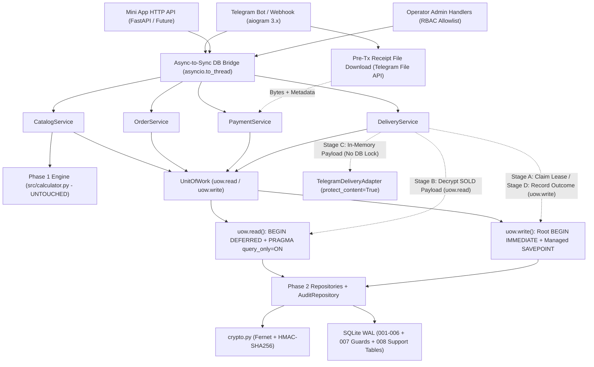
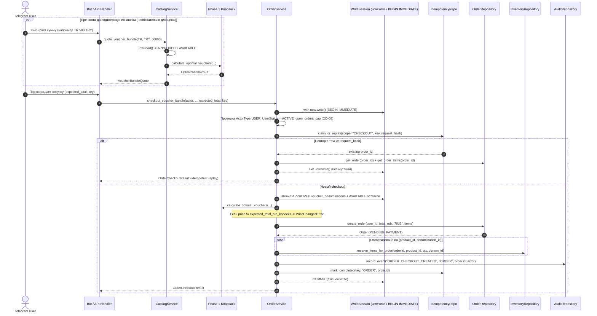
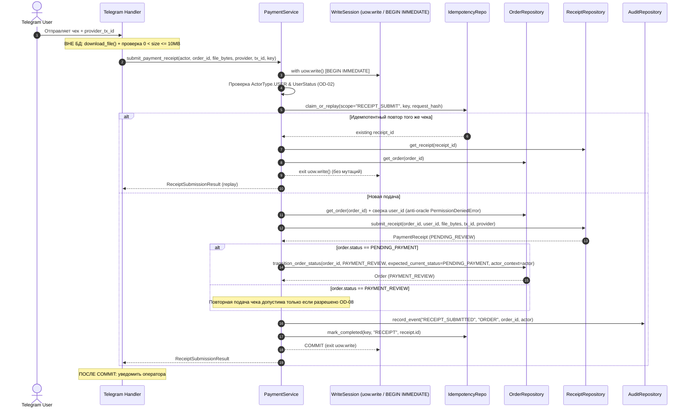

# Phase 3 Architecture & Implementation Design (Revision 1) — «Сервис для PS» (`HipTwinse/ps-service`)

- **Repository:** `https://github.com/HipTwinse/ps-service`
- **Source Code Baseline:** `main` @ `a261edcd2154e524426d6a258da1862c92ce297d` (`origin/main` синхронизирован; Python-код, SQL-миграции и схема БД не изменялись)
- **Documentation Branch:** `docs/phase3-architecture-design` (Revision 1 поверх коммита `f284924edbcbdd0cc01b846b3cd0952f8c91aa45`)
- **Статус документа:** `DESIGN ONLY (Revision 1) — IMPLEMENTATION BLOCKED PENDING PRODUCT COMMANDER APPROVAL`
- **Статус Phase 1 (`src/engine/`, `src/calculator.py`):** не изменена (`0` diff относительно `main`)
- **Статус Phase 2 (`src/db/`, `src/migrations/001`–`006`):** закрыта Security Gate (`GO`), PR #1 влит в `main`, CI (`Python 3.11` / `3.12`) и локальный прогон (`147` тестов на `Python 3.14.7`) — зелёные.

---

## 1. Executive Summary

Настоящий документ (Revision 1) фиксирует уточнённую целевую архитектуру **Phase 3 (Service Layer, Transaction Coordination, DB Hardening & Security Policy)** для принятия решения Product Commander о старте реализации. Документ основан на фактическом коде на `main @ a261edcd` и эмпирических проверках совместимости Python / SQLite (`Python 3.14.7` / `SQLite 3.50.4`, с обязательным последующим прогоном в CI на `Python 3.11` и `3.12`).

Ключевые архитектурные решения (с учётом исправлений Revision 1):

1. **Механизм координации транзакций без `WeakKeyDictionary` (`SG-P2-004`):** стандартный `sqlite3.Connection` в CPython не поддерживает слабые ссылки (`TypeError: cannot create weak reference to 'sqlite3.Connection' object`). Вместо `WeakKeyDictionary` и вместо удаления `transaction()` из репозиториев выбирается **реестр активных управляемых транзакций `_ACTIVE_MANAGED_TX: dict[int, _ManagedTxEntry]` (ключ `id(conn)`) со строгой проверкой `entry.conn is conn`, сильной ссылкой строго на время активной корневой транзакции и гарантированной очисткой в `finally:`**. Вложенные управляемые вызовы используют `SAVEPOINT`; неуправляемые внешние транзакции, кросс-поточный доступ и эскалация режима блокировки (`DEFERRED -> IMMEDIATE`) жёстко отклоняются с `RuntimeError`.
2. **Согласованные чтения в `UnitOfWork` (`uow.read()` vs `uow.write()`):** `uow.read()` всегда открывает явный `BEGIN DEFERRED` в режиме `PRAGMA query_only = ON` и сразу выполняет `SELECT 1;` для фиксации единого WAL-снимка на всю серию `SELECT` (каталог, цены, остатки склада, статус пользователя). Скрытая эскалация `DEFERRED -> IMMEDIATE` и любые записи внутри `uow.read()` блокируются на трёх уровнях (`ReadSession` API, Python-реестр `transaction()`, SQLite `PRAGMA query_only = ON`). `uow.write()` открывает корневой `BEGIN IMMEDIATE` (или `EXCLUSIVE`) на одном соединении для всех репозиториев.
3. **Рабочая схема pre-flight для миграции `007` (`SG-P2-006`):** автономный `SELECT RAISE(ABORT, ...)` в SQLite вне триггеров синтаксически нелегален (`OperationalError: RAISE() may only be used within a trigger-program`). Вместо него проектируется **Python pre-flight hook (`MIGRATION_PREFLIGHT_CHECKS[7]`) в `run_migrations()`**, выполняющийся внутри **той же** транзакции `BEGIN IMMEDIATE` строго **до** миграционного DDL. Проверка выполняется через `SELECT` с `LEFT JOIN`; при нарушении выбрасывается `MigrationPreflightError`, транзакция откатывается без единого DDL-изменения, старые checksum `001`–`006` не затрагиваются, повторный запуск безопасен.
4. **4-стадийный Delivery Workflow (без ложных гарантий `exactly-once`):** выдача цифровых товаров разделяется на независимые фазы: **A. `Claim delivery`** (короткая write-транзакция с lease-токеном и защитой от гонок), **B. `Prepare payload`** (после коммита claim: короткий `uow.read()` для выборки и расшифровки `SOLD`-кодов в памяти с маскированным `__repr__`), **C. `External delivery`** (Telegram Bot API `protect_content=True` полностью вне БД и SQLite-блокировок), **D. `Record outcome`** (отдельная короткая write-транзакция CAS-фиксации `SENT` / `FAILED` / `UNCERTAIN`). Поскольку Telegram Bot API не даёт распределённых транзакций, система честно гарантирует **at-least-once внешнюю доставку с однопоточной lease-дедупликацией и нулевым риском двойного списания со склада**.
5. **Сохранение Phase 1 и открытые решения:** `src/engine/` и `src/calculator.py` не изменяются; спорные продуктовые/безопасностные политики вынесены в **Раздел 13 (`OD-01`–`OD-09`)**.

---

## 2. Current Architecture Assessment

### 2.1. Phase 1 (`src/calculator.py`, `src/engine/`)

Фактическая реализация на `main @ a261edcd`:
- `src/calculator.py` (`L1–L28`) — фасад реэкспорта `src/engine/__init__.py`.
- `src/engine/models.py`:
  - `Region` (`TR`, `US`), `Currency` (`TRY`, `USD`, алиас `US = "USD"` — валюты `RUB` в Phase 1 нет), `REGION_CURRENCY_MAP = {Region.TR: Currency.TRY, Region.US: Currency.USD}`.
  - `Denomination(face_value_minor: int, cost_rub_kopecks: int, stock_limit: int, enabled: bool = True)`.
  - `SelectedDenomination(face_value_minor: int, quantity: int, cost_rub_kopecks: int, total_cost_rub_kopecks: int)`.
  - `OptimizationResult(status, region, currency, target_amount_minor, selected_denominations, total_face_value_minor, wallet_change_minor, total_procurement_cost_rub_kopecks, voucher_count, reason)` со свойством `is_success`.
  - Контрактные ограничения: `DEFAULT_MAX_VOUCHERS_PER_ORDER = 6`, `MAX_PERMITTED_VOUCHERS_PER_ORDER = 20`, `MAX_TARGET_AMOUNT_MINOR = 5_000_000`, `MAX_FACE_VALUE_MINOR = 5_000_000`, `MAX_COST_RUB_KOPECKS = 50_000_000`, `MAX_STOCK_LIMIT = 1_000`, `MAX_DENOMINATIONS_COUNT = 20`.
- `src/engine/knapsack.py`: функция `calculate_optimal_vouchers(...)` (Branch-and-Bound оптимизатор: минимум `total_procurement_cost_rub_kopecks`, минимум `wallet_change_minor`, минимум `voucher_count`, приоритет более крупных номиналов).

**Критическое наблюдение по мосту Phase 1 <-> Phase 2:**
1. `Denomination` и `SelectedDenomination` не содержат `denomination_id` и `product_id`; сопоставление с БД идёт по `UNIQUE (region, currency, face_value_minor)` таблицы `voucher_denominations` (`001_initial_schema.sql:49`).
2. `CatalogRepository.get_active_denominations(region, currency)` (`src/db/repositories.py:236–259`) фильтрует только `voucher_denominations.is_active = 1`, но **не проверяет `products.status = 'APPROVED'`**, тогда как `OrderRepository.create_order()` (`src/db/repositories.py:1050`) требует `APPROVED`.
3. Phase 1 принимает `TRY`/`USD` и считает `total_procurement_cost_rub_kopecks`, а `OrderRepository.create_order()` (`src/db/repositories.py:1073–1114`) требует `currency == "RUB"` и точного совпадения `unit_price_minor == voucher_denominations.cost_rub_kopecks`.

### 2.2. Phase 2 (`src/db/` и `src/migrations/001`–`006`)

Фактическая реализация на `main @ a261edcd`:
- **`src/db/connection.py`:**
  - `get_connection()` / `create_connection()`: выставляет `row_factory = sqlite3.Row`, `PRAGMA foreign_keys = ON`, `PRAGMA busy_timeout`, для файловых БД `PRAGMA journal_mode = WAL` и `PRAGMA synchronous = NORMAL`; использует стандартный `isolation_level=""` модуля `sqlite3`.
  - `transaction(conn, mode="IMMEDIATE")`: при `conn.in_transaction == True` падает с `RuntimeError` (`L97–L100`); в `except BaseException:` откатывает транзакцию (`L106–L112`).
  - `backup_database()` (`L115–L138`): запрещает запуск при `source_conn.in_transaction`.
  - `restore_database()` (`L141–L330`): проверяет блокировку (`BEGIN EXCLUSIVE` + `PRAGMA wal_checkpoint(TRUNCATE)`), проверяет `PRAGMA integrity_check`, подменяет файл через `.orig_bak_*`, но в блоках `L232` (временный файл бэкапа), `L257` (staging safety backups) и `L295` (swap & rollback, плюс `L304` при копировании обратно) ловит `except Exception:` вместо `BaseException` (`SG-P2-014`).
- **`src/db/crypto.py`:** Fernet-шифрование + HMAC-SHA256 с проверкой `ENV`/`APP_ENV`. Остаются недочёты `SG-P2-012` (`key or get_encryption_key()`, нет минимальной длины `FINGERPRINT_PEPPER`, пробельный `FINGERPRINT_PEPPER` затеняет `INVENTORY_FINGERPRINT_PEPPER`).
- **`src/db/migrations.py`:** `run_migrations()` сериализует применение миграций через `BEGIN IMMEDIATE`, проверяет SHA-256 `checksum` в `schema_migrations`, разбивает скрипт через `_split_sql_statements()` (`sqlite3.complete_statement`). Остаточные краевые случаи парсера (`;` в одной строке или завершающий `/* ... */`) описаны в `SG-P2-005`. Прикладные миграции `003`–`006` реализовали пре-флайты через SQL-паттерн `CREATE TEMP TABLE ... CHECK (ok = 1)`.
- **`src/db/repositories.py`:** 5 классов (`CatalogRepository`, `UserRepository`, `InventoryRepository`, `OrderRepository`, `ReceiptRepository`). **`AuditRepository` отсутствует** — запись в `audit_events` выполняется только в `OrderRepository.transition_order_status()` (`L1185–L1193`).
- **`src/migrations/001`–`006`:** 11 таблиц, 13 индексов, 12 активных триггеров. Ключевые пробелы на `HEAD`:
  1. Невозможность объединить несколько write-операций репозиториев в одну транзакцию (`SG-P2-004`).
  2. `OrderRepository.transition_order_status()` разрешает `FULFILLING -> COMPLETED` без проверки инвентаря и `-> CANCELLED` при наличии `RESERVED` (`SG-P2-004`).
  3. `finalize_order_sale()` требует `RESERVED`-инвентарь для **всех** `order_items`, не различая неинвентарные `FIXED_PRODUCT` (`MANUAL_REVIEW`).
  4. На уровне SQLite не закрыты `SOLD -> AVAILABLE`, привязка `voucher_denominations -> FIXED_PRODUCT`, прыжки `orders.status`, изменение/отмена уже обработанных `payment_receipts` и правки `order_items` после оплаты (`SG-P2-006`).
  5. `ReceiptRepository.submit_receipt()` не проверяет `users.status == 'BLOCKED'`; `update_review_status()` не запрещает откат терминальных статусов чека; `get_revealed_code()` не проверяет `users.status` (`SG-P2-013`).
  6. Методы записи репозиториев читают возвращаемый DTO (`self.get_*()`) после выхода из `with transaction(...)` (`SG-P2-014`).

**Все 3 существующих теста Phase 2, затрагиваемые проектированием Phase 3 (важно для Stage 3.1):**
1. `tests/test_orders.py:232–275` (`test_order_state_machine_transitions`) — создаёт заказ `VOUCHER` с 0 инвентаря и переводит его `FULFILLING -> COMPLETED`. При включении инварианта `SG-P2-004` потребуется резерв+финализация инвентаря до `COMPLETED` (или отдельный тест на неинвентарный `FIXED_PRODUCT`).
2. `tests/test_phase2_security_gate_remediation.py:605–643` (`test_sg_p2_002_cancelled_order_release_lifecycle_and_safe_cleanup`) — вызывает `transition_order_status(CANCELLED)` **до** `release_order_reservations()`. При строгой модели `CANCELLED` (Вариант A, Раздел 5.4) порядок должен быть `release` -> `CANCELLED` (или `OrderService.cancel_order()`).
3. `tests/test_phase2_remediation_followup.py:75–82, 225–274` (`test_finalize_order_sale_enforces_complete_reservation_atomically`) — проверяет **смешанный заказ** (`VOUCHER` + `FIXED_PRODUCT` с `DeliveryMethod.OFFICIAL_ACTIVATION` и `InventoryType.ACTIVATION_DATA`) через `finalize_order_sale()`. Выбор политик `OD-03` и `OD-04` напрямую влияет на то, сохраняется ли этот контракт или мигрирует в Stage 3.1.

---

## 3. Proposed Service Layer Architecture

### 3.1. Архитектурная схема слоёв



### 3.2. Разграничение ответственности слоёв

| Слой | Размещение | Ответственность | Жёсткие запреты |
| :--- | :--- | :--- | :--- |
| **Transport / Adapters** | `src/bot/` (Stage 3.3) | Приём updates/HTTP, скачивание файлов чеков, проверка allowlist операторов, вызов Telegram API доставки (`Stage C`) | Не импортирует `sqlite3`, не открывает транзакций, не формирует SQL |
| **Service Layer** | `src/services/` (Stage 3.2) | Оркестрация через `UnitOfWork`, проверка `ActorContext` и политик доступа, вызов Phase 1, идемпотентность, аудит, `Claim`/`Prepare`/`Record` доставки | Не выполняет Telegram/HTTP I/O внутри `uow.write()` или `uow.read()` |
| **Domain Engine (Phase 1)** | `src/engine/`, `src/calculator.py` | Математический подбор номиналов (`calculate_optimal_vouchers`) | **Неприкосновенно.** Никакого I/O и зависимостей от БД |
| **Repository & DB Layer** | `src/db/`, `src/migrations/` | CRUD, криптография, реестр управляемых транзакций (`BEGIN`/`SAVEPOINT`), `run_migrations` + pre-flight hooks, SQLite-триггеры | Не содержит сетевых вызовов и Telegram-специфики |

### 3.3. Компоненты сервисного слоя и контракты

#### 1) `src/services/actor.py` — субъект вызова
- `ActorType(str, Enum)`: `USER = "USER"`, `OPERATOR = "OPERATOR"`, `SYSTEM = "SYSTEM"`.
- `@dataclass(frozen=True) class ActorContext`:
  - `actor_type: ActorType`
  - `user_id: Optional[int]` (обязателен `>= 1` для `USER`; `None` для `OPERATOR`/`SYSTEM`)
  - `external_id: str` (непустой идентификатор: Telegram `user.id` или `"SYSTEM_TTL_WORKER"` / `"SYSTEM_DELIVERY_REAPER"`)
  - `correlation_id: Optional[str] = None` (ID запроса/trace для аудита без секретов).

#### 2) `src/services/errors.py` — согласованная иерархия доменных исключений
Все сервисные ошибки наследуют `ServiceError(DatabaseError)` (и при конфликте/ограничении также соответствующий базовый класс `src.db.models`), чтобы обработчики верхнего уровня могли ловить как узкие классы (`ConflictError`, `PermissionDeniedError`), так и общий `ServiceError` или `DatabaseError`:
- `ServiceError(DatabaseError)` — корень сервисных исключений.
- `PermissionDeniedError(ServiceError)` — нарушение RBAC, отсутствие прав, anti-oracle ошибка доступа к чужому/несуществующему заказу/коду.
- `UserBlockedError(PermissionDeniedError)` — запрет действия для `UserStatus.BLOCKED`.
- `PriceChangedError(ConflictError, ServiceError)` — расхождение цены/активности/наличия между квотой и checkout.
- `IdempotencyConflictError(ConflictError, ServiceError)` — повтор `idempotency_key` с отличающимся `request_hash`.
- `DeliveryError(ServiceError)` — ошибка стадий доставки (в `__str__` запрещено включать plaintext-коды).
- `DeliveryInProgressError(ConflictError, DeliveryError)` — активный неистёкший lease `DISPATCHING` другого обработчика.

#### 3) `src/services/uow.py` — `UnitOfWork`, `ReadSession`, `WriteSession`
- `ReadSession` (только read-методы и сервисные read-запросы на едином `conn` в `BEGIN DEFERRED` + `PRAGMA query_only = ON`):
  - `.catalog` (read-методы), `.users` (read-методы), `.orders` (read-методы), `.receipts` (read-методы), `.inventory` (read-методы, включая `get_revealed_code`), `.deliveries` (read-методы).
- `WriteSession` (все 5 существующих репозиториев + новые репозитории, привязанные к **одному** `sqlite3.Connection` в корневом `BEGIN IMMEDIATE`/`EXCLUSIVE`):
  - `.catalog: CatalogRepository`
  - `.users: UserRepository`
  - `.inventory: InventoryRepository`
  - `.orders: OrderRepository`
  - `.receipts: ReceiptRepository`
  - `.audit: AuditRepository`
  - `.idempotency: IdempotencyRepository`
  - `.deliveries: DeliveryRepository`

#### 4) `src/services/catalog_service.py` — каталог и мост к Phase 1
- `quote_voucher_bundle(region: str, currency: str, target_amount_minor: int, max_vouchers_per_order: int = 6, max_allowed_overshoot_minor: Optional[int] = None) -> VoucherBundleQuote`:
  - Граница: `with uow.read() as session:` читает в едином WAL-снимке одобренные `voucher_denominations` (`products.status = 'APPROVED' AND products.product_type = 'VOUCHER' AND vd.is_active = 1`) и агрегат доступного склада (`AVAILABLE`), **затем вне транзакции** запускает `calculate_optimal_vouchers(...)` (Phase 1).
  - Маппинг: ограничивает `stock_limit = min(available_count, 1000)`, сопоставляет `SelectedDenomination.face_value_minor` к `VoucherDenomination.(id, product_id)` по уникальному ключу `(region, currency, face_value_minor)`.
- `list_approved_fixed_products() -> list[FixedProductOffer]`: `uow.read()`, строго `products.status = 'APPROVED' AND fixed_product_details.approval_status = 'APPROVED'`.
- Операторские методы (`create_voucher_product`, `add_voucher_denomination`, `create_fixed_product`, `approve_fixed_product`, `set_product_status`, `import_inventory_codes`): `uow.write()`, требуют `ActorType.OPERATOR`, пишут аудит (без открытых кодов).

#### 5) `src/services/order_service.py` — оформление, отмена и возврат заказов
- `checkout_voucher_bundle(actor: ActorContext, region: str, currency: str, target_amount_minor: int, expected_total_rub_kopecks: Optional[int] = None, max_vouchers_per_order: int = 6, max_allowed_overshoot_minor: Optional[int] = None, idempotency_key: Optional[str] = None) -> OrderCheckoutResult`:
  - Граница: **одна** `uow.write()` (`BEGIN IMMEDIATE`) без предварительного `uow.read()` для избежания TOCTOU. Внутри транзакции проверяет `actor.actor_type == USER`, `actor.user_id >= 1`, `UserStatus == ACTIVE`, лимит открытых заказов (`OD-08`), `IdempotencyRepository`, читает актуальный одобренный каталог и остатки, вызывает чистую функцию `calculate_optimal_vouchers(...)` в памяти (~0.1 мс для `<= 20` номиналов), сверяет `expected_total_rub_kopecks` (`PriceChangedError`), вызывает `OrderRepository.create_order()`, резервирует в отсортированном порядке `(product_id, denomination_id)` через `InventoryRepository.reserve_items_for_order()`, пишет `audit_events` и фиксирует `idempotency_keys`.
- `checkout_fixed_product(actor: ActorContext, product_id: int, quantity: int = 1, expected_unit_price_rub_kopecks: Optional[int] = None, idempotency_key: Optional[str] = None) -> OrderCheckoutResult`:
  - Граница: одна `uow.write()`, проверяет `UserStatus`, `APPROVED`, цену (`PriceChangedError`), резервирует склад для инвентарных типов (`CODE`, и `OFFICIAL_ACTIVATION` согласно `OD-03`).
- `cancel_order(actor: ActorContext, order_id: int, reason: Optional[str] = None, idempotency_key: Optional[str] = None) -> Order`:
  - Граница: одна `uow.write()`, единая точка перевода в `CANCELLED` (включая `REFUND_REVIEW -> CANCELLED`). Проверяет матрицу `actor x order.status` (`USER` владелец в `PENDING_PAYMENT`, и в `PAYMENT_REVIEW` по `OD-05`; `OPERATOR` в `PENDING_PAYMENT`/`PAYMENT_REVIEW`/`REFUND_REVIEW`; `SYSTEM` в `PENDING_PAYMENT`), идемпотентность, освобождает `RESERVED` через `release_order_reservations()`, обрабатывает висящие `PENDING_REVIEW` чеки (`OD-05`), вызывает `transition_order_status(..., OrderStatus.CANCELLED, expected_current_status=..., actor_context=actor)`.
- `initiate_refund_review(actor: ActorContext, order_id: int, reason: str, idempotency_key: Optional[str] = None) -> Order`:
  - Граница: `ActorType.OPERATOR`, одна `uow.write()`, переводит `PAID`/`FULFILLING`/`COMPLETED` в `REFUND_REVIEW` с обязательным непустым `reason`. *(Размещение в `OrderService` держит все переходы `orders.status` без привязки к чеку в одном сервисе.)*
- `expire_stale_orders(actor: ActorContext, ttl_seconds: int = 900, batch_limit: int = 50) -> list[int]`:
  - Граница: `ActorType.SYSTEM`; выборка просроченных `PENDING_PAYMENT` через `uow.read()`, затем индивидуальная короткая `uow.write()` на каждый заказ.
- `get_order_details(actor: ActorContext, order_id: int) -> OrderDetailsDTO`:
  - Граница: `uow.read()`, проверяет владельца и политику `UserStatus` (`OD-01`), при нарушении отдаёт anti-oracle `PermissionDeniedError`.

#### 6) `src/services/payment_service.py` — приём чеков и подтверждение оплаты/выполнения
- `submit_payment_receipt(actor: ActorContext, order_id: int, file_bytes: bytes, provider_name: str = "MANUAL", provider_tx_id: Optional[str] = None, idempotency_key: Optional[str] = None) -> ReceiptSubmissionResult`:
  - Скачивание `file_bytes` из Telegram выполняется **строго до** вызова сервиса. Внутри одной `uow.write()`: проверка `USER` & `UserStatus` (`OD-02`), ownership с anti-oracle обработкой, идемпотентность, `ReceiptRepository.submit_receipt()`, при `order.status == PENDING_PAYMENT` переход `transition_order_status(order_id, PAYMENT_REVIEW, expected_current_status=PENDING_PAYMENT, actor_context=actor)` (при уже `PAYMENT_REVIEW` поведение определяется `OD-08`), запись `audit_events`.
- `approve_receipt_and_fulfill(actor: ActorContext, receipt_id: int, reviewer_notes: Optional[str] = None, idempotency_key: Optional[str] = None) -> FulfillmentResult` (**Путь 3A — предрезервированные складские заказы**):
  - Граница: `ActorType.OPERATOR`, одна `uow.write()`. Переводит чек `PENDING_REVIEW -> ACCEPTED`, заказ `PAYMENT_REVIEW -> PAID -> FULFILLING`, вызывает `finalize_order_sale()`, переводит `FULFILLING -> COMPLETED` и пишет аудит.
- `approve_receipt_only(actor: ActorContext, receipt_id: int, start_fulfillment: bool = False, reviewer_notes: Optional[str] = None, idempotency_key: Optional[str] = None) -> Order` (**Пути 3B и 3C**):
  - Граница: `ActorType.OPERATOR`, одна `uow.write()`. Переводит чек в `ACCEPTED`, заказ в `PAID` (`start_fulfillment=False` для дропшиппинга **3B** перед внешним импортом и вызовом `fulfill_paid_order()`) или сразу `PAID -> FULFILLING` (`start_fulfillment=True` для ручной услуги **3C** перед `complete_manual_fulfillment()`).
- `fulfill_paid_order(actor: ActorContext, order_id: int, notes: Optional[str] = None, idempotency_key: Optional[str] = None) -> FulfillmentResult`:
  - Граница: `ActorType.OPERATOR`, одна `uow.write()`, для заказов в `PAID`/`FULFILLING` (при необходимости резервирует только что импортированные коды, финализирует `finalize_order_sale()`, переводит в `COMPLETED`).
- `complete_manual_fulfillment(actor: ActorContext, order_id: int, fulfillment_notes: str, idempotency_key: Optional[str] = None) -> Order`:
  - Граница: `ActorType.OPERATOR`, одна `uow.write()`. Только для неинвентарных позиций заказа (`MANUAL_REVIEW` и др. по `OD-03`): проверяет непустой `fulfillment_notes`, отсутствие `RESERVED` и `SOLD` по этим позициям и переводит `FULFILLING -> COMPLETED`.
- `reject_receipt(actor: ActorContext, receipt_id: int, reviewer_notes: str, return_to_pending_payment: bool = True, idempotency_key: Optional[str] = None) -> ReceiptReviewResult`:
  - Граница: `ActorType.OPERATOR`, одна `uow.write()`. Переводит чек `PENDING_REVIEW -> REJECTED` (или `DUPLICATE`), при отсутствии других активных чеков и `return_to_pending_payment=True` возвращает заказ `PAYMENT_REVIEW -> PENDING_PAYMENT`.

#### 7) `src/services/delivery_service.py` — 4-стадийная безопасная доставка
- `@dataclass(frozen=True) class DeliveryCodeItem`: поля `(inventory_item_id, product_id, denomination_id, code)` с переопределёнными `__repr__` и `__str__`, возвращающими `"DeliveryCodeItem(id=..., code=***REDACTED***)"`.
- `@dataclass(frozen=True) class DeliveryPayload`: `(delivery_id, claim_token, order_id, target_user_id, target_external_id, items: tuple[DeliveryCodeItem, ...])` (также с маскированным `__repr__`).
- **4 независимых метода/стадии:**
  1. **Stage A (`claim_delivery`):** короткая `uow.write()`, проверяет права (`USER` владелец своего заказа / `OPERATOR` повторная отправка по `OD-07` / `SYSTEM` автодиспатч после `approve_receipt_and_fulfill`), политику `UserStatus` (`OD-01`), лениво закрывает просроченные lease (`DISPATCHING -> UNCERTAIN`), отклоняет при активном lease (`DeliveryInProgressError`), создаёт строку в `order_deliveries` (`status='DISPATCHING'`, `claim_token`, `lease_expires_at`), пишет `DELIVERY_CLAIMED` в `audit_events`. Возвращает `DeliveryClaim(delivery_id, claim_token, order_id, target_user_id, target_external_id, lease_expires_at)`.
  2. **Stage B (`prepare_payload`):** после коммита Stage A открывает короткий `uow.read()`, проверяет, что `delivery_id` всё ещё `DISPATCHING`, `claim_token` совпадает, lease не истёк, а заказ/пользователь в допустимом статусе (`REVEALABLE_ORDER_STATUSES` + `OD-01`); читает `SOLD`-позиции и расшифровывает через `InventoryRepository.get_revealed_code(..., expected_order_id=order_id, expected_user_id=target_user_id)`. Возвращает in-memory `DeliveryPayload`, закрывает read-транзакцию. Никакой plaintext не записывается в БД, логи или аудит.
  3. **Stage C (Вне сервиса БД — `TelegramDeliveryAdapter`):** отправляет сообщение в Telegram на `payload.target_external_id` (`chat_id` покупателя) с `protect_content=True`. В случае `OD-07` Option A операторский бот вызывает только доставку покупателю, а plaintext не возвращается в интерфейс оператора.
  4. **Stage D (`record_outcome`):** отдельная короткая `uow.write()`, по `(delivery_id, claim_token)` атомарно обновляет статус `DISPATCHING -> SENT` (при `external_message_id`), `FAILED` или `UNCERTAIN` (при timeout/обрыве связи), либо безопасно до-подтверждает `UNCERTAIN -> SENT` по совпадению `claim_token`. Если lease уже перехвачен другим воркером, исход не затирает новую попытку и логируется как `DELIVERY_STALE_OUTCOME_IGNORED`.
- `reap_expired_leases(actor: ActorContext, batch_limit: int = 50) -> int`: системный фоновый сборщик просроченных `DISPATCHING` (`lease_expires_at <= CURRENT_TIMESTAMP` -> `UNCERTAIN`).

#### 8) `AuditRepository` (`src/db/repositories.py`)
- `record_event(event_type: str, entity_type: str, entity_id: int, actor: Optional[ActorContext] = None, details: Optional[dict[str, Any]] = None) -> AuditEvent`.
- `OrderRepository.transition_order_status()` получает опциональный обратно совместимый параметр `actor_context: Optional[ActorContext] = None`, чтобы **каждый** переход `ORDER_STATUS_TRANSITION` (`SG-P2-015`) сохранял нормализованные `actor_type`, `actor_external_id`, `correlation_id`, `from_status`, `to_status`, `notes`.
- **Запрет секретов в аудите:** в `details_json` не передаются plaintext коды, `file_bytes`, `encrypted_payload`, ключи/pepper.

---

## 4. Transaction Coordination / Unit of Work Design (`SG-P2-004`)

### 4.1. Выбор механизма учёта состояния транзакций

Локальная проверка в Python подтвердила: `weakref.WeakKeyDictionary` **непригоден** для `sqlite3.Connection` (`TypeError: cannot create weak reference to 'sqlite3.Connection' object`). Сравнение рабочих альтернатив для `Python 3.11`, `3.12` и `3.14`:

| Подход | Механизм | Совместимость с Phase 2 (147 тестов) | Риски и недостатки | Вердикт |
| :--- | :--- | :--- | :--- | :--- |
| **1. `id(conn)` с сильной ссылкой только на активную корневую транзакцию** | `_ACTIVE_MANAGED_TX: dict[int, _ManagedTxEntry]` под `threading.Lock()`, с проверкой `entry.conn is conn` и удалением в корневом `finally:` | **100%** (работает с любым `sqlite3.Connection` из `sqlite3.connect` / `create_connection`) | Требует строгой очистки в `finally:` на корневом уровне | **ВЫБРАН** |
| **2. `id(conn)` без сильной ссылки на объект** | Хранит только `int` и `depth` | 100% | При редком сбое/утечке и закрытии `conn` освобождённый `id` может быть переиспользован новым `sqlite3.Connection` (ABA-ошибка) | Отклонён |
| **3. Обёртка / Proxy над `sqlite3.Connection`** | Отдельный класс-обёртка со своим атрибутом `_tx_state` | **Нарушает** прямой `isinstance(conn, sqlite3.Connection)` и обходится при передаче сырого `conn` в репозитории | Сломает часть вызовов или потребует переписывания сигнатур | Отклонён |
| **4. Подкласс `sqlite3.Connection` (`factory=ManagedConnection`)** | Хранение атрибута в подклассе | Работает только через `create_connection()`, **не работает** для соединений, созданных через `sqlite3.connect()` в стороннем коде/тестах | Хрупко без резервного реестра | Отклонён |

### 4.2. Точный алгоритм управляемого `transaction()` (`src/db/connection.py`)

```python
@dataclass
class _ManagedTxEntry:
    conn: sqlite3.Connection          # сильная ссылка ТОЛЬКО на время активной корневой транзакции
    depth: int
    root_mode: str                    # 'DEFERRED' | 'IMMEDIATE' | 'EXCLUSIVE'
    read_only: bool                   # True только для uow.read() / read_only=True
    next_savepoint_id: int
    owner_thread_id: int
```

1. **Реестр:** `_ACTIVE_MANAGED_TX: dict[int, _ManagedTxEntry] = {}` и `_TX_REGISTRY_LOCK = threading.Lock()`.
2. **Валидация режима:** `norm_mode` должен быть в `{"DEFERRED", "IMMEDIATE", "EXCLUSIVE"}` (`ValueError`).
3. **Атомарная проверка входа под `_TX_REGISTRY_LOCK`:**
   - `conn_id = id(conn)`, `tid = threading.get_ident()`.
   - Получить `entry = _ACTIVE_MANAGED_TX.get(conn_id)`.
   - Если `entry is None`:
     - **Защита от чужой незакоммиченной транзакции:** если `conn.in_transaction` истинно -> `raise RuntimeError("Cannot start managed transaction: connection already has an active uncommitted transaction.")` (полное сохранение контракта Phase 2).
     - Иначе регистрируется корневая транзакция: `is_root = True`, `entry = _ManagedTxEntry(conn=conn, depth=1, root_mode=norm_mode, read_only=read_only, next_savepoint_id=1, owner_thread_id=tid)`, `_ACTIVE_MANAGED_TX[conn_id] = entry`.
   - Если `entry is not None`:
     - Проверка идентичности объекта: если `entry.conn is not conn` -> `raise RuntimeError("Managed transaction registry identity mismatch.")`.
     - Проверка рассинхронизации: если `not conn.in_transaction` (внешний код сделал raw `COMMIT`/`ROLLBACK` внутри `with transaction`) -> удалить запись из `_ACTIVE_MANAGED_TX` и `raise RuntimeError("Managed transaction state desynchronized.")`.
     - **Контроль `owner_thread_id`:** если `entry.owner_thread_id != tid` -> `raise RuntimeError("Cannot enter managed transaction from a different thread.")`.
     - **Запрет эскалации режима и записи в `read_only`:**
       - `rank = {"DEFERRED": 1, "IMMEDIATE": 2, "EXCLUSIVE": 3}`.
       - Если `entry.read_only and not read_only` -> `raise RuntimeError("Cannot start write transaction inside a read-only transaction.")`.
       - Если `rank[norm_mode] > rank[entry.root_mode]` -> `raise RuntimeError(f"Cannot escalate SQLite transaction mode from {entry.root_mode} to {norm_mode}.")`.
     - Присвоить `is_root = False`, `sp_name = f"sp_mgr_{entry.next_savepoint_id}"`, `entry.next_savepoint_id += 1`, `entry.depth += 1`.
4. **Выполнение и гарантированная очистка:**
   - **Корневая (`is_root=True`):**
     - Если перед `BEGIN` возникает ошибка (`conn.execute(f"BEGIN {norm_mode};")` упало с `OperationalError` при `SQLITE_BUSY`), `finally:` гарантированно удаляет `entry` из `_ACTIVE_MANAGED_TX`!
     - `try: yield conn`: если `read_only=True`, выполняется `conn.rollback()` (освобождает snapshot без commit-эффектов); иначе `conn.commit()`.
     - `except BaseException:` (перехватывает `KeyboardInterrupt`, `SystemExit`, `asyncio.CancelledError`, пользовательские `BaseException`): если `conn.in_transaction`, выполняется `conn.rollback()` (ошибки `sqlite3.Error` самого rollback не затирают исходное исключение) и re-raise.
     - `finally:` под `_TX_REGISTRY_LOCK` проверяется `if _ACTIVE_MANAGED_TX.get(conn_id) is entry: _ACTIVE_MANAGED_TX.pop(conn_id, None)`. Сильная ссылка на `conn` немедленно освобождается — **0 утечки памяти**.
   - **Вложенная (`is_root=False`):**
     - `conn.execute(f"SAVEPOINT {sp_name};")`.
     - При нормальном выходе: `conn.execute(f"RELEASE SAVEPOINT {sp_name};")`.
     - При `except BaseException:`: если `conn.in_transaction`, последовательно выполняются **оба** оператора:
       1. `conn.execute(f"ROLLBACK TO SAVEPOINT {sp_name};")`
       2. `conn.execute(f"RELEASE SAVEPOINT {sp_name};")`
       *(Проверено локально в SQLite: без второго `RELEASE` savepoint остаётся висеть в стеке SQLite; с обоими — внутренние правки откатываются, внешний контекст может продолжать работу или откатываться дальше).*
     - `finally:` под `_TX_REGISTRY_LOCK` уменьшается `entry.depth -= 1`.
5. **Совместимость с `backup_database()`, `run_migrations()` и `isolation_level=""`:**
   - `backup_database()` и `run_migrations()` сохраняют `if conn.in_transaction: raise RuntimeError(...)` и поэтому запрещены внутри любой управляемой или неуправляемой транзакции.
   - Поведение проверено на `isolation_level=""`: явный `BEGIN IMMEDIATE;` / `BEGIN DEFERRED;` выставляет `conn.in_transaction = True`, а вложенные `SAVEPOINT` и `RELEASE` сохраняют целостность транзакции до внешнего `conn.commit()`/`conn.rollback()`.
   - Для консистентности чтения DTO (`SG-P2-014`) все вызовы `self.get_*()` в методах записи репозиториев переносятся **внутрь** `with transaction(self.conn, mode="IMMEDIATE"):`.

### 4.3. Семантика `UnitOfWork`: `uow.read()` vs `uow.write()`

```python
class UnitOfWork:
    @classmethod
    def from_connection(cls, conn: sqlite3.Connection) -> "UnitOfWork": ...

    @contextmanager
    def read(self) -> Iterator["ReadSession"]: ...

    @contextmanager
    def write(self, mode: str = "IMMEDIATE") -> Iterator["WriteSession"]: ...
```

- **`uow.read()` (согласованный WAL snapshot без записи):**
  1. Получает `conn` (из фабрики или заимствованный в тестах) и проверяет, что `not conn.in_transaction` (если передано заимствованное соединение с чужой открытой транзакцией — `RuntimeError`).
  2. Читает текущее значение `prev_qo = conn.execute("PRAGMA query_only;").fetchone()[0]` и включает `conn.execute("PRAGMA query_only = ON;")`.
  3. **Всегда** открывает `with transaction(conn, mode="DEFERRED", read_only=True):`.
  4. **Немедленно выполняет `conn.execute("SELECT 1;").fetchone()`**! *(Критично для SQLite: сам по себе `BEGIN DEFERRED;` откладывает захват WAL read-маркера до первого запроса; только после первого `SELECT` все последующие `SELECT` каталога, цен и склада видят абсолютно один и тот же снимок БД, даже если параллельный писатель закоммитил изменения между 1-м и 2-м `SELECT` — подтверждено локальной пробой `WAL_DEFERRED_SNAPSHOT`.)*
  5. Передаёт `ReadSession(conn)` (экспонирует только read-методы).
  6. При выходе сбрасывает транзакцию (`rollback()`), в `finally:` восстанавливает `PRAGMA query_only = {prev_qo};` и закрывает соединение, если оно создано фабрикой.
  7. Любая случайная попытка записи или вызова метода репозитория с `transaction(mode="IMMEDIATE")` внутри `uow.read()` блокируется **тройной защитой**: интерфейсом `ReadSession`, Python-проверкой `read_only`/`DEFERRED -> IMMEDIATE` (`RuntimeError`) и SQLite `PRAGMA query_only = ON` (`OperationalError: attempt to write a readonly database`).
- **`uow.write(mode="IMMEDIATE")`:**
  - Принимает только `"IMMEDIATE"` или `"EXCLUSIVE"` (попытка передать `"DEFERRED"` в `uow.write()` отклоняется с `ValueError`).
  - Открывает корневой `with transaction(conn, mode=mode, read_only=False):`, отдаёт `WriteSession(conn)` (все репозитории используют одно и то же соединение `conn` и вложенные `SAVEPOINT`).
  - Ретраи на `SQLITE_BUSY` разрешены **исключительно** до успешного входа в корневой `BEGIN IMMEDIATE` (когда не выполнено ни одного оператора), с ограниченным числом попыток и коротким джиттером.

---

## 5. Order Lifecycle State Machine

### 5.1. Диаграмма состояний заказа (`orders.status`)

```mermaid
stateDiagram-v2
    [*] --> PENDING_PAYMENT : create_order (RUB snapshot and reserve if inventory-backed)

    PENDING_PAYMENT --> PAYMENT_REVIEW : submit_receipt (PENDING_REVIEW)
    PENDING_PAYMENT --> CANCELLED : cancel_order / TTL expire [RESERVED == 0]

    PAYMENT_REVIEW --> PAID : approve_receipt [receipt ACCEPTED]
    PAYMENT_REVIEW --> PENDING_PAYMENT : reject_receipt [no other active receipts]
    PAYMENT_REVIEW --> CANCELLED : cancel_order [RESERVED == 0]

    PAID --> FULFILLING : start_fulfillment
    PAID --> REFUND_REVIEW : initiate_refund_review

    FULFILLING --> COMPLETED : complete_inventory [RESERVED == 0 and SOLD == ordered_qty]
    FULFILLING --> COMPLETED : complete_manual [non-inventory and operator notes]
    FULFILLING --> REFUND_REVIEW : initiate_refund_review

    COMPLETED --> REFUND_REVIEW : initiate_refund_review

    REFUND_REVIEW --> CANCELLED : cancel_order [RESERVED == 0; SOLD per OD-06]

    CANCELLED --> [*]
```

### 5.2. Матрица строгих предусловий переходов

| Переход | Предусловие в Python (`OrderRepository` / Service) | Предусловие в SQLite (Миграция `007`) | Политика по инвентарю и чекам |
| :--- | :--- | :--- | :--- |
| `PENDING_PAYMENT -> PAYMENT_REVIEW` | Через `PaymentService`: создан чек `PENDING_REVIEW` в той же транзакции | Разрешён только из `PENDING_PAYMENT` | Резервы остаются `RESERVED` |
| `PAYMENT_REVIEW -> PAID` | Фиксируется `paid_at = CURRENT_TIMESTAMP`; через `PaymentService` проверен чек `ACCEPTED` | Разрешён только из `PAYMENT_REVIEW`; проверяет `NEW.paid_at IS NOT NULL` *(для сервиса/репозитория гарантировано SQL-запросом `paid_at = CURRENT_TIMESTAMP`)* | До 1 `ACCEPTED` чека на заказ |
| `PAYMENT_REVIEW -> PENDING_PAYMENT` | Через `PaymentService`: не осталось `ACCEPTED`/`PENDING_REVIEW` чеков | Разрешён из `PAYMENT_REVIEW` | Резервы сохраняются |
| `PAID -> FULFILLING` | У заказа есть `>= 1` `order_items` | Разрешён только из `PAID` | Подготовка выдачи / дозакупки |
| **`FULFILLING -> COMPLETED` (инвентарные позиции)** | 1) `COUNT(RESERVED для order_id) == 0`; 2) Для каждого инвентарного `(product_id, denomination_id)` `COUNT(SOLD) == SUM(order_items.quantity)` | **Триггер блокирует**, если есть хотя бы 1 `RESERVED` по заказу ИЛИ по любому инвентарному `(product_id, denomination_id)` `SOLD != ordered_qty` | 100% полнота выдачи |
| **`FULFILLING -> COMPLETED` (неинвентарные позиции)** | 1) `COUNT(RESERVED для order_id) == 0`; 2) Для неинвентарного `(product_id, NULL)` `COUNT(SOLD) == 0`; 3) В сервисе `ActorType.OPERATOR` + непустой `fulfillment_notes` | Триггер проверяет `RESERVED == 0` и отсутствие `SOLD` по неинвентарным позициям | Чёткая граница между складом и ручной услугой |
| **`* -> CANCELLED`** (`PENDING_PAYMENT`, `PAYMENT_REVIEW`, `REFUND_REVIEW`) | **`COUNT(RESERVED для order_id) == 0`** (резервы снимаются до перехода в `CANCELLED` в той же транзакции) | **Триггер блокирует `NEW.status = 'CANCELLED'`**, если существует хотя бы 1 `RESERVED` по заказу | При `REFUND_REVIEW -> CANCELLED` обработка `SOLD` по `OD-06` |
| `* -> REFUND_REVIEW` | Допустим из `PAID`, `FULFILLING`, `COMPLETED`; через сервис — обязательный непустой `reason` | Разрешён из `PAID`, `FULFILLING`, `COMPLETED` | Останавливает выдачу (`REVEALABLE_ORDER_STATUSES` не включает `REFUND_REVIEW`) |

### 5.3. Политика инвентарных vs неинвентарных `FIXED_PRODUCT`

- `'CODE'` (`delivery_method`): **всегда инвентарный** (`InventoryType.FIXED_CODE`).
- `'MANUAL_REVIEW'`: **всегда неинвентарный** (финализируется через `complete_manual_fulfillment`).
- `'OFFICIAL_ACTIVATION'`: **ожидает решения Product Commander (`OD-03`)** — в коде на `HEAD` существует тест `tests/test_phase2_remediation_followup.py:75–82, 225–274`, использующий `OFFICIAL_ACTIVATION` вместе с `InventoryType.ACTIVATION_DATA` в одном заказе с `VOUCHER` (смешанный заказ в контексте `finalize_order_sale()`, что также вынесено в `OD-04`).
- Соответственно `InventoryRepository.finalize_order_sale()` и `trg_orders_validate_status_transition` (миграция `007`) будут использовать единую согласованную классификацию инвентарных позиций после утверждения `OD-03`/`OD-04`.

### 5.4. Модель освобождения резервов при `CANCELLED` (Вариант A)

Принята строгая двухшаговая модель в одной транзакции:
1. `OrderRepository.transition_order_status(..., CANCELLED)` проверяет `COUNT(RESERVED) == 0` (при нарушении — `InvalidStateTransitionError`).
2. `OrderService.cancel_order()` внутри одной `uow.write()` вызывает сначала `InventoryRepository.release_order_reservations()`, затем `OrderRepository.transition_order_status(CANCELLED)`.
3. Триггер `trg_orders_validate_status_transition` дублирует запрет на уровне SQLite.

### 5.5. Жизненный цикл проверки чека (`payment_receipts.review_status`)

- При создании: строго `PENDING_REVIEW` (проверяется в Python и `BEFORE INSERT` триггером).
- Разрешённые переходы: `PENDING_REVIEW -> {ACCEPTED, REJECTED, DUPLICATE}`.
- `ACCEPTED`, `REJECTED`, `DUPLICATE` — **терминальные** состояния (защищено и в `ReceiptRepository.update_review_status()`, и в `BEFORE UPDATE` триггере).
- Частичный уникальный индекс `idx_receipts_single_accepted_per_order ON payment_receipts(order_id) WHERE review_status = 'ACCEPTED'` гарантирует не более одного принятого чека на заказ.

---

## 6. Atomic Business Workflows

Во всех 4 сценариях ниже операции с БД внутри одной транзакции выполняются на **едином `sqlite3.Connection`**, принадлежащем `WriteSession` (`uow.write()`), с точным использованием `expected_current_status=...` в `OrderRepository.transition_order_status()`.

### 6.1. Workflow 1: Checkout (`create_order` + `reserve_items_for_order`)



- **Граница транзакции:**
  - *До транзакции:* опциональное предварительное квотирование `CatalogService.quote_voucher_bundle()` (`uow.read()` + Phase 1).
  - *Внутри одной `uow.write()` (`BEGIN IMMEDIATE`):* проверка `actor.actor_type == USER`, `actor.user_id >= 1`, `UserStatus == ACTIVE`, лимит неоплаченных заказов (`OD-08`), идемпотентность, **повторное чтение** одобренных номиналов и остатков склада на том же соединении, вызов чистой функции Phase 1 `calculate_optimal_vouchers()`, сверка `expected_total_rub_kopecks`, `OrderRepository.create_order()`, резервирование `InventoryRepository.reserve_items_for_order()` в отсортированном порядке `(product_id, denomination_id)`, аудит, фиксация `idempotency_keys`.
  - *После коммита:* отображение счёта на оплату пользователю в Telegram.
- **Предусловия:** `UserStatus.ACTIVE`, `ProductStatus.APPROVED`, `voucher_denominations.is_active == 1` (или `ApprovalStatus.APPROVED` для `FIXED_PRODUCT`), достаточный `AVAILABLE` остаток.
- **Возможные ошибки:** `UserBlockedError`, `PermissionDeniedError`, `PriceChangedError`, `InsufficientInventoryError`, `IdempotencyConflictError`, `ValidationError` (включая `no_solution` от Phase 1).
- **Поведение при rollback:** при сбое на любом номинале или при аудите `transaction()` откатывает весь `BEGIN IMMEDIATE` целиком: не остаётся ни строки в `orders`/`order_items`, ни частичных резервов, ни `IN_PROGRESS` ключа идемпотентности.
- **Защита от повторного выполнения:** `idempotency_key` (`request_hash` включает `user_id`, `region`, `currency`, `target_amount_minor`, `expected_total_rub_kopecks`, `max_vouchers_per_order`, `max_allowed_overshoot_minor`).
- **Необходимые тесты:** checkout 1 и 2+ номиналов, rollback на 2-м номинале при нехватке склада, `PriceChangedError` при изменении цены между квотой и checkout, гонка 2 потоков (`Barrier(2)`) за последний ваучер, replay и `IdempotencyConflictError`.

### 6.2. Workflow 2: Submit Receipt (`submit_receipt` + `transition_order_status(PAYMENT_REVIEW)`)



- **Граница транзакции:**
  - *До транзакции:* скачивание байтов чека через Telegram API и проверка размера `0 < len <= 10 MiB`.
  - *Внутри `uow.write()` (`BEGIN IMMEDIATE`):* проверка `UserStatus` (`OD-02`), идемпотентность (`request_hash` включает `actor.user_id`, `order_id`, `file_sha256`, канонизированный `provider_name`, канонизированный `provider_tx_id`), проверка существования и владения `order` с единым anti-oracle `PermissionDeniedError`, `ReceiptRepository.submit_receipt()`, переход `PENDING_PAYMENT -> PAYMENT_REVIEW` с `expected_current_status=OrderStatus.PENDING_PAYMENT`, запись аудита, фиксация `idempotency_keys`.
  - *После коммита:* уведомление операторов.
- **Предусловия:** заказ существует и принадлежит `actor.user_id`, статус `PENDING_PAYMENT` (или `PAYMENT_REVIEW` по `OD-08`), файл не пуст и `<= 10 MiB`, `provider_name` — валидная строка (после фикса `SG-P2-016` не допускает нестроковые типы и обрезается/нормализуется; разрешённые провайдеры могут быть ограничены конфигом), `file_sha256` и `(provider_name, provider_tx_id)` не дублируются.
- **Возможные ошибки:** `PermissionDeniedError` (чужой или несуществующий `order_id`), `UserBlockedError` (`OD-02`), `ValidationError` (размер/тип), `DuplicateReceiptError` (дубль хэша или `provider_tx_id`), `InvalidStateTransitionError` (заказ уже `CANCELLED`/`PAID`/`COMPLETED`), `IdempotencyConflictError`.
- **Поведение при rollback:** ошибка в `transition_order_status` или аудите полностью откатывает `submit_receipt()`.
- **Необходимые тесты:** атомарный перевод в `PAYMENT_REVIEW`, rollback-тест при ошибке после `submit_receipt()`, гонка `submit_payment_receipt` vs `cancel_order` (`Barrier(2)`), replay одного запроса vs конфликт при смене `provider_tx_id` под тем же `idempotency_key` (`IdempotencyConflictError`), антидубль `DuplicateReceiptError`.

### 6.3. Workflow 3: Approve Receipt and Fulfill + 4-Stage Delivery

```mermaid
sequenceDiagram
    autonumber
    actor Op as Operator
    participant AdminBot as Operator Bot Handler
    participant PaySvc as PaymentService
    participant DlvSvc as DeliveryService
    participant Session as WriteSession / ReadSession
    participant TgAdapter as TelegramDeliveryAdapter
    actor Buyer as Buyer Telegram Chat

    Op->>AdminBot: Нажимает "Подтвердить и выдать" (receipt_id)
    AdminBot->>PaySvc: approve_receipt_and_fulfill(actor=OPERATOR, receipt_id, notes, key)
    PaySvc->>Session: with uow.write() [BEGIN IMMEDIATE]
    Note over PaySvc: Проверка ActorType.OPERATOR & IdempotencyRepo
    PaySvc->>Session: receipt = update_review_status(receipt_id, ACCEPTED, notes)
    PaySvc->>Session: transition_order_status(order_id, PAID, expected_current_status=PAYMENT_REVIEW, actor_context=actor)
    PaySvc->>Session: transition_order_status(order_id, FULFILLING, expected_current_status=PAID, actor_context=actor)
    PaySvc->>Session: finalize_order_sale(order_id)
    PaySvc->>Session: transition_order_status(order_id, COMPLETED, expected_current_status=FULFILLING, actor_context=actor)
    PaySvc->>Session: audit.record_event("ORDER_APPROVED_AND_FULFILLED", "ORDER", order_id, actor)
    PaySvc-->>Session: COMMIT (exit uow.write)
    PaySvc-->>AdminBot: FulfillmentResult(order=COMPLETED, sold_count)

    Note over AdminBot,Buyer: ДОСТАВКА В 4 НЕЗАВИСИМЫХ СТАДИИ (внешний I/O строго вне БД)

    rect rgb(235, 245, 255)
        Note over AdminBot,Session: Stage A: Claim delivery (короткая write-транзакция)
        AdminBot->>DlvSvc: claim_delivery(actor=OPERATOR, order_id, delivery_kind="INITIAL")
        DlvSvc->>Session: with uow.write() [BEGIN IMMEDIATE]
        DlvSvc->>Session: Просрочить истекшие DISPATCHING; проверить отсутствие активного lease & политика OD-01
        DlvSvc->>Session: INSERT order_deliveries (DISPATCHING, claim_token, lease_expires_at) + audit
        DlvSvc-->>Session: COMMIT (write lock освобождён)
        DlvSvc-->>AdminBot: DeliveryClaim(delivery_id, claim_token)
    end

    rect rgb(245, 245, 245)
        Note over AdminBot,Session: Stage B: Prepare payload (после коммита Stage A, read-only snapshot)
        AdminBot->>DlvSvc: prepare_payload(actor=OPERATOR, delivery_id, claim_token)
        DlvSvc->>Session: with uow.read() [BEGIN DEFERRED + query_only=ON]
        DlvSvc->>Session: Проверить активный claim_token; get_revealed_code() по всем SOLD позициям
        DlvSvc-->>Session: ROLLBACK (read tx закрыта)
        DlvSvc-->>AdminBot: DeliveryPayload (in-memory, masked __repr__)
    end

    rect rgb(255, 248, 235)
        Note over AdminBot,Buyer: Stage C: External delivery (БЕЗ подключения и транзакции SQLite)
        AdminBot->>TgAdapter: send_delivery_payload(payload, protect_content=True)
        TgAdapter->>Buyer: Telegram sendMessage(buyer_chat_id, codes, protect_content=True)
        TgAdapter-->>AdminBot: ExternalDeliveryOutcome(SENT/FAILED/UNCERTAIN, msg_id/err_code)
    end

    rect rgb(235, 255, 240)
        Note over AdminBot,Session: Stage D: Record outcome (отдельная короткая write-транзакция)
        AdminBot->>DlvSvc: record_outcome(actor=OPERATOR, delivery_id, claim_token, outcome)
        DlvSvc->>Session: with uow.write() [BEGIN IMMEDIATE]
        DlvSvc->>Session: CAS UPDATE order_deliveries WHERE id=? AND claim_token=? -> SENT/FAILED/UNCERTAIN + audit
        DlvSvc-->>Session: COMMIT
    end
```

- **Пути исполнения оплаты и выполнения:**
  - **Путь 3A (`approve_receipt_and_fulfill`):** 1-клик для предрезервированных складских заказов (`ACCEPTED -> PAID -> FULFILLING -> finalize_order_sale -> COMPLETED` в одной `uow.write()`).
  - **Путь 3B (`approve_receipt_only(start_fulfillment=False)` -> закупка/импорт -> `fulfill_paid_order`):** для дропшиппинга без предрезерва.
  - **Путь 3C (`approve_receipt_only(start_fulfillment=True)` -> ручное оказание -> `complete_manual_fulfillment`):** для неинвентарных `MANUAL_REVIEW`.
- **Обработка граничного кейса с блокировкой пользователя до одобрения:** если между созданием заказа/подачей чека и подтверждением оператором пользователь получил `UserStatus.BLOCKED`, политика определяется `OD-01`/`OD-02`: при `OD-01` Option A (`Strict Lockout`) в `approve_receipt_and_fulfill` заказ переходит в `COMPLETED`/`SOLD`, а `DeliveryService.claim_delivery` при `UserStatus == BLOCKED` отклоняет автодиспатч с `UserBlockedError` и оставляет `SOLD`-товар замороженным до разблокировки/ручного возврата (`REFUND_REVIEW`) — без утечки кодов заблокированному пользователю.
- **Сценарии сбоев и восстановления 4-стадийной доставки:**

| Сценарий сбоя | Состояние в БД (`order_deliveries`) | Механизм восстановления и гарантии |
| :--- | :--- | :--- |
| **1. Падение процесса до отправки в Telegram (после Stage A или B)** | Строка остаётся в `DISPATCHING` с `lease_expires_at` (например, `now + 60s`). | По истечении lease следующий вызов `claim_delivery()` или `reap_expired_leases()` переводит просроченный `DISPATCHING` в `UNCERTAIN` и разрешает выдать новый `claim_token` для повторной попытки. |
| **2. Падение после успешной отправки в Telegram, до коммита Stage D `SENT`** | В Telegram сообщение уже ушло, а в БД висит истёкший `DISPATCHING` -> переходит в `UNCERTAIN`. | При повторной доставке клиент получает **те же самые `SOLD`-коды** своего заказа (новое списание со склада невозможно). В логе/аудите честно отражено, что предыдущая попытка имела статус `UNCERTAIN` (модель **at-least-once**). |
| **3. Timeout / обрыв сети с неизвестным ответом Telegram API** | Stage C классифицирует результат как `UNCERTAIN`; Stage D фиксирует `status = 'UNCERTAIN'` с `error_code = 'TG_TIMEOUT'`. | Если фоновый retry или повторный запрос пользователя/оператора запускает новую попытку, используется новый `attempt_no` и те же `SOLD`-коды. Если поздний ответ предыдущего HTTP-запроса успевает прийти в `record_outcome` с тем же `claim_token`, `UNCERTAIN -> SENT` обновляется безопасно; при перехвате другим `claim_token` результат старого токена игнорируется (`DELIVERY_STALE_OUTCOME_IGNORED`). |
| **4. Повторная отправка (`REDELIVERY` / `OPERATOR_RESEND`)** | Предыдущая попытка в статусе `SENT`/`FAILED`/`UNCERTAIN` сохраняется неизменной; создаётся **новая** строка `order_deliveries` с `attempt_no + 1`. | `claim_delivery(delivery_kind="REDELIVERY")` проверяет rate-limit (`OD-08`) и активный `DISPATCHING` lease, не переписывает историю прошлых успешных `SENT` и заново проходит B -> C -> D. |
| **5. Гонка двух параллельных обработчиков доставки** | Частичный уникальный индекс `idx_order_deliveries_single_active_dispatch ON order_deliveries(order_id) WHERE status = 'DISPATCHING'`. | В `BEGIN IMMEDIATE` второй обработчик не может вставить второй активный `DISPATCHING` при неистёкшем lease и получает `DeliveryInProgressError`. |

- **Честный отказ от `exactly-once`:** Telegram Bot API не поддерживает идемпотентные ключи доставки сообщений и двухфазный коммит. Поэтому система не обещает `exactly-once delivery`; гарантируются: **одномоментная эксклюзивность `DISPATCHING` (lease)**, **невозможность повторного списания/выдачи чужого или нового инвентаря** и **полная наблюдаемость статусов `SENT` / `FAILED` / `UNCERTAIN`**.

### 6.4. Workflow 4: Cancel Order (`release_order_reservations` + `CANCELLED`)

```mermaid
sequenceDiagram
    autonumber
    actor Caller as User / Operator / TTL Worker
    participant OrdSvc as OrderService
    participant Session as WriteSession (uow.write / BEGIN IMMEDIATE)
    participant Idem as IdempotencyRepo
    participant OrdRepo as OrderRepository
    participant InvRepo as InventoryRepository
    participant RcptRepo as ReceiptRepository
    participant Audit as AuditRepository

    Caller->>OrdSvc: cancel_order(actor, order_id, reason, idempotency_key)
    OrdSvc->>Session: with uow.write() [BEGIN IMMEDIATE]
    OrdSvc->>Idem: claim_or_replay(scope="ORDER_CANCEL", key, request_hash)
    alt Повтор с тем же request_hash
        Idem-->>OrdSvc: existing order_id
        OrdSvc->>OrdRepo: get_order(order_id)
        OrdSvc-->>Session: exit uow.write() (без мутаций)
        OrdSvc-->>Caller: Order (CANCELLED - idempotent replay)
    else Новая отмена
        OrdSvc->>OrdRepo: get_order(order_id)
        Note over OrdSvc: Матрица прав (USER owner в PENDING_PAYMENT [и PAYMENT_REVIEW по OD-05]; OPERATOR в PENDING_PAYMENT/PAYMENT_REVIEW/REFUND_REVIEW; SYSTEM только PENDING_PAYMENT)
        alt Статус допустим для actor
            OrdSvc->>InvRepo: release_order_reservations(order_id)
            InvRepo-->>OrdSvc: released_count (RESERVED -> AVAILABLE, reserved_order_id = NULL)
            opt Есть чеки PENDING_REVIEW (согласно OD-05)
                OrdSvc->>RcptRepo: reject_pending_receipts_for_order(order_id, reason)
            end
            OrdSvc->>OrdRepo: transition_order_status(order_id, CANCELLED, notes=reason, expected_current_status=order.status, actor_context=actor)
            Note over OrdRepo: Проверяет COUNT(RESERVED)==0; обработка SOLD при REFUND_REVIEW по OD-06
            OrdSvc->>Audit: record_event("ORDER_CANCELLED", "ORDER", order_id, actor, {released_count})
            OrdSvc->>Idem: mark_completed(key, "ORDER", order.id)
            OrdSvc-->>Session: COMMIT (exit uow.write)
            OrdSvc-->>Caller: Order (CANCELLED)
        else Недопустимый статус (PAID / FULFILLING / COMPLETED / чужой заказ)
            OrdSvc-->>Caller: InvalidStateTransitionError / PermissionDeniedError
        end
    end
```

- **Граница транзакции:** одна короткая `uow.write()` (`BEGIN IMMEDIATE`); уведомления в Telegram — после коммита.
- **Возможные ошибки:** `PermissionDeniedError`, `InvalidStateTransitionError`, `IdempotencyConflictError`, `ConflictError`.
- **Поведение при rollback:** ошибка на шаге `transition_order_status(CANCELLED)` или обработке чеков откатывает `release_order_reservations()` (резервы возвращаются в `RESERVED`).
- **Необходимые тесты:** отмена из `PENDING_PAYMENT`, `PAYMENT_REVIEW`, `REFUND_REVIEW`; rollback-тест отказа после `release_order_reservations()`; отказ прямого `transition_order_status(CANCELLED)` при наличии `RESERVED`; replay + `IdempotencyConflictError`; гонки `cancel_order` vs `submit_payment_receipt` и `cancel_order` vs `approve_receipt_and_fulfill`.

---

## 7. Database Invariants and Migration 007 Proposal (`SG-P2-006`)

### 7.1. Необходимость миграции `007` и сохранение checksum `001`–`006`

Миграции `001`–`006` защищены SHA-256 `checksum` в таблице `schema_migrations` (`src/db/migrations.py:159–164`) и остаются **полностью неизменными**. Все новые инварианты схемы добавляются строго forward-only миграцией **`src/migrations/007_phase3_integrity_guards.sql`**, а сервисные таблицы — миграцией **`src/migrations/008_phase3_service_support.sql`**.

### 7.2. Pre-flight проверки миграции `007` (исправленная рабочая схема)

> **Исправление архитектурной ошибки:** автономный оператор `SELECT RAISE(ABORT, ...);` вне триггера в SQLite запрещён (`sqlite3.OperationalError: RAISE() may only be used within a trigger-program`, подтверждено локальной пробой). Поэтому pre-flight для миграции `007` реализуется не через standalone `SELECT RAISE`, а через **Python pre-flight hook в `src/db/migrations.py`**, который выполняется **внутри той же транзакции `BEGIN IMMEDIATE`** перед исполнением DDL миграции.

**Необходимые изменения в `src/db/migrations.py` (для Stage 3.1):**
1. Новое исключение `MigrationPreflightError(RuntimeError)` (экспорт в `src/db/__init__.py`).
2. Реестр `MIGRATION_PREFLIGHT_CHECKS: dict[int, Callable[[sqlite3.Connection], None]] = {7: _preflight_migration_007}` и опциональный параметр `preflight_hooks` в `run_migrations(...)` для тестируемости.
3. Точный порядок внутри `with transaction(conn, mode="IMMEDIATE"):` в `run_migrations()` для версии `version`:
   - **Шаг 1:** `SELECT checksum FROM schema_migrations WHERE version = ?`. Если версия уже применена: проверить совпадение `checksum` и выполнить `continue` **до** запуска pre-flight и DDL (гарантирует идемпотентность повторных запусков).
   - **Шаг 2:** Если для `version` есть hook в `preflight_hooks` — вызвать `preflight_fn(conn)` **строго до выполнения любого DDL** из `.sql`-файла, но в той же `BEGIN IMMEDIATE` транзакции. При обнаружении нарушений `preflight_fn` бросает `MigrationPreflightError` с точным кодом проверки и первыми ID битых строк -> `transaction()` откатывает транзакцию целиком, DDL не выполняется, `schema_migrations` остаётся нетронутой.
   - **Шаг 3:** Выполнить все операторы из `_split_sql_statements(sql_script)` в этой же `BEGIN IMMEDIATE` транзакции (в SQLite DDL — `CREATE TRIGGER`, `CREATE INDEX`, `CREATE TABLE` — полностью транзакционен и откатывается при ошибке, подтверждено локальной пробой `DDL_TRIGGER_ROLLBACK`).
   - **Шаг 4:** Вставить запись в `schema_migrations` (`version, name, file_checksum`) и зафиксировать единым `COMMIT`.

**Перечень проверок в `_preflight_migration_007(conn)` (все через `LEFT JOIN` согласно `SG-P2-006`):**

1. `chk_007_voucher_denom_invalid_product`: `voucher_denominations vd LEFT JOIN products p ON p.id = vd.product_id WHERE p.id IS NULL OR p.product_type != 'VOUCHER'`.
2. `chk_007_voucher_denom_details_mismatch`: `voucher_denominations vd LEFT JOIN voucher_details vdet ON vdet.product_id = vd.product_id WHERE vdet.product_id IS NULL OR vdet.region != vd.region OR vdet.currency != vd.currency OR NOT ((vd.region = 'TR' AND vd.currency = 'TRY') OR (vd.region = 'US' AND vd.currency = 'USD'))` *(явная проверка `vdet.product_id IS NULL` закрывает `UNKNOWN` в SQL NULL-логике)*.
3. `chk_007_orphaned_inventory_or_order_items`: строки `inventory_items` или `order_items` с `p.id IS NULL` (`LEFT JOIN products`).
4. `chk_007_cancelled_order_with_reserved_inventory`: заказы в `CANCELLED`, на которых числятся `inventory_items` со статусом `'RESERVED'`.
5. `chk_007_completed_order_inventory_mismatch`: заказы в `COMPLETED`, у которых либо есть `'RESERVED'` позиции, либо по инвентарным `order_items` (критерий инвентарности `VOUCHER` / `CODE` / плюс `OFFICIAL_ACTIVATION` согласно `OD-03`) количество `'SOLD'` не равно `SUM(quantity)`.
6. `chk_007_paid_order_missing_paid_at`: заказы со статусом `'PAID'` (или `'FULFILLING'`/`'COMPLETED'`), у которых `paid_at IS NULL` *(если применимо к существующим БД — в тестах Phase 2 `transition_order_status(PAID)` всегда проставляет `paid_at`)*.
7. `chk_007_multiple_accepted_receipts`: заказы, у которых `COUNT(*) > 1` для `payment_receipts.review_status = 'ACCEPTED'`.

### 7.3. Предлагаемые объекты в `007_phase3_integrity_guards.sql`

| Объект БД | Тип и событие | Точные проверяемые инварианты (с учётом исправлений Revision 1) |
| :--- | :--- | :--- |
| `idx_receipts_single_accepted_per_order` | `CREATE UNIQUE INDEX ... ON payment_receipts(order_id) WHERE review_status = 'ACCEPTED'` | Атомарно запрещает иметь > 1 принятого чека на заказ как при `INSERT`, так и при `UPDATE` (проверено локальной пробой) |
| `trg_voucher_denominations_validate_insert` | `BEFORE INSERT ON voucher_denominations` | Блокирует `product_type != 'VOUCHER'` (`FIXED_PRODUCT`), отсутствие/несовпадение `voucher_details.(region, currency)` и неверную пару `TR/TRY` / `US/USD` |
| `trg_voucher_denominations_validate_update` | `BEFORE UPDATE OF product_id, region, currency ON voucher_denominations` | То же для `NEW`, плюс запрет менять `region`/`currency` при наличии ссылающихся `order_items` или `inventory_items` |
| `trg_inventory_items_prevent_direct_sold_insert` | `BEFORE INSERT ON inventory_items WHEN NEW.status = 'SOLD'` | Запрещает прямую SQL-вставку сразу в `'SOLD'` в обход пути `AVAILABLE -> RESERVED -> SOLD` |
| `trg_inventory_items_validate_status_transition` | `BEFORE UPDATE OF status, reserved_order_id ON inventory_items` | **1)** Блокирует любой уход из `OLD.status = 'SOLD'` (и смену `reserved_order_id` у `SOLD`) *(либо разрешает только `SOLD -> QUARANTINED` без смены `reserved_order_id`, если выбрано `OD-06` B)*; **2)** Блокирует прямой прыжок `AVAILABLE -> SOLD`; **3)** Блокирует перепривязку `RESERVED` на другой `order_id`; **4)** Блокирует возврат `QUARANTINED`/`DISABLED` сразу в `RESERVED`/`SOLD` (или в `AVAILABLE` с не-`NULL` `reserved_order_id`) |
| `trg_inventory_items_enforce_allocation_cap_insert` | `BEFORE INSERT ON inventory_items WHEN NEW.status IN ('RESERVED', 'SOLD')` | Отдельный `INSERT`-триггер **без** `id != NEW.id` (так как в `BEFORE INSERT` при `AUTOINCREMENT` `NEW.id IS NULL`): проверяет `COUNT(существующих RESERVED/SOLD по (order_id, product_id, denomination_id)) + 1 <= SUM(order_items.quantity)` и допустимый `orders.status` |
| `trg_inventory_items_enforce_allocation_cap_update` | `BEFORE UPDATE OF product_id, denomination_id, status, reserved_order_id ON inventory_items WHEN NEW.status IN ('RESERVED', 'SOLD')` | Отдельный `UPDATE`-триггер **с** `AND id != OLD.id`: проверяет ту же границу квоты и допустимый `orders.status` (подтверждено пробой) |
| `trg_orders_validate_status_transition` | `BEFORE UPDATE OF status ON orders` | **1)** Матрица допустимых переходов `OLD.status -> NEW.status` (`ALLOWED_ORDER_TRANSITIONS`); **2)** При `NEW.status = 'PAID'`: требует `NEW.paid_at IS NOT NULL`; **3)** При `NEW.status = 'COMPLETED'`: запрещает `RESERVED > 0`, проверяет `COUNT(SOLD) == SUM(quantity)` по инвентарным позициям и `COUNT(SOLD) == 0` по неинвентарным; **4)** При `NEW.status = 'CANCELLED'`: запрещает `RESERVED > 0` |
| `trg_payment_receipts_validate_insert_status` | `BEFORE INSERT ON payment_receipts` | Запрещает прямую SQL-вставку чека сразу в статусе `ACCEPTED`/`REJECTED`/`DUPLICATE` (только `PENDING_REVIEW`) |
| `trg_payment_receipts_validate_review_transition` | `BEFORE UPDATE OF review_status ON payment_receipts` | Запрещает любое изменение уже терминального `OLD.review_status IN ('ACCEPTED', 'REJECTED', 'DUPLICATE')` |
| `trg_order_items_freeze_insert_after_pending` | `BEFORE INSERT ON order_items` | Запрещает добавлять строки, если `orders.status != 'PENDING_PAYMENT'` |
| `trg_order_items_freeze_update_after_pending` | `BEFORE UPDATE ON order_items` | Запрещает менять строки заказа, если `orders.status != 'PENDING_PAYMENT'` |
| `trg_order_items_freeze_delete_after_pending` | `BEFORE DELETE ON order_items` | Запрещает удалять строки заказа, если `orders.status != 'PENDING_PAYMENT'` |

### 7.4. Отдельное предложение по миграции `008` (`008_phase3_service_support.sql`)

1. **`idempotency_keys`:** `(id INTEGER PRIMARY KEY AUTOINCREMENT, scope TEXT NOT NULL, actor_key TEXT NOT NULL, idempotency_key TEXT NOT NULL, request_hash TEXT NOT NULL, status TEXT NOT NULL CHECK (status IN ('IN_PROGRESS', 'COMPLETED')), response_entity_type TEXT, response_entity_id INTEGER, created_at TIMESTAMP DEFAULT CURRENT_TIMESTAMP, expires_at TIMESTAMP NOT NULL, UNIQUE (scope, actor_key, idempotency_key))`. *(Статус `'FAILED'` убран, так как неудачная транзакция откатывается и не оставляет записи.)*
2. **`order_deliveries` (под 4-стадийный delivery workflow):**
   - Столбцы: `id INTEGER PRIMARY KEY AUTOINCREMENT`, `order_id INTEGER NOT NULL REFERENCES orders(id) ON DELETE RESTRICT`, `channel TEXT NOT NULL DEFAULT 'TELEGRAM'`, `delivery_kind TEXT NOT NULL CHECK (delivery_kind IN ('INITIAL', 'REDELIVERY', 'OPERATOR_RESEND'))`, `status TEXT NOT NULL CHECK (status IN ('DISPATCHING', 'SENT', 'FAILED', 'UNCERTAIN'))`, `attempt_no INTEGER NOT NULL CHECK (attempt_no >= 1)`, `claim_token TEXT UNIQUE NOT NULL`, `claimed_by TEXT NOT NULL`, `lease_expires_at TIMESTAMP NOT NULL`, `external_message_id TEXT`, `error_code TEXT`, `created_at TIMESTAMP DEFAULT CURRENT_TIMESTAMP`, `updated_at TIMESTAMP DEFAULT CURRENT_TIMESTAMP`, `delivered_at TIMESTAMP`.
   - Индексы: `UNIQUE INDEX idx_order_deliveries_single_active_dispatch ON order_deliveries(order_id) WHERE status = 'DISPATCHING'`, `UNIQUE INDEX idx_order_deliveries_order_attempt ON order_deliveries(order_id, attempt_no)`, `idx_order_deliveries_lease ON order_deliveries(status, lease_expires_at)`. *(Никаких plaintext-кодов; каждая попытка append-only с новым `attempt_no`, история прошлых `SENT` никогда не затирается.)*
3. **Индекс TTL-заказов:** `CREATE INDEX IF NOT EXISTS idx_orders_status_created_at ON orders(status, created_at);` для быстрого поиска просроченных `PENDING_PAYMENT` в `expire_stale_orders()`.
4. **Неизменяемость `audit_events`:** `trg_audit_events_prevent_update` (`BEFORE UPDATE`) и `trg_audit_events_prevent_delete` (`BEFORE DELETE`).

### 7.5. Согласованность Python и SQLite

- Вся валидация выполняется сначала в Python-репозиториях и сервисах (включая добавление проверок терминальности в `ReceiptRepository.update_review_status()`), выбрасывая типизированные доменные исключения.
- В `CatalogRepository.add_voucher_denomination()` (`SG-P2-008`) `except sqlite3.IntegrityError` разделяет `UNIQUE` (`ConflictError`) и нарушения `CHECK`/триггеров (`ValidationError`).
- Обратная совместимость миграции `007` тестируется и на чистом прогоне `001 -> ... -> 007`, и на апгрейде `006 -> 007`, включая негативные тесты на отказ pre-flight при битых данных.

---

## 8. Security and Access Policy

### 8.1. Матрица доступа

| Операция | `USER` (`ACTIVE`) | `USER` (`BLOCKED`) | `OPERATOR` | `SYSTEM` |
| :--- | :--- | :--- | :--- | :--- |
| Просмотр одобренного каталога | Разрешено | Запрещено / Разрешено *(по `OD-01`)* | Разрешено (все статусы) | Read-only для TTL/мониторинга |
| Создание заказа (`checkout_*`) | **Разрешено** (в пределах квоты `OD-08`) | **СТРОГО ЗАПРЕЩЕНО** (`UserBlockedError`) | **Неприменимо** (оператор не оформляет заказы от имени других лиц) | Запрещено |
| Подача чека (`submit_payment_receipt`) | Разрешено только для своего заказа | **Открытый вопрос (`OD-02`)** | Запрещено подменять пользователя | Запрещено |
| Чтение своего оплаченного / завершённого заказа | Разрешено | **Открытый вопрос (`OD-01`)** | Разрешено (с аудитом) | Read-only для SLA |
| Получение/повторная доставка `SOLD`-кодов | Разрешено только для своих заказов (`REVEALABLE_ORDER_STATUSES`) + rate limit | **Открытый вопрос (`OD-01` — `SG-P2-013`)** | По `OD-07`: переотправка в чат покупателя (или break-glass с аудитом) | Только автодиспатч для заказа, разрешённого политикой `OD-01` |
| Чтение чужих заказов / чеков / кодов | **СТРОГО ЗАПРЕЩЕНО** (единый anti-oracle `PermissionDeniedError`) | **СТРОГО ЗАПРЕЩЕНО** | Только по `OPERATOR_EXTERNAL_IDS` allowlist + аудит | Запрещено |
| Подтверждение/отклонение чека, возврат, ручное завершение | **СТРОГО ЗАПРЕЩЕНО** (`PermissionDeniedError`) | **СТРОГО ЗАПРЕЩЕНО** | **Разрешено** + обязательный `actor_external_id` в `audit_events` | Запрещено |
| Отмена заказа (`cancel_order`) | Разрешено в `PENDING_PAYMENT` *(в `PAYMENT_REVIEW` — `OD-05`)* | **Открытый вопрос (`OD-02`)** | Разрешено в `PENDING_PAYMENT`, `PAYMENT_REVIEW`, `REFUND_REVIEW` | Разрешено только в `PENDING_PAYMENT` (TTL) |

### 8.2. Anti-oracle, `SG-P2-013` и безопасность секретов

1. **Разделение слоёв в `SG-P2-013` (без ломки существующих тестов Phase 2):**
   - Существующие тесты (`tests/test_phase2_remediation_followup.py:620, 647`, `tests/test_phase2_audit_remediation.py:692, 728`) напрямую проверяют точные типы исключений `InventoryRepository.get_revealed_code()` (`NotFoundError`, `ValidationError`, `InvalidStateTransitionError`).
   - Поэтому на уровне **репозитория** (`get_revealed_code()`) сохраняется SQL `JOIN users u ON u.id = o.user_id` с проверкой `users.status` (по `OD-01`), сохраняются доменные классы исключений для внутренних вызовов, но детализирующие сообщения с перечислением статусов/принадлежности (`"not assigned to any order"`, `"not assigned to the specified order"`, `"does not belong to the specified user"`) заменяются на нейтральные формулировки без оракула чужих сущностей.
   - На уровне **сервиса** (`DeliveryService`, `OrderService`, `PaymentService`) для всех запросов от `ActorType.USER` к несуществующему или чужому `order_id` / `item_id` выдаётся строго **идентичное** `PermissionDeniedError("Order or digital item is unavailable.")`.
2. **Защита секретов доставки:** `protect_content=True` в Telegram, маскированный `DeliveryCodeItem.__repr__`, запрет сохранения plaintext в БД/логах/ошибках/аудите.

---

## 9. Idempotency and Concurrency

### 9.1. Идемпотентность

- Таблица `idempotency_keys` (`UNIQUE (scope, actor_key, idempotency_key)`).
- `request_hash` = SHA-256 от канонического JSON всех значимых аргументов:
  - `CHECKOUT`: `(user_id, region, currency, target_amount_minor, expected_total_rub_kopecks, max_vouchers_per_order, max_allowed_overshoot_minor)` (или `product_id, quantity, expected_unit_price_rub_kopecks`).
  - `RECEIPT_SUBMIT`: `(user_id, order_id, file_sha256, norm_provider_name, norm_provider_tx_id)`.
  - `ORDER_CANCEL`: `(actor_type, actor_external_id, order_id, norm_reason)`.
  - `RECEIPT_APPROVE` / `FULFILL` / `REJECT`: `(actor_external_id, receipt_id/order_id, action, norm_notes)`.
- При откате транзакции строка `idempotency_keys` откатывается вместе со всей операцией — после сбоя повтор с тем же ключом выполнится заново.
- **Срок жизни ключей (`expires_at`):** 24 часа (`TTL = 86400s`); истёкшие ключи очищаются фоновым системным сборщиком по батчам и не влияют на глобальный вечный антидубль чеков по `file_sha256` и `(provider_name, provider_tx_id)` в `payment_receipts`.

### 9.2. Модель конкурентности SQLite WAL

- Чтения `uow.read()` используют `BEGIN DEFERRED` + `PRAGMA query_only = ON` + `SELECT 1;` для неблокирующего и полностью согласованного WAL-снимка.
- Записи `uow.write()` используют `BEGIN IMMEDIATE` с коротким временем удержания (только локальный SQL и быстрый Fernet/HMAC), детерминированным порядком блокировки позиций `(product_id, denomination_id)` и выносом всей сети (`Telegram` API) наружу.
- Интеграция с `asyncio` (`aiogram 3.x`): через `asyncio.to_thread` / ограниченный пул DB-потоков (1–2 потока записи).

---

## 10. SG-P2-004–SG-P2-016 Remediation Matrix

> **Правило достоверности:** На `main @ a261edcd` закрытие фиксируется только по фактическому коду и тестам. Расхождение с `HANDOFF_ARGON.md`: `SG-P2-009` подтверждён закрытым в коде, а в `SG-P2-007` на диске остаются два `time.sleep()` (`test_phase2_remediation_followup.py:837` и `test_orders.py:817`).

| ID | Severity | Фактический статус на `main @ a261edcd` | Актуальность | Рекомендуемое исправление | Зависимости | Приоритет | Этап | Необходимые тесты |
| :--- | :--- | :--- | :--- | :--- | :--- | :--- | :--- | :--- |
| **`SG-P2-004`** | `MEDIUM` | **Открыто** (`connection.py:97-100`, `repositories.py:1140-1195`) | **Критическая** | Реестр `_ACTIVE_MANAGED_TX` по `id(conn)` со строгой очисткой + `SAVEPOINT`; `UnitOfWork` (`read`/`write`); инварианты `COMPLETED`/`CANCELLED`; фильтрация инвентарных позиций в `finalize_order_sale()`; адаптация 3 тестов Phase 2 | `SG-P2-006`, `SG-P2-014` | **P0** | **Stage 3.1** (DB/tx) & **Stage 3.2** (UoW) | Тесты `SAVEPOINT`, `read_only`/`DEFERRED` snapshot, эскалации, `COMPLETED`/`CANCELLED`, конкурентные гонки |
| **`SG-P2-005`** | `MEDIUM` *(report)* / `LOW` *(Argon)* | **Открыто** (`migrations.py:88-110`) | Низкая для `001`–`006`, средняя для будущих миграций | Переписать `_split_sql_statements()` на токенный разбор (`;` на одной строке и завершающий `/* ... */`) *(либо оставить `DEFER` по `OD-09`)* | `OD-09` | **P2** *(или `DEFER`)* | **Stage 3.1** (по `OD-09`) | Unit-тесты 2 операторов в строке, trailing `/* ... */`, триггеров `BEGIN ... END;` |
| **`SG-P2-006`** | `MEDIUM` | **Частично закрыто в `005`**, основные пробелы **открыты** (`003:4-133`) | **Высокая** | **Миграция `007` + Python pre-flight hooks (`LEFT JOIN`)** в `run_migrations()`: запрет отката/прямой вставки `SOLD`, запрет `voucher_denominations -> FIXED_PRODUCT`, парные триггеры cap для `INSERT`/`UPDATE`, триггеры `orders`/`payment_receipts`/`order_items`, mirror-проверки в `ReceiptRepository.update_review_status()` | `SG-P2-004` | **P0** | **Stage 3.1** | Апгрейд `006 -> 007`, негативные pre-flight тесты (`LEFT JOIN`), прямые SQL-атаки |
| **`SG-P2-007`** | `MEDIUM` | **Частично закрыто** (`time.sleep` в `test_phase2_remediation_followup.py:837` и `test_orders.py:817` **остаются на диске**) | **Средняя** (флаки CI) | Заменить оба остаточных `time.sleep` на детерминированный `set_trace_callback` + `threading.Event`; актуализировать `test_inventory.py` | Нет | **P1** | **Stage 3.1** | Повторные прогоны конкурентных тестов без `time.sleep` в CI (`3.11`/`3.12`) |
| **`SG-P2-008`** | `LOW` | **Открыто** (`repositories.py:112-154`) | Средняя | В `add_voucher_denomination()` проверять совпадение `(region, currency)` с `voucher_details` и допустимость значений до SQL; разделять `UNIQUE` (`ConflictError`) и `CHECK`/триггер (`ValidationError`) | `SG-P2-006` | **P1** | **Stage 3.1** | Тесты несовпадения с `voucher_details`, невалидной валюты (`ValidationError`), дубликата (`ConflictError`) |
| **`SG-P2-009`** | `LOW` | **Закрыто и подтверждено в коде** (`repositories.py:992-1012, 1073-1109`) | Закрыто | Дополнительно в Python не требуется; опц. `CHECK` на `order_items.currency` при изменениях `order_items` | Нет | **Done** | На `HEAD` | Покрыто `test_sg_p2_003_rejects_invalid_types_and_currencies` |
| **`SG-P2-010`** | `LOW` | **Открыто** (`repositories.py:278-296, 398-404`) | Средняя | Проверять `cur.rowcount == 0 -> NotFoundError` в `update_fixed_product_approval()` и `update_user_status()` | Нет | **P1** | **Stage 3.1** | Тесты на несуществующий ID и `VOUCHER` в `update_fixed_product_approval()` |
| **`SG-P2-011`** | `LOW` | **Открыто** (`repositories.py:549-612`) | Низкая в MVP (`DEFER` по Argon) | При не-`None` `old_pepper` проверять совпадение существующих fingerprint перед ротацией | `OD-09` | **P2** *(или `DEFER`)* | **Stage 3.1** (по `OD-09`) | Тесты валидного/невалидного `old_pepper` |
| **`SG-P2-012`** | `LOW` | **Открыто** (`crypto.py:111-121, 138, 152`) | Средняя | `get_encryption_key() if key is None else key`; `FINGERPRINT_PEPPER` не затеняет `INVENTORY_FINGERPRINT_PEPPER` пробелом; `MIN_PEPPER_LENGTH = 16` в `get_fingerprint_pepper()` | Совместимость с `tests/test_crypto*.py` | **P1** | **Stage 3.1** | Тесты на `key=b""`, пробельный env, короткий pepper `< 16` байт |
| **`SG-P2-013`** | `LOW` | **Открыто** (`repositories.py:887-962`) | Высокая | В `get_revealed_code()` сделать `JOIN users`, применить политику `users.status` (`OD-01`), убрать оракул в текстах ошибок при сохранении классов исключений; на уровне сервиса — единый `PermissionDeniedError` | **`OD-01`** | **P1** | **Stage 3.1** + **3.2** | Тесты для `BLOCKED`, чужого заказа, `RESERVED`/`QUARANTINED`, равенство ошибок |
| **`SG-P2-014`** | `LOW` | **Открыто** (`connection.py:232, 257, 295, 304`; 7 методов `repositories.py`) | **Высокая** | В `restore_database()` заменить `except Exception:` на `except BaseException:` (`L232`, `L257`, `L295`, плюс `L304` в rollback); во всех 7 методах записи перенести `self.get_*()` внутрь `with transaction(...)` | `SG-P2-004` | **P0** (DTO) / **P1** (restore) | **Stage 3.1** | Тесты `_CustomBaseAbort` при `restore_database()`, тесты снапшота DTO внутри вложенной транзакции |
| **`SG-P2-015`** | `INFO` | **Открыто** (`repositories.py:1185`) | Средняя | В `transition_order_status()` всегда писать JSON (`from_status`, `to_status`, `notes`, `actor_type`, `actor_external_id`) даже при `notes=None` | Нет | **P1** | **Stage 3.1** | Проверка `details_json IS NOT NULL` и корректности полей при `notes=None` |
| **`SG-P2-016`** | `INFO` | **Открыто** (`repositories.py:156-199, 1269`) | Средняя | Проверять непустые строки `display_name`/`supply_method` в `create_fixed_product()`; проверять `isinstance(..., str)` для `provider_name` и `provider_tx_id` в `submit_receipt()` | Нет | **P2** | **Stage 3.1** | Тесты на пустые строки и нестроковый `provider_name`/`provider_tx_id` |

---

## 11. Implementation Roadmap

### 11.1. Карта затрагиваемых файлов (для этапа реализации — сейчас не изменяются)

| Категория | Путь к файлу | Назначение изменений |
| :--- | :--- | :--- |
| **Неприкосновенно** | `src/calculator.py`, `src/engine/*`, `src/migrations/001`–`006` | **0 изменений** (ядро Phase 1 и checksum-защищённые миграции `001`–`006`) |
| **Stage 3.1 (`src/db/`, `src/migrations/`)** | `src/db/connection.py` | Реестр `_ACTIVE_MANAGED_TX` (`id(conn)`), `SAVEPOINT`, `read_only` / lock-mode guard, `except BaseException:` в `restore_database()` (`L232, L257, L295, L304`) |
| | `src/db/crypto.py` | Фиксы `SG-P2-012` |
| | `src/db/migrations.py` | `MigrationPreflightError`, `MIGRATION_PREFLIGHT_CHECKS[7]`, вызов pre-flight до DDL в `BEGIN IMMEDIATE` (опц. `SG-P2-005` по `OD-09`) |
| | `src/db/models.py` | Константы/enum для `AuditEvent`, при необходимости `DeliveryStatus` / `DeliveryKind` |
| | `src/db/repositories.py` | `AuditRepository`, предусловия `COMPLETED`/`CANCELLED` и optional `actor_context` в `transition_order_status()`, фильтр инвентарных позиций в `finalize_order_sale()`, терминальность + single-`ACCEPTED` в `ReceiptRepository.update_review_status()`, `reject_pending_receipts_for_order()`, read-методы каталога с `APPROVED` и открытых/просроченных заказов, `get_*()` внутри транзакций, фиксы `SG-P2-008`, `010`, `013`, `014`, `015`, `016` (опц. `011` по `OD-09`) |
| | `src/db/__init__.py` | Реэкспорт `AuditRepository`, `MigrationPreflightError`, `ApprovalStatus`, `DatabaseError` |
| | `src/migrations/007_phase3_integrity_guards.sql` *(новый)* | Индекс `idx_receipts_single_accepted_per_order` и 12 триггеров целостности |
| **Stage 3.1 (тесты)** | `tests/test_orders.py`, `tests/test_phase2_security_gate_remediation.py`, `tests/test_phase2_remediation_followup.py`, `tests/test_inventory.py` | Адаптация 2–3 тестов Phase 2 под `SG-P2-004` / `OD-03` / `OD-04`, удаление остаточных `time.sleep()` (`SG-P2-007`) |
| | `tests/test_transaction_savepoints.py`, `tests/test_migration_007.py` *(новые)* | Тесты реестра `id(conn)`, `SAVEPOINT`, `read_only`, pre-flight и SQL-атак на триггеры `007` |
| **Stage 3.2 (`src/services/`, `008`)** | `src/migrations/008_phase3_service_support.sql` *(новый)* | `idempotency_keys`, `order_deliveries` (4-stage lease), `idx_orders_status_created_at`, защита `audit_events` |
| | `src/db/repositories.py` (расширение) | `IdempotencyRepository`, `DeliveryRepository` |
| | `src/services/__init__.py`, `actor.py`, `errors.py`, `uow.py`, `catalog_service.py`, `order_service.py`, `payment_service.py`, `delivery_service.py` *(новые)* | Весь сервисный слой (`UnitOfWork`, 4 бизнес-сценария, 4-стадийная доставка, мост к Phase 1) |
| | `tests/test_uow_and_read_snapshots.py`, `tests/test_services_workflows.py`, `tests/test_services_concurrency.py`, `tests/test_services_delivery_recovery.py`, `tests/test_services_security.py` *(новые)* | Тесты WAL-снимков, откатов, гонок, сбоев 4-стадийной доставки, access policy и интеграции с Phase 1 |
| **Stage 3.3 (Transport)** | `requirements.txt`, `src/bot/...`, `src/app.py` | Зависимость `aiogram`, обработчики бота, операторская админка, `TelegramDeliveryAdapter` (`protect_content=True`), `TTL Worker`, `DeliveryLeaseReaper` |

### 11.2. Поэтапный план и критерии завершения

1. **Stage 3.0 — Утверждение политик (Product Commander Gate):** письменные решения по `OD-01`–`OD-09`.
2. **Stage 3.1 — Фундамент БД, реестр `transaction()` и миграция `007`:**
   - Критерий завершения: `0` diff в `src/engine/`, `src/calculator.py`, `001`–`006`; `test_transaction_savepoints.py`, `test_migration_007.py` и вся база тестов зелёные локально **и в CI (`Python 3.11` & `3.12`)**; положительный вердикт Argon по `SG-P2-004` (уровень БД/tx), `SG-P2-006`–`008`, `010`, `012`–`016` (и `005`/`011`, если не оставлены в `DEFER` по `OD-09`).
3. **Stage 3.2 — Сервисный слой (`src/services/`), `UnitOfWork`, миграция `008` и 4-стадийная доставка:**
   - Критерий завершения: все 4 сценария, fault-injection rollback, краш-восстановление доставки (`Stage A–D`), согласованность `uow.read()`, конкурентные тесты без `time.sleep()` и проверка `access policy` проходят локально **и в CI (`Python 3.11` & `3.12`)**; Argon Security Gate выдает `GO` до начала интеграции Telegram.
4. **Stage 3.3 — Адаптеры `aiogram 3.x`:**
   - Критерий завершения: E2E-тесты с моками Telegram API, CI (`3.11`/`3.12`), финальный Gate.

---

## 12. Test Strategy

> **Правило среды:** локальный успех (на Windows / `Python 3.14.7`) не является доказательством совместимости. Обязателен зелёный прогон матрицы GitHub Actions (`ubuntu-latest`, `Python 3.11` и `Python 3.12`) для каждого этапа.

1. **Транзакции и реестр `id(conn)`:**
   - Корневой commit / rollback на `Exception` и `BaseException`, проверка `len(_ACTIVE_MANAGED_TX) == 0` после выхода (включая отказ `BEGIN` и `GeneratorExit`).
   - Вложенные `SAVEPOINT` (частичный откат с последующим коммитом внешнего блока; каскадный откат при неперехваченном исключении), отклонение внешней транзакции, отклонение другого потока, отклонение `DEFERRED -> IMMEDIATE` и записи в `read_only`, проверка запрета `backup_database`/`run_migrations` внутри транзакции.
2. **Согласованные чтения `UnitOfWork.read()`:**
   - Двухпоточный WAL-тест: поток `reader` входит в `uow.read()`, читает цену/остаток; поток `writer` меняет цену и коммитит; `reader` делает второй `SELECT` в том же `uow.read()` и гарантированно видит **исходное** значение (единый snapshot); попытка записи внутри `uow.read()` падает с `RuntimeError`/`OperationalError`.
3. **Миграция `007` и Python pre-flight hooks:**
   - Накатка с нуля `001..007` и апгрейд `006 -> 007`; повторный идемпотентный вызов `run_migrations()`; неизменность `checksum` `001`–`006`.
   - Тесты на каждый pre-flight check (включая битые строки с `LEFT JOIN`) — подтверждение `MigrationPreflightError`, 0 новых триггеров в `sqlite_master` и неизменности `schema_migrations`.
   - Прямые SQL-атаки на триггеры `007` (`SOLD` insert/rollback, cap overflow на `INSERT` и `UPDATE`, `voucher_denominations -> FIXED_PRODUCT`, 2 `ACCEPTED` чека, `COMPLETED` с `RESERVED`, `CANCELLED` с `RESERVED`, мутация `order_items` после оплаты).
4. **4-стадийная доставка и fault-injection:**
   - Симуляция сбоя после Stage A, после Stage B, timeout в Stage C (`UNCERTAIN`), позднего ответа с тем же `claim_token` (`UNCERTAIN -> SENT`), перехвата истёкшего lease другим воркером + игнорирование устаревшего ответа, повторной выдачи `REDELIVERY` (история прежнего `SENT` не стирается, склад не трогается).
5. **Детерминированные конкурентные тесты (СТРОГО без `time.sleep`):**
   - Синхронизация исключительно через `threading.Barrier(N)`, `threading.Event` и `set_trace_callback`, с проверкой `join(timeout=10.0)` и `assertFalse(t.is_alive())`.
   - Покрытие: гонка checkout за последний код, `submit_payment_receipt` vs `cancel_order`/TTL, 2 оператора на `approve_receipt_and_fulfill`, 2 воркера на `claim_delivery`, replay одного `idempotency_key`, зачистка `time.sleep` в `test_phase2_remediation_followup.py:837` и `test_orders.py:817`.
6. **Безопасность, Phase 1 и логи:**
   - Матрица `ACTIVE`/`BLOCKED`, изоляция чужих заказов (идентичные `PermissionDeniedError`), `assertLogs` на отсутствие plaintext кодов/ключей/байтов чеков в логах и `audit_events`, полный проход `quote_voucher_bundle -> checkout -> approve -> 4-stage delivery`.

---

## 13. Risks and Open Decisions for Product Commander

### 13.1. Технические и операционные риски

| Риск | Вероятность | Влияние | Смягчение |
| :--- | :--- | :--- | :--- |
| Всплеск `SQLITE_BUSY` при пиках checkout / доставки | Средняя | Среднее | Сверхкороткие `uow.write()`, 4-стадийная доставка без блокировки БД во время Telegram API, retry только до входа в корневой `BEGIN` |
| Различия поведения SQLite/CPython между `3.11`, `3.12` и `3.14` | Низкая/Средняя | Высокое | Матрица CI (`3.11`, `3.12`) обязательный gate на каждом этапе; отказ от `WeakKeyDictionary` |
| Двойная доставка уведомления пользователю при `UNCERTAIN` в Telegram API | Низкая | Низкое | Честная модель **at-least-once** с lease-блокировкой; повторно доставляются **те же `SOLD`-коды**, склад не тратится повторно |
| Захват склада неоплаченными заказами | Высокая | Среднее | Лимит открытых `PENDING_PAYMENT` + TTL `expire_stale_orders` |
| Воздействие `SG-P2-004` и `OD-03`/`OD-04` на 3 существующих теста Phase 2 | Высокая | Низкое | Явная фиксация списка (`test_orders.py:232`, `test_phase2_security_gate_remediation.py:605`, `test_phase2_remediation_followup.py:218`) до начала Stage 3.1 |

### 13.2. Открытые решения Product Commander (`OD-01`–`OD-09`)

1. **`OD-01` (`SG-P2-013`):** Политика для `BLOCKED`-пользователя: полный запрет на чтение старых оплаченных заказов и раскрытие ранее купленных `SOLD`-кодов (Вариант A, рекомендуется для антифрода) или разрешение доступа к уже завершённым покупкам (Вариант B)?
2. **`OD-02`:** Может ли `BLOCKED`-пользователь подавать чек (`submit_payment_receipt`) или отменять (`cancel_order`) существующий `PENDING_PAYMENT` заказ (рекомендуется: запретить подачу чека и автоматически отменять зависшие `PENDING_PAYMENT` при блокировке пользователя)?
3. **`OD-03`:** Является ли `FIXED_PRODUCT` с `delivery_method = 'OFFICIAL_ACTIVATION'` инвентарным (`ACTIVATION_DATA`, как в тесте `test_phase2_remediation_followup.py:78, 228`), неинвентарным (`MANUAL_REVIEW`) или нужен отдельный флаг `requires_inventory` в `fixed_product_details`?
4. **`OD-04`:** Запретить ли смешанные заказы (инвентарные + ручные неинвентарные позиции в одном `order_id`, рекомендуется для Phase 3 MVP) или поддерживать их в одной транзакции финализации/завершения?
5. **`OD-05`:** Разрешена ли самостоятельная отмена заказа покупателем после отправки чека (`PAYMENT_REVIEW`), и переводить ли висящие `PENDING_REVIEW` чеки в `REJECTED` при отмене заказа (с сохранением `file_sha256` в вечном антидубле)?
6. **`OD-06`:** При `REFUND_REVIEW -> CANCELLED` после выдачи кода оставлять ли инвентарь строго вечно `SOLD` (Вариант A, рекомендуется) или разрешить `SOLD -> QUARANTINED` с сохранением `reserved_order_id` (Вариант B)?
7. **`OD-07`:** Имеет ли оператор только «слепую» переотправку `SOLD`-кодов в Telegram-чат покупателя (Вариант A, рекомендуется) или break-glass просмотр открытого кода в админке (Вариант B)?
8. **`OD-08`:** Числовые пороги MVP: лимит одновременных `PENDING_PAYMENT` заказов на пользователя (напр., `2–3`), TTL резерва (`15 мин`?), разрешение повторной загрузки чека пока заказ в `PAYMENT_REVIEW`, таймаут lease доставки (напр., `60 сек`) и cooldown на повторную отправку кода.
9. **`OD-09`:** Является ли `voucher_denominations.cost_rub_kopecks` розничной ценой клиента в Phase 3 (без изменений Phase 1) или требуется разделение `procurement_cost` / `retail_price` (что потребует адаптации оценки стоимости в Phase 1 или отдельной наценки в сервисе)? И включать ли `SG-P2-005` + `SG-P2-011` в Stage 3.1 или оставить в `DEFER` согласно `HANDOFF_ARGON.md`?

---

## 14. Explicit Out-of-Scope Items

1. Любое изменение Python-кода, SQL-миграций, схемы БД, `requirements.txt` или Phase 1 до явного одобрения Stage 3.1.
2. Автоматические платёжные шлюзы и авто-`PAID` по webhook без ручной проверки/подписанной верификации.
3. Интеграции с внешними API бирж/поставщиков (Plati/Digiseller/SEAGM/Turgame).
4. Парсер PS Store и база PS Plus Extra/Deluxe (**Phase 4**).
5. Telegram Mini App фронтенд, AI-консультант и AI-маркетолог (**Phase 5**).
6. Миграция на PostgreSQL/Supabase и CLI ротации `INVENTORY_ENCRYPTION_KEY`.
